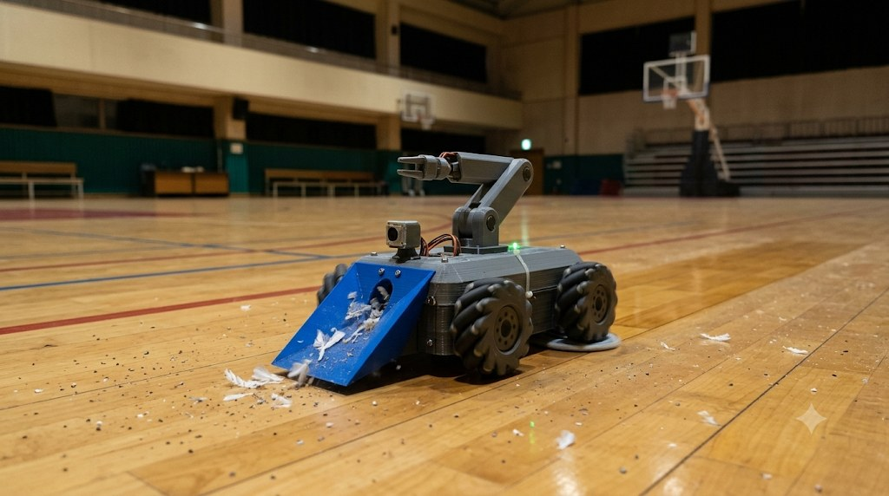

# 체육관 정리 로봇 — 한 장 요약

P00 요약 · 한 장 요약(발표 첫 장용) · 작성 최현준(PM) · 검토 최현준 · 상태 작성 · v2.1 · 2026-11-25 · 관련 전문 [00-기획안.md](00-기획안.md), R/T 번호 없음

**한 문장:** 다른 시설 업무 때문에 대관마다 코트를 확인·청소하기 어려운 체육관 관리자를 위해, 사람 없는 시간(첫 대관 전·마지막 대관 후·낮 빈 시간)에 코트의 먼지·흙먼지·셔틀콕 깃털을 극세사 밀대로 밀고(주 기능) 벤치 쪽 생수병·과자 봉지를 집게로 집은 뒤(보조) 충전 자리로 돌아와 결과와 못 치운 구역을 알려 주는 체육관 정리 로봇. 4주 동안 MuJoCo(메카넘 + SO-101 모델, `robot_v2`)로 확인하고, 메카넘 축소판(청소 모듈 A + 차체에 얹은 SO-ARM101 팔)은 Fusion 360 매개변수 CAD 모델로 설계를 확인한다 — 실물은 만들지 않는다(기획자 결정 2026-11-24, 실물 제작은 로드맵).

  
*개념 이미지(AI 생성). 실제 설계와 다름: 앞 가이드는 실제로 V자 날 2개 + 가운데 흡입구, 뒤 회전 패드 2개(반대 방향).*

*정확한 구조는 그림 3(module_a_sketch). 집기·4컷 시나리오 그림은 전문 6-1·7장.*

| 항목 | 내용 |
| --- | --- |
| 지금 상태 (2026-11-24) | 현장 데이터 실측 0건 · 추정 3건 / 시뮬은 장면 뼈대 `gym_v0` v0(로봇 없음)과 확인용 스크립트까지 / 실물은 만들지 않음(범위 변경 2026-11-24) — Fusion 360 매개변수 CAD 모델 v1(User Parameters 36개, 컴포넌트 12개, 만들기봇) 있음, 간섭 검사로 뒤 패드 Ø110 / 다음 관문 12/01 현장 데이터 판단 |
| 아이디어 전환 (0-1장) | 가게 앞 청소로봇·정화로봇 → 교차 연구(claude·grok 모두 **건물 공용부** 1위) → 기획자 제안 체육관. 불법 주정차 순찰은 뺌(기획자 결정, 이유 확인 필요), 지하철 청소로봇은 검토 뒤 로드맵(운행 중 사람이 많고, 무인 시간엔 이미 사람·장비가 청소하고, 공공시설 바닥 청소 로봇이 이미 있음). 체육관 = 빈 시간이 확실 + 혼자 셀 수 있음 + 기획자가 약 10곳 직접 이용 |
| 현장 데이터 (실측 + 추정) | **실측 0건 · 추정 3건 — 실측 보강 진행 중(11/24~).** 자동 요약 [03-현장데이터-요약.md](03-현장데이터-요약.md). 한계: 세 유형 값이 회고 한 줄의 복사라 같음(유형 차이는 실측으로), 위치 '벤치 약 75%'와 봉지 구겨짐 1 : 납작 1은 가정 |
| 문제 (1차 근거) | **관리자가 다른 시설 업무 때문에 대관마다 코트를 확인·청소하기 어렵다 (가설 — 관리자 부담·청소 빈도·효과는 인터뷰·파일럿으로 확인, [problem.md](problem.md) 1-1).** 대관 사이 짧은 교대 시간(5~10분, 가정)은 배경이다. **현장 관찰 기반 추정(체육관 약 10곳·1년, 기획자 직접 이용)**: 경기 1회 뒤 평균 생수병 1 + 과자 봉지 2, 먼지 뭉치·흙먼지·셔틀콕 깃털(코트 위)·분실물(교복). 쓰레기는 주로 벤치 쪽(비율은 없음), 쓰레기통은 입구 쪽. 사람 정리 쓰레기만 5~10분, 밀대까지 10~20분. 마루가 먼지로 미끄럽다(기획자 관찰). 11/24~30 계수로 확인할 가설 |
| 보강 근거 | 공공체육시설 38,603개소 중 **체육관 1,530개소**(2024 말, e-나라지표 원문 확인), 체육관 없는 초·중·고 3.7%뿐(보도). 대관은 팀당 1일 2시간 원칙(강남구 2024 상반기 안내문 원문 확인, 현행 여부 확인 필요), 대관 시간에 준비·철수 포함(공주시 원문 확인). 정리는 이용자 몫이라는 체육관 원문은 아직 확인 필요. 미국 업계 기사: 미끄럼 대부분이 먼지, 경기 전후 밀대질 권장. 농구 참여자 85.2% 부상 경험(2023 보도 원문 확인, 재단 원 보고서는 확인 필요) |
| 사용자 | 체육관 관리자(돈 내는 사람, 주 사용자) · 시설 청소 담당 · 다음 팀 동호인 · 대관 팀 총무(배경) (가상 인물) |
| 왜 로봇 (회고 숫자) | 경기마다 사람 10~20분 × 유형별 하루 타임 수(기획자 진술 기반 추정, 한 타임 2~3시간): **사설 6~9타임 → 하루 60~180분·월 최소 약 30시간(최대 90) / 구민 3~5 → 30~100분·월 최소 약 15시간(최대 50) / 학교 평일 저녁 1~2 → 10~40분·월 최소 약 4시간(최대 15)** — 모두 예약이 꽉 찬 날이 운영일 내내 이어질 때다(예약률 확인 필요). 지금은 밀대질을 자주 건너뛴다(가정) → 로봇은 그 밀대질을 사람 없는 시간마다 하고, 관리자는 결과만 확인한다(가설) |
| 우선순위 (확정) | **청소 모듈 = 주, 집게 = 보조 (기획자 확정 2026-11-23).** 큰 쓰레기는 경기당 2~3개뿐이고 사람 시간의 절반 이상이 밀대. 과자 봉지: 구겨진 것 = 집게(작으면 흡입), 납작한 것(바닥에 펴져 높이 몇 mm) = 작은 건 가이드 → 흡입, 큰 건 가이드가 밀어 모아 기록 — 결정됨 (기획자 2026-11-23) |
| 운영 | **빈 시간에 전체 모드만** (기획자 결정 2026-11-24, 상용 청소 로봇과 같은 방식): 첫 대관 전·마지막 대관 후(사설 새벽 1시~6시, 구민 자정 이후, 학교 저녁 10시 이후)·대관이 비는 시간에 핫스폿 집기 + 코트 전체 밀기, 첫 대관 전 충전 자리 복귀. 대관 사이 짧은 모드는 없앰, 관리자 버튼 '벤치만 줍기'는 선택. 차별점은 로봇팔 하나. 분실물은 줍지 않고 사진·알림 |
| 모듈 A (기획자 아이디어) | **① V자 사선 가이드 → ② 가운데 흡입(시판 핸디 청소기 1~3만 원 + 3D 프린트 덕트, 청소기 배터리로 전원 분리) → ③ 뒤 패드.** 패드만 쓸 때의 포화·깃털 흩어짐을 줄인다. 4주: 시뮬은 3단 전부(가이드 충돌 형상 + 흡입구 영역 + 닦인 면적), CAD는 3단 장착·간섭까지. 뒤 회전 패드 2개(반대 방향, 건식) 실물 4주 필수(기획자 결정 2026-11-23)는 범위 변경(2026-11-24)으로 만들 경우로 — 그때 위험(모터 2개, 정지 전류 최대 1.5 A, 반작용, 마루 마모)은 K-15로 판단. 일정 압박 땐 제설 데모 → 찾아가기 비교 순서로 밀어낸다. 사람이 3 m 안이면 흡입을 끄는 조용한 운행(핸디 70~80 dB, 제조사 자료). 실물 일정 +3~4.5일(가정)은 만들 경우 |
| CAD 모델 (만들지 않음, 기획자 결정 2026-11-24) | Fusion 360 **'litter-bot 축소판 v1 (매개변수)'** — `config/robot_params.yaml` 값을 User Parameters 36개로, 컴포넌트 12개(베이스·몸통·바퀴·청소·범퍼·팔 장착판·SO-101 덩어리·크래들·옆 통·센서·손잡이·배터리). CAD로 확인: **간섭**(뒤 패드 Ø140 → Ø110 반영, 옆솔–앞바퀴 0.4 cm³ 남음), **팔이 바닥·옆 통에 닿는 범위**(자리는 CAD, 도달은 시뮬 실측), **무게중심·넘어짐**, **3D 프린트 부품 베드 크기**. 부품 목록·예산은 참고. 사본: robot-lab 저장소 `builds/so-arm101/chassis/fusion/` (f3d·STEP·그림 3장) |
| 팔 설계 (만들 경우 참고) | **SO-ARM101**(오픈소스 3D 프린트 팔, 관절 5 + 그리퍼, Feetech STS 서보)을 메카넘 넓은 차체(직접 제작, 38~40 cm급)에 얹는다. 장착부 디자인은 기획자가 직접(책상 위 시연안은 버림). 서보는 12V로 구매 → 팔 전원 12V 5A 이상·퓨즈·끄는 스위치, 차체 배터리와 따로 또는 강압 모듈. 팔 약 0.6~0.8 kg(어림) — 무게중심·흔들림은 장착 디자인이 나오면 검토. 팔로워 출력 약 56시간·453 g, 공식 부품표 약 $122(약 17만 원 어림, 배송·관세 별도, 12V면 달라질 수 있음 — 확인 필요), 결제는 기획자 결정 대기. 도달 거리·가반하중은 공식 자료에 없어 확인 필요 → 빈 병·과자 봉지부터. 우선순위는 그대로 청소 모듈 > 팔(출력도 청소 모듈 부품 다음) |
| 예산 (어림, 만들 경우 참고) | 합계 **약 26만~48만 원** = 청소 모듈·차체 약 7만~28만 원 + 팔 약 19만~20만 원(부품 + PLA+). 12V 전원·배송·관세 빠짐 (확인 필요) |
| 앞 모듈 교체형 | 공용 장착부(M3 볼트 4개, 커넥터 없음, 가정) — **모듈 A 가이드·흡입·패드(필수)** / 모듈 B 제설 날(확장: 시뮬 2 m × 1 m·입자 1,500개 이하 영상). 여름~가을 체육관 + 겨울 출입로 제설 = 연중 사용. 4주 범위·일정은 그대로 |
| 로봇 없이? | 수거함·대관 규칙·사람 정리와 정면 비교. 병·캔은 로봇 없이도 꽤 풀릴 수 있다 → 로봇의 근거는 **사람 없는 시간마다 빠짐없는 밀대질 + 관리자가 볼 기록**(가설). 사람이 정리하는 시간을 스톱워치로 재서 기준선으로 |
| 방법 | 운행 순서는 모드 1 **핫스폿 순회**(벤치 → 구석)로 집기 → 모드 2 직선 훑기로 밀기(모터 없는 패드, 주 기능). 장애물 우회, 사람 1 m면 멈춤. 4주는 5 m × 3 m 장면에서 방법을 확인(실제 코트 420 m² 규모는 제품 개념, 가정) |
| 인식 | 투명 병 때문에 **깊이 '받침면(바닥·벤치·창문틀) 위 돌출물' + 뚜껑·라벨 색**이 1안 (시뮬 깊이 렌더로 바닥의 3개 검출, 벤치에 붙은 2개는 놓침 — 실측). 공·가방·신발은 모양 규칙으로 장애물 |
| 시뮬 로봇 | CAD 모델과 같은 메카넘 **넓은 차체(390 × 280 mm, 직접 제작 38~40 cm급 — 기획자 결정 2026-11-24)** + SO-101(`robot_v2`, 기획자 설계 2026-11-24), 운행 0.3 m/s(기획자 결정 — 상용 휠리 J30 최고 속도와 같음). SO-101 손끝은 바닥(차체 앞면에서 0.04~0.26 m, robot_v2 실측)부터 최고 약 0.67 m까지 (실측) → 창문틀(1.0 m)은 빠짐. 병은 목·뚜껑을 잡는다(몸통 ø65는 0/9). 쓰레기통은 묻힌 통(0/9, [robot_v2 실측](../logs/2026-11-24_robot_v2_measurements.md))을 취소하고 팔 옆에 거는 통(robot_v1 옆 바구니 8/9). 넓은 차체 + 옆 통 모델(베이스·위 몸통 폭 = Fusion 213.2 · 183.2 mm)의 넣기는 9곳 **9/9**, 병 위치 ±3 cm·차체 방향 ±15°까지 36/36(실측, 손목 돌림 가지 고정 — [넣기 안정화](../logs/2026-11-24_pick_robust.md). 고정 전 6/9). 장면 밀기 커버리지 98.4 %(줄 끝 메우기 포함) |
| 운행 조건 | 실내 마루, 사람 없는 빈 시간(첫 대관 전·마지막 대관 후·낮 빈 시간), 코트·사이드라인·벤치 주변. **관람석 Out** |
| 성공 기준 | 시뮬 10회: 밀대 커버리지 95% · 모드 2 ≤ 600 s · **빈 시간 안 장면 전체 청소 + 충전 자리 복귀 ≤ 650 s (기획자 확정 2026-11-24, 계산 예상 약 370~480 s)** · 분실물 집기 0회 · 핫스폿 수거율 80% · 모드 1 ≤ 480 s · 충돌 0 · 사람 1초 안 정지 · 3전략 비교(순회/지그재그/찾아가기) · CAD: 간섭 0 · 팔 받침·옆 통 자리 = 시뮬 값 · 무게중심 바퀴 사각형 안 · 출력 부품 베드 안 · 관리자 1명 이상 시험 운영 동의. (실물 5회 — 깃털 20개 중 ≤ 5, 팔 3개 중 2개, 패드 90 %, 긁힘 0 — 은 만들 경우, 로드맵) |
| 중단 기준 | 집게 대상(병·캔·컵·구겨진 봉지) 경기당 < 1개 → 집게를 확장으로, 밀대 전용 + 분실물 알림 (지금 2.0 = 생수병 1 + 구겨진 봉지 1(가정). **생수병만 세면 1.0 = 경계값**) · 전체 모드가 기준을 넘음 → 운행 속도·줄 간격 재검토, 구역 나눠 밀기 · 패드가 깃털을 흩뜨림 → 깃털은 사람 수거 · 관리자 모두 '문제없음' + 민원 없음 → 가설 내림 · 반입 금지로 코트에 없음 → 범위 재검토 · 바퀴 미끄러짐 → 밀대 선행·고무 바퀴(만들 경우) · CAD 간섭이 12/11까지 안 풀림 → 설계 위험으로 기록(K-16, 제안) · 창문틀은 빠짐(SO-101 손끝 0.67 m; 예전 기준: 윗면 1.1 m 이하가 없으면 로드맵) |
| 법·안전 | 4주는 시뮬·CAD 모델(만들지 않음). 실제 운행은 시설 동의·안전 확인 전제. ISO 13482 목차 수준 참고 |
| 4주 | 11/23 정하기 + 현장 검증(11/24~30) → 12/01 판단 → 12/04 한 개 집기·한 줄 밀기(시뮬) + CAD 간섭 정리 → 12/11 전체·측정 + CAD 무게중심·출력 크기 → 12/18 시뮬 영상·CAD 그림 시연·발표 |
| 로드맵 | **실물 축소판 제작·실물 시험(4주 뒤)** · 겨울 출입로 제설(모듈 B, 더 큰 차체) · 입구 쓰레기통에 스스로 비우기 · 관람석 아래 통로 → 계단 오르는 로봇 · 실외 보도 버전은 v1.1 · 지하철 역사 등 공공시설(운행 종료 뒤 무인 시간) |

숫자 옆 '가정'은 근거 없이 정한 값이다. 1주 현장 검증에서 계수·인터뷰·스톱워치로 바꾼다. 출처는 전문의 '출처'에 있다.
