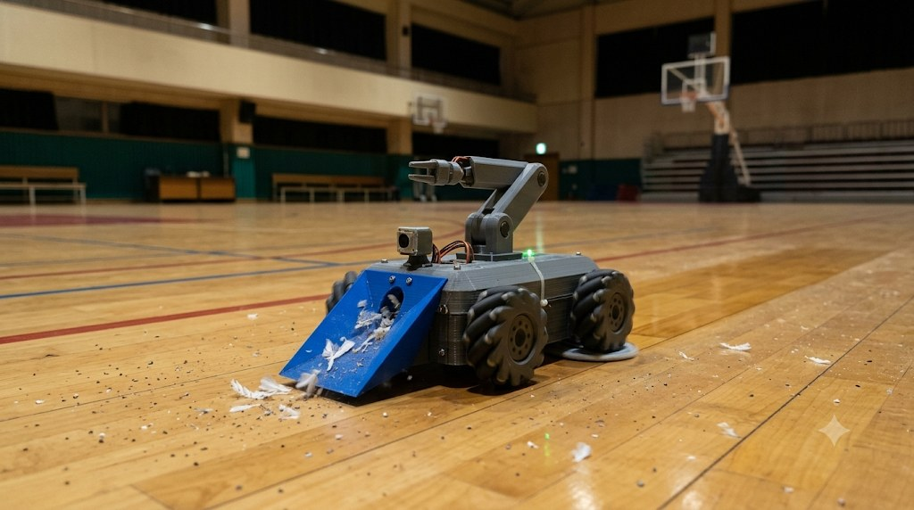
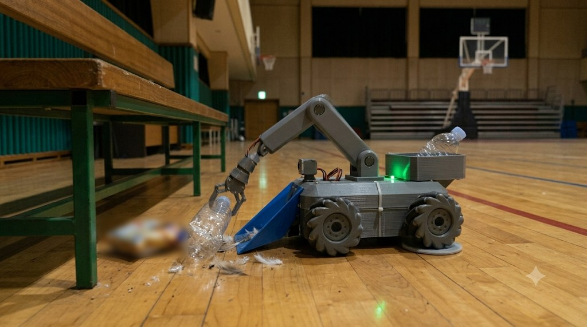
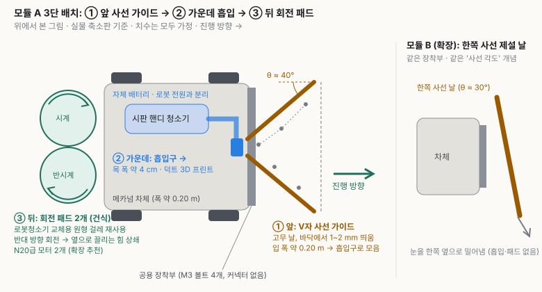
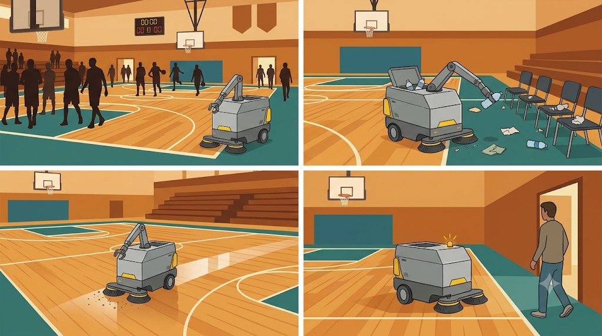
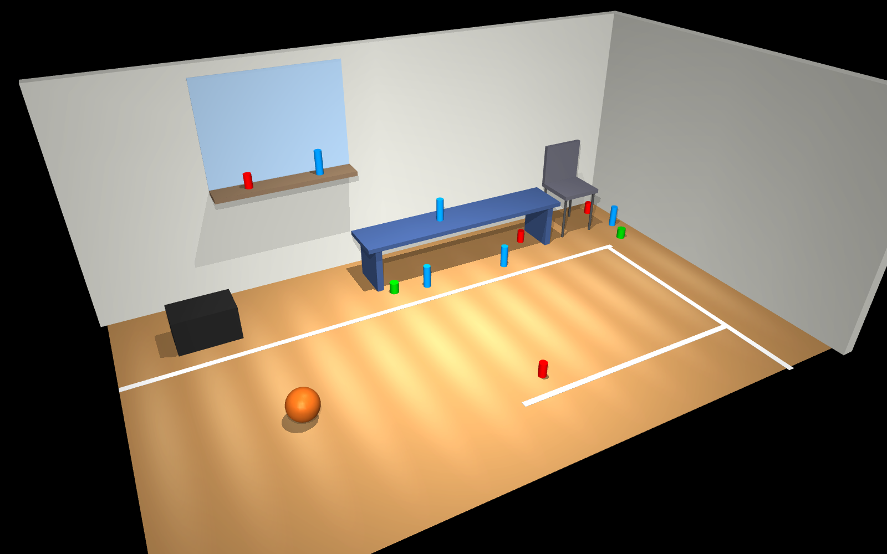
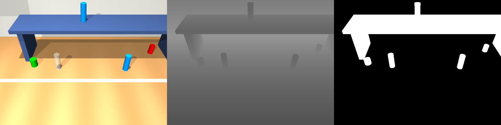

# 체육관 정리 로봇 기획안

P00 · 기획안(Project Proposal) · 작성 최현준(PM) · 검토 최현준 + AI 심사위원 리뷰 1회 · 상태 작성 · v1.5 · 2026-11-24 · 관련 [한 장 요약](00-기획안-요약.md), [01-유저시나리오.md](01-유저시나리오.md), [charter.md](charter.md), R-17·R-19 인용(정의는 P01)

> 읽는 법: 숫자 옆 **[번호]**는 맨 아래 '출처'의 번호다. **(가정)**은 근거 없이 정한 값이고, **(확인 필요)**는 찾았지만 원문으로 확인하지 못한 값이다. **(실측)**은 이 저장소 `logs/`에 기록이 있는 직접 측정값이고, **(주인 관찰)**은 기획자 본인이 체육관을 다니며 본 것이고, **(현장 관찰 기반 추정(체육관 약 10곳·1년, 기획자 직접 이용))**은 기획자가 최근 1년 동안 체육관 약 10곳을 직접 이용하며 관찰한 것을 정리한 값이다 — 실측(현장 계수)과 나눠 적는다. 가정과 주인 관찰은 1주 현장 검증(13장)에서 계수와 인터뷰로 바꾼다. 본문은 **지금 결정만** 적는다. 버전마다 무엇이 왜 바뀌었는지는 [변경 기록](#변경-기록)과 [0-1장](#0-1-아이디어-전환-과정)에 있다.

<!-- toc -->
## 목차

[이 기획안의 약속](#이-기획안의-약속) · [지금 상태](#지금-상태) · [0. 한 문장](#0-한-문장) · [0-1. 아이디어 전환 과정](#0-1-아이디어-전환-과정) · [1. 문제와 근거](#1-문제와-근거) · [2. 사용자](#2-사용자) · [3. 로봇 없이 풀리는가](#3-로봇-없이-풀리는가-대안-비교) · [4. 대상 정의](#4-대상-정의) · [5. 운행 조건](#5-운행-조건-odd-로봇이-일하는-조건) · [6. 해결 방식](#6-해결-방식) · [7. 유저 시나리오](#7-유저-시나리오-요약) · [8. 시뮬레이션 계획](#8-시뮬레이션-계획) · [9. 실물 축소판 계획](#9-실물-축소판-계획) · [10. 비슷한 제품과 차별점](#10-비슷한-제품과-차별점) · [11. 성공 기준](#11-성공-기준) · [12. 위험과 중단 기준](#12-위험과-중단-기준) · [13. 현장 검증](#13-현장-검증-1주) · [14. 4주 일정](#14-4주-일정) · [15. 주인이 정할 것](#15-주인이-정할-것) · [16. 로드맵](#16-로드맵) · [출처](#출처) · [변경 기록](#변경-기록)
<!-- /toc -->

---

## 이 기획안의 약속

> **"농구 대관 사이 체육관 정리를 돕는 로봇 기획안을, 직접 센 현장 데이터와 원본 자료로 뒷받침하고, 사람·쓰레기통 같은 대안보다 나은 점과 4주 안에 시뮬·실물로 확인할 숫자 기준을 담아 써 줘."** — 주인 확정 부탁문 (2026-11-23)

이 문장의 네 가지를 각 장이 어디서 채우는지 연결한다.

| 약속 | 채우는 곳 | 지금 상태 |
| --- | --- | --- |
| **① 직접 센 현장 데이터** | 13장 현장 검증, [02-현장계수표.md](02-현장계수표.md), `logs/field/field_count_template.csv` → 1-1(주인 관찰을 숫자로), 4장(대상·위치), 12장(K-1·K-1b·K-1c·K-1e·K-7 판단) | 실측 0건 · 추정 3건 (아래 '지금 상태', 1-1) |
| **② 원본 자료** | 1장(통계·대관 규정), 5장(법·표준), 6-4·8장(Stretch 모델 XML·MuJoCo 실측), 10장(제품), '출처' | 법령·표준·모델 XML·MuJoCo 문서·실측 로그는 원문. 체육시설 통계(체육관 1,530개소)·강남구 대관 2시간(2024 상반기 안내문)·공주시 대관 안내·농구 부상 보도는 원문 확인. 목포·군산 대관 자료, 부상 원 보고서는 아직 '확인 필요' ('출처' 머리말) |
| **③ 사람·쓰레기통 같은 대안보다 나은 점** | **3장 대안 비교**(수거함·대관 규칙·사람 정리·반입 제한·시판 로봇), 10장 차별점, 13-1 사람 기준선(스톱워치), K-1e | 비교 틀은 씀. 사람 시간은 회고로 **쓰레기만 5~10분, 밀대까지 10~20분**(n≈10곳, 기억). 스톱워치 값은 **11/24~11/30 주인 계수로 채움** |
| **④ 4주 안 시뮬·실물 숫자 기준** | **11장 성공 기준**(모드별 시뮬·실물, 3전략 비교, 사용자 검증), 12장 중단 기준·날짜, 14장 일정 | 씀. 12/01에 현장 데이터로 재조정(폭 고정) |

---

## 지금 상태

2026-11-24, 저장소에서 확인한 것만 적는다.

1. **현장 데이터:** 실측 0건 · 추정 3건(사설·구민·학교 대표 행). `logs/field/field_count.csv`는 아직 머리줄뿐이다. 실측은 11/24~11/30에 센다(13장).
2. **시뮬:** 장면 뼈대 `scenes/gym_v0.xml`(v0, 로봇 없음)과 확인용 스크립트 3개(`src/checks/`: 장면 렌더, Stretch 리프트 높이, 깊이 돌출 검출)까지. 장면 v1(Stretch 3 + 바구니 + 패드)·판정 함수·테스트(`tests/` 비어 있음)는 아직 없다.
3. **실물:** 부품 준비 전. 메카넘 차체 보유 여부는 확인 필요, SO-ARM101 팔은 12V 팔로워로 정했고 결제·주문은 주인 결정 대기, 출력은 청소 모듈 부품 다음 순서(9장).
4. **결정:** 청소 모듈 주·집게(집기) 보조, 회전 패드 실물 4주 필수, SO-ARM101 차체 장착(2026-11-24) 등 정해진 것과 남은 것은 15장.
5. **다음 관문:** 12/01(화) 현장 데이터로 K-1·K-1b·K-1c·K-1e·K-7 판단, 12/04 일정 압박 사다리, 12/09 회전 패드(K-15) 판단(14장).

---

## 0. 한 문장

**대관과 대관 사이, 코트의 먼지·흙먼지·셔틀콕 깃털을 극세사 밀대로 밀어 다음 팀이 미끄럽지 않게 하고, 벤치 쪽에 남은 생수병·과자 봉지는 집게로 집는 체육관 정리 로봇.** 밀대(청소 모듈)가 주, 집게가 보조다(6-2).


*개념 이미지(AI 생성). 실제 설계와 다름: 앞 가이드는 실제로 V자 날 2개 + 가운데 흡입구, 뒤 회전 패드 2개(반대 방향). 정확한 구조는 그림 3(module_a_sketch).*

이번 4주에는 두 기능을 **MuJoCo 시뮬레이션(Hello Robot Stretch 3)으로 입증**하고, 메카넘 바퀴 차에 청소 모듈 A와 **SO-ARM101 팔(오픈소스 3D 프린트 팔, 9장)**을 얹은 축소판으로 **실내 마루 바닥에서 시연**한다. 체육관은 실내 마루라서 **체육관 마루와 비슷한 실내 평탄 바닥에서 시연하면 현장과 가까운 조건**이 된다(집 바닥은 코팅 마루와 다를 수 있다). 4주는 시뮬과 실내 시연까지이고, 실제 체육관 운행은 **시설 관리 주체의 동의와 안전 확인을 전제**로 한다(5장). 기간은 4주(2026-11-23 ~ 12-18), 인원은 1명이다.

| 한눈에 | 내용 |
| --- | --- |
| **주 기능 (4주 필수)** | **먼지 밀기·빨아들이기.** 앞 모듈 A = **① V자 사선 가이드 → ② 가운데 흡입구(시판 핸디 청소기 + 덕트) → ③ 뒤 회전 패드 2개(건식, 반대 방향)**(6-10). 코트를 직선 줄로 훑어 먼지·흙먼지·먼지 뭉치·셔틀콕 깃털을 모아 빨아들이고 닦는다(**직선 훑기**). 성과 = 닦은 면적 %(커버리지) + 흡입 수거율. **회전 패드 실물까지 4주 필수 (주인 결정 2026-11-23)** |
| **보조 기능 (4주 필수, 범위 작게)** | **병·봉지 집기.** 쓰레기가 모이는 벤치 구역(→ 코트 구석)을 돌며 생수병·구겨진 과자 봉지(·캔·컵)를 집는다(**핫스폿 순회**, 6-3). 창문틀은 **확장**(6-4) |
| 앞 모듈 교체형 | 로봇 앞쪽 **공용 장착부**에 모듈을 바꿔 단다: **모듈 A = 사선 가이드 + 흡입 + 뒤 패드(4주 필수, 6-10)**, 모듈 B = 제설 날(**확장** — 4주 필수 범위·일정은 늘리지 않음). 여름~가을 체육관, 겨울 출입로 제설 = 연중 사용 (6-9) |
| 분실물 | 옷(교복)·수건·물이 찬 병·개인 물건은 **줍지 않고 사진·위치만 남겨 관리자에게 알림** (R-17) |
| 운영 모드 | **짧은 모드**(빈 시간이 빠듯할 때: 벤치 구역 집기 + 벤치 앞 띠 밀기) / **전체 모드**(오전 여유·마지막 대관 뒤: 핫스폿 + 코트 전체 밀기). 목표: **다음 팀 입장 전에 끝, 사람 5~20분보다 짧게** (6-8) |
| 순서 | 집기 먼저, 밀기 나중 (패드가 병·캔을 밀어내지 않게) |
| 안전 | 장애물(공·가방·의자)은 우회, **사람이 1 m 안에 오면 멈춤**, 비상정지 |
| 운행 조건 | 실내 마루, 대관 사이 빈 시간, 코트 바닥·사이드라인·선수 벤치 주변만. **관람석은 Out** |
| 시뮬 (필수) | 농구 코트 일부 5 m × 3 m 장면(라인·벤치, 창문틀은 장면에만 있음). 코트 밀대 커버리지 95% · 핫스폿 병·봉지 수거율 80% · 짧은 모드 360 s 이하 · 분실물 집기 0회 |
| 실물 (필수) | 메카넘 축소판 + 청소 모듈 A + **SO-ARM101 팔(차체 장착, 주인 결정 2026-11-24)**, 실내 마루 2 m × 2 m. 표적 3개 중 2개 수거 + 패드로 구역 훑기 (9장) |
| 로봇 없이? | 수거함·대관 규칙·사람 정리와 정면 비교(3장). 사람이 정리하는 시간을 스톱워치로 재서 기준선으로 쓴다 |
| 인식 | 투명 생수병 때문에 **깊이 카메라 '바닥 위 돌출물' + 뚜껑·라벨 색**이 1안. 공·가방·신발은 모양 규칙으로 장애물 처리 (6-7) |
| 사용자 검증 | 관리자 인터뷰는 과거 행동만 묻는다(The Mom Test). 성공 신호 = **관리자 1명 이상의 시험 운영 동의** (11-3) |
| 4주 | 1주 정하기·현장 검증 → 2주 한 줄 밀기·한 개 집기 → 3주 전체 훑기·핫스폿 순회·짧은/전체 모드·3전략 비교·측정 → 4주 시연·발표 |

---

## 0-1. 아이디어 전환 과정

가게 앞에서 체육관까지. **한 줄:** 가게 앞 청소로봇·정화로봇(11/20~21) → 가게 앞 기획안 v1.0·v1.1(11/23) → 교차 연구로 '건물 공용부' 1위 → 주인이 그중 **실내 체육관**을 제안(v1.2) → 같은 날 떠올린 **지하철 청소로봇**은 검토 뒤 로드맵으로. 불법 주정차 순찰은 중간에 뺐다. 기준은 처음부터 끝까지 같았다: **사람이 없는 시간이 확실한가, 현장을 직접 셀 수 있는가, 4주 안에 시연할 수 있는가, '왜 로봇인가'가 서는가.**

각 후보마다 '왜 떠올렸나 → 무엇을 봤나 → 왜 버렸나/골랐나'를 시간 순서로 적는다. 기록이 없는 이유는 지어내지 않고 **(확인 필요)**로 둔다.

### ① 가게 앞 청소로봇 (2026-11-20 첫 기획서) [39]

| | 내용 |
| --- | --- |
| 왜 떠올렸나 | 매일 아침 가게·건물 앞을 청소하는 사람의 쓰레기 줍기를 이동형 로봇팔(Stretch 3)이 맡으면 어떨까 — 더럽고 매일 반복되고 몸을 숙여야 하는 일(3D) |
| 무엇을 봤나 | 길거리 쓰레기는 개수로 **꽁초가 약 54%**(환경운동연합 2020, v1.1 출처)다. 그런데 시뮬에서 Stretch 3 그리퍼 패드 아래면이 바닥에서 1~2 cm 떠서 **꽁초(높이 8 mm)를 집지 못했고**, 강체 롤러로 쓸어 담기도 10개 중 0~3개뿐이었다(실측 [37]). 큰 쓰레기(컵·캔·페트병)만 줍게 좁히면 **하루 절약이 약 10~50초**(v1.1 자체 추정)라 '왜 로봇인가'가 약했다. 받은 피드백: "보도가 울퉁불퉁해 바퀴가 문제", "범위 설정이 중요" |
| 왜 버렸나 | 공공 보도는 바닥을 고를 수 없고(횡단경사 1/50~1/25), 실제 운행에는 실외이동로봇 **운행안전인증**이 걸린다[23]. 돈 낼 사람(가게 주인)의 이유도 약했다. → 더 나은 현장을 찾으려고 교차 연구(③)를 돌렸다. 통계·설계는 v1.1(커밋 `b1f4b6b`)에 남겼다 |

### ② 정화로봇 — 수면 쓰레기 수거 (2026-11-21, 짝 과제) [40]

| | 내용 |
| --- | --- |
| 왜 떠올렸나 | 인스타그램 릴스의 ESP32 강 청소 쌍동선을 보고, 저수지·하천 관리 인력이 배와 뜰채로 하던 일을 로봇이 맡는 것으로 기획했다 |
| 무엇을 봤나 | 시뮬은 수면을 '평면 이동 + 물 저항'으로 단순화하고 쌍동선 모델을 직접 만들어야 했다(이 모델이 과제 요건에 맞는지 강사 확인이 필요한 상태였다). 실물 시제품은 본문이 아니라 부록(확장·개인 프로젝트)으로 뺐다. 실측으로 '훑기만 해서는 10분에 20개 중 평균 8.3개'라 찾아가기 전략이 필요하다는 것도 확인했다 |
| 왜 이 팀프로젝트 주제가 아닌가 | **기록이 없다 (확인 필요).** 두 기획은 새싹 '짝 과제'로 함께 준비됐고, 팀프로젝트 저장소(litter-bot)는 처음부터 가게 앞(①)으로 시작했다. 정화로봇에서 남긴 것: **'흡입구 영역에 들어오면 수거'하는 판정 방식**을 모듈 A 흡입 시뮬에 그대로 쓴다(6-10) |

### ③ 교차 연구: 건물 공용부 1위 (2026-11-23) [21]

| | 내용 |
| --- | --- |
| 왜 했나 | 주인 질문 "동네 가게 앞보다 아파트 도보로 다니는 청소로봇 정도는 어때? … 어디에 더 효과적일지 확인해줘". 기준 다섯 가지: ① 문제·돈 낼 주체 ② 4주·1인 입증 ③ 울퉁불퉁·범위 피드백 ④ 집게 대상과 현장 쓰레기가 맞나 ⑤ 안전·법 |
| 무엇을 봤나 | 두 모델(claude = 제안 A, grok = 제안 B)이 같은 브리프로 후보 7개(가게 앞 보도, 아파트 단지, 주차장, 건물 공용부, 공원, 캠퍼스, 지하철역 출입구·버스정류장)를 따로 점수 매겼다. **둘 다 '상가·오피스 건물 공용부(1층 출입 평탄부)'를 1위**로 골랐다(A 19점/25, B 21점/25 — 둘레 공공 보도를 빼는 조건). 이유는 '쓰레기가 많은 곳'이 아니라 **'로봇이 다닐 수 있고, 구역과 돈 내는 사람이 정해진 곳'**이었다 |
| 비판 | 건물 공용부는 미화가 자주 돌아 큰 쓰레기가 적을 수 있고, 주 품목이 꽁초이며, 범위를 좁힐수록 '왜 로봇인가'가 약하다. '사유지면 인증 면제'도 확인되지 않은 해석이다. 비판은 한 모델만 했다(한도로 하나 빠짐) |
| 왜 체육관으로 | 비판 단계 뒤 **주인이 실내 체육관을 제안**했다(학교·구민·사설 체육관에서 자주 농구를 함, 경기 뒤 병·캔이 남고 마루가 먼지로 미끄러움). 체육관은 건물 공용부의 장점(평탄한 실내 바닥, 관리 주체, 작은 구역)을 가지면서 약점을 주인의 반복 관찰로 메운다. 종합은 체육관을 1위로, 건물 공용부를 **2위 후보**로 남겼다(신뢰도 0.6, 독립 확인 아님 — 1-6, K-1) |

### ④ 불법 주정차 순찰 (2026-11-23, 뺌)

| | 내용 |
| --- | --- |
| 왜 떠올렸나 | **기록이 없다 (확인 필요).** 가게 앞 버전(v1.0)을 쓰는 동안 후보로 거론됐다 |
| 무엇을 봤나 | 기획안 v1.0에는 처음부터 넣지 않았다(작성 기록상 확인) |
| 왜 버렸나 | **주인 결정(2026-11-23): "불법 주정차 순찰·촬영 기능은 기획안에서 제외, 로드맵에도 넣지 않음"** [41]. 결정의 이유는 기록에 없다 (확인 필요). 참고로 같은 교차 연구에서 주차장 후보는 '차량이 후진할 때 낮은 로봇이 안 보이는 위험' 때문에 안전·법 점수가 최저(1점)였다[21] — 이것이 주정차 제외의 이유였다고 단정하지는 않는다 |

### ⑤ 지하철 청소로봇 (2026-11-23, 검토 뒤 로드맵)

| | 내용 |
| --- | --- |
| 왜 떠올렸나 | 주인이 지하철을 타러 가다가 떠올렸다. 역은 사람이 많이 지나가고 바닥이 넓고 평탄하다 |
| 무엇을 봤나 | ⓐ **운행 중에는 사람이 계속 많다** → 사람 1 m 안이면 멈추는 규칙으로는 거의 움직이지 못하고, 안전 기준과 4주 시연이 어렵다(교차 연구도 역 출입구를 '인파·안전·법 최악'으로 봤다 [21]). ⓑ **사람 없는 시간은 운행 종료~첫차(약 새벽 1시~5시 반)뿐**인데, 그 시간은 유지보수·정비와 청소에 쓰인다 — 서울교통공사는 열차 운행이 끝난 심야에 터널·역사·승강장을 "대규모 장비와 인력을 동원하여" 청소한다(2019 기사, 일요일마다 두세 개 역씩 하는 대청소 [44]). 서울시는 2025-05에 1~8호선 첫차를 5시로 30분 앞당기고 막차도 30분 당긴다고 발표했다(유지보수·정비 시간 확보, 시행 여부 확인 필요 [46]). 매일 밤 미화원이 역사를 청소한다는 부분은 일반 상식 수준이라 **확인 필요**. ⓒ **넓은 공공시설용 바닥 청소 로봇은 이미 있다** → 서울 지하철은 2019년에 이미 277개 역 중 234개 역에 습식청소기(장비, 로봇 아님)를 들였고[45], GTX-A 구성역 연결통로·승강장에는 2025년 산업용 로봇청소기(SC50)가 설치됐다(업체 사례 [42]). 해외에는 상파울루 지하철 5호선 승강장에 바닥 세척 로봇을 들여 청소 시간이 3.5시간 → 약 40분으로 줄었다는 업체 사례가 있다[43]. 그래서 '바닥 청소'만으로는 차별점이 약하다. ⓓ **역 안 사진·실증은 운영 기관 허가가 필요할 것이다 (가정 — 절차 확인 안 함).** 4주 안에 받기 어렵다 |
| 왜 체육관을 지켰나 | 체육관은 **대관 사이 빈 시간이 확실하고**(대관이 시간 단위로 끝남), 기획자가 약 10곳을 **직접 다녀 봤으며**, 바닥(실내 마루)이 시연 바닥과 같다. 지하철의 ⓐ~ⓓ가 체육관에는 없거나 작다 |
| 지하철에서 얻은 것 | ① **'세기 쉬운 현장'이 중요하다** — 역은 사람이 많아 쓰레기 수를 혼자 세기 어렵다. 체육관 계수(13장)는 경기 직후 혼자 셀 수 있다. ② 운행 종료 뒤 무인 시간에 도는 **공공시설 확장**은 로드맵 한 줄로 둔다(16장) |

### ⑥ 후보 비교

칸마다 근거를 붙였다. **(가정)** = 근거 없이 판단한 것, **(확인 필요)** = 찾았지만 원문 확인을 못 한 것. 점수는 매기지 않는다(교차 연구의 교훈: 점수표는 연구자 판단의 합이다).

| 후보 | 사람 없는 시간 | 현장 데이터 모으기 | 경쟁 제품 | 4주 시연 가능성 | 기획자 경험 |
| --- | --- | --- | --- | --- | --- |
| **가게 앞 보도** | 영업 전 아침(가정). 보행자는 언제든 지나감 | 아침 청소 전 50 m 계수 가능(계획만, 실제로 세지 않음) | 실외 꽁초 줍기 로봇이 있다(BeachBot·Angsa, 실외·작은 쓰레기 [29][30]) | 실물은 실외에 못 나감(울퉁불퉁 보도, 메카넘 [22]). 시뮬은 가능. 꽁초는 집지 못함(실측 [37]) | 일상에서 지나다님(가정) |
| **건물 공용부** (1층 출입 평탄부) | 개점·출근 전(교차 연구, 가정) | 건물 관리인 인터뷰 필요(성사 미확인 [21]) | 공용부 바닥 청소 로봇(지하주차장 등) 국내 사례 있음(교차 연구 출처, 확인 필요 [21]) | 바닥은 평탄(추정 [21]). 미화가 자주 돌아 쓰레기가 적을 수 있음(비판 [21]) | 특정 건물 없음(가정) |
| **불법 주정차 순찰** | — (쓰레기 대상이 아님) | 차량번호 촬영이 들어감 — 계수표의 '차량번호가 나오지 않게' 원칙과 부딪힘(13-1) | 확인 안 함 | 확인 안 함 | 기록 없음 (확인 필요) |
| **실내 체육관** ✅ | **대관 사이 + 마지막 대관 뒤~첫 대관 전**(주인 진술, 6-8). 대관은 시간 단위(강남구 예: 팀당 1일 2시간 원칙 [4]) | **경기 직후 혼자 셀 수 있음**(13장, 계수표 준비됨). 지금은 추정 3행·실측 0행 | 시판 바닥 청소 로봇은 밀대만, 병·캔은 못 집음(10장). 체육관에서 병을 집는 로봇은 이번 검색에서 못 찾음 | 실내 마루 = 시연 바닥(9장). 시뮬 장면 `gym_v0` 있음 | **약 10곳·최근 1년 직접 이용**(회고) |
| **지하철 역사** | 운행 종료~첫차 약 4시간(⑤ⓑ [46]), 그 시간은 정비·청소에 쓰임 [44] | 사람이 많아 혼자 세기 어려움(가정). 촬영 허가 필요(가정) | **넓은 공공시설용 바닥 청소 로봇이 이미 도입됨**(GTX-A 구성역 [42], 상파울루 [43]) | 역 안 실증은 허가 필요(가정). 실내 바닥 시연은 가능하나 현장과 규모가 다름(가정) | 이용자로 지나다님(주인 진술) |

**결론:** 다섯 후보 중 '사람 없는 시간이 확실하다 + 혼자 셀 수 있다 + 시연 바닥 = 현장 바닥 + 기획자가 직접 다녀 봤다'를 모두 가진 것은 체육관뿐이다. 다만 체육관의 근거도 아직 **기획자 한 사람의 회고**다 — 13장 계수가 첫 관문이다.

---

## 1. 문제와 근거

### 1-1. 1차 근거: 현장 데이터 (실측 + 추정)

**현장 데이터 (실측 + 추정):** 1차 근거 = 현장 관찰 기반 추정(체육관 약 10곳·1년, 기획자 직접 이용), 실측(현장 계수)이 들어오는 대로 갱신한다. 지금 **실측 0건 · 추정 3건(사설·구민·학교 대표 행) — 실측 보강 진행 중(11/24~)**. 숫자는 [03-현장데이터-요약.md](03-현장데이터-요약.md)(자동 생성, `logs/field/field_estimate_v1.csv` + `logs/field/field_count.csv`)을 따른다. 추정은 실측이라고 부르지 않는다.

기획자(주인)는 **학교 체육관, 구민체육관, 사설 체육관**에서 자주 농구를 한다. 그때 본 것을 이 기획의 1차 근거로 적는다. 한 사람의 관찰이라는 한계가 있어 13장에서 계수와 인터뷰로 확인한다.

| 관찰 (주인 진술, 2026-11-23) | 이 기획에서 쓰는 곳 |
| --- | --- |
| 경기 뒤 **생수병·캔이 남는 편**이고, 치운다고 해도 쉽지 않다 | 보조 기능 (집기) |
| 쓰레기는 **코트의 벤치 쪽, 구석, 창문틀**에 많이 남는다 | 핫스폿 순회 전략(6-3), 대상 정의(4장) |
| **마루 바닥이 먼지 때문에 많이 미끄럽다** | 주 기능 (밀대) |

**현장 관찰 기반 추정(체육관 약 10곳·1년, 기획자 직접 이용)** (2026-11-23) — 기획자가 최근 1년 동안 학교·구민·사설 체육관 약 10곳을 직접 이용하며 관찰한 것. 원문: `logs/field/2026-11-23_주인회고.md`. 11/24~11/30 계수로 확인할 **가설**이다.

| 항목 | 현장 관찰 기반 추정 | 이 기획에서 쓰는 곳 |
| --- | --- | --- |
| 경기 1회 뒤 평균 | **생수병 1개, 과자 봉지 2개**, 먼지 뭉치, 바닥 흙먼지, 배드민턴 셔틀콕 깃털 조각, 학생 교복(분실물) 등. 관리가 아주 잘 된 곳을 빼면 대체로 비슷 | 우선순위(6-2), 대상(4장), K-1 경계값 |
| 위치 | 쓰레기는 주로 **벤치 쪽**. 셔틀콕 깃털은 **코트 위**에 많음 | 핫스폿 = 벤치 구역 우선, 깃털 = 밀대 |
| 쓰레기통 | 보통 **입구 쪽**(벤치와 떨어져 있음) | 로봇에 통 싣기 유지(6-8), 대안 비교(3장) |
| 다음 대관까지 | 사설: 오후 빠듯, 오전 여유 · 학교: 수업에 따라 다름 · 구민: **다음 대기자가 일찍 와서 기다림** · 구청 시설: 비교적 관리가 잘 되지만 큰 쓰레기가 있을 때가 있음 | 짧은/전체 모드(6-8) |
| 사람 정리 시간 | **쓰레기만 5~10분, 밀대까지 10~20분** | 왜 로봇인가(1-5), 사람 기준선(13-1), 시간 목표 |

**이 추정의 한계:**
- **세 유형(사설·구민·학교)의 쓰레기 수·위치·사람 시간이 똑같다.** 유형별로 따로 기억한 값이 아니라, 약 10곳을 묶어 말한 회고 한 줄("관리가 아주 잘 된 곳을 빼면 대체로 비슷")을 세 행에 그대로 복사했기 때문이다. 유형마다 다른 것은 하루 타임 수와 다음 대관까지 시간뿐이다. 그래서 지금은 **"사설이 구민보다 쓰레기가 많다" 같은 유형 차이를 말하지 않는다.** 확인 방법: 13장 계수에서 유형마다 경기 직후 3회 이상(가능하면 2곳 이상)을 `gym_type`을 나눠 적고, 유형별 평균과 범위(최소~최대)를 [03-현장데이터-요약.md](03-현장데이터-요약.md)에서 비교한다. 유형 사이 평균 차이가 같은 유형 안의 범위보다 작으면 '차이 없음'으로 본다(가정 기준).
- **위치 분포는 '주로 벤치 쪽'일 뿐 비율이 없다.** 추정 데이터셋은 생수병은 벤치, 과자 봉지 일부는 코트 구석으로 나눠 **벤치 약 75% · 구석 약 25%(가정)**로 둔다(`logs/field/field_estimate_v1.csv`의 `note`에 표시). 모두 벤치에 넣은 '벤치 100%'는 회고보다 과장이라 버렸다.
- **'과자 봉지 2개'를 구겨진 1 : 납작한 1로 나눈 것은 가정이다** → 집게 대상 수(4장, K-1)에 그대로 영향을 준다.

### 1-2. 통계로 보강: 체육관은 많고, 대관으로 계속 쓰인다

| 숫자 | 내용 | 출처 |
| --- | --- | --- |
| **38,603개소 · 그중 체육관 1,530개소** | 2024년 말 전국 공공체육시설 수(전년보다 1,427개소 늘어남). 유형별로는 간이운동장이 27,850개소로 가장 많고 **체육관은 1,530개소**다(e-나라지표 원문 확인, 2026-11-23). 학교 체육관은 이 수에 들어가지 않는다(다음 줄) | [1][2] |
| **439곳 (3.7%)** | 체육관이 없는 초·중·고교 수(2026-09-01 기준, 전국 약 1만 2천 곳 중). 뒤집어 보면 **대부분의 학교에 체육관이 있다** (국회의원실이 시도교육청 자료를 모은 보도, 교육부 원자료 확인 필요) | [3] |
| **1일 2시간** | 강남구 구립 실내체육시설의 대관 시간 배정 원칙: "전용사용(대관) 시간은 시설별 대관팀당 1일 2시간 배정을 원칙으로 함" — 대관은 시간 단위로 이어진다 (원문 확인: **2024년 상반기** 접수 안내문. 지금도 같은지는 확인 필요) | [4] |
| 준비·철수 포함 | 공주시 국민체육센터: "대관시간은 준비 및 철수시간을 모두 포함" (원문 확인, 게시일 미표시) | [5] |

### 1-3. 대관 사이 정리는 누가 하나 — 규정은 '이용자', 현실은 확인 필요

- **규정 예:** 대관 시설 안내에는 "시설을 이용 전 상태로 정리하고, 행사 중 생긴 쓰레기는 이용자가 직접 회수·처리한다"는 조항이 있다(목포시 청소년 시설 대관 안내 [6] — **원문 확인 필요:** 2026-11-23에 다시 열었으나 접속이 막혀(403) 확인하지 못했고, 체육관이 아닌 청소년 시설 자료다). 체육센터 사용 조건에는 파손 시 원상복구·배상 조항이 있다(군산국민체육센터 [7] — 한글(HWP) 파일이라 v1.4에서도 본문을 읽지 못함, 확인 필요). 원문으로 확인한 것은 공주시 국민체육센터의 "체육시설 및 부대시설을 파손하였을 때에는 이용자가 원상복구하거나 그 손해를 배상하여야 함"뿐이다[5]. **'정리는 이용자 몫'이라는 문장을 원문으로 확인한 체육관 자료는 아직 없다(확인 필요)** → 13장에서 각 체육관 게시물 사진으로 확인한다.
- **빈틈(가설):** 규정은 이용자 책임인데, 대관이 2시간 단위로 이어지고 철수 시간이 대관 시간에 들어가면, 경기 직후 **정리는 대충 되고 다음 팀이 남은 병·캔과 먼지 낀 바닥에서 시작**한다(주인 관찰과 맞음). 실제로 누가 언제 치우는지는 **13장 관리자 인터뷰 질문 1~3**으로 확인한다.

### 1-4. 먼지와 미끄럼, 부상

| 내용 | 출처 | 표시 |
| --- | --- | --- |
| 바닥 전문가: 농구 코트 **미끄럼 문제 대부분은 표면 먼지** 때문이라고 본다. 땀·기름 같은 '유기 오염'도 같은 역할을 한다. (그가 말한 '90%'는 본인이 "지어낸 숫자"라고 밝힌 추정이라 숫자는 쓰지 않는다) | [8] | 업계 기사 (미국) |
| 관리 권장: 학기 중 **하루 2~3번 건식 먼지 밀대질**, 이용이 많으면 4~5번, **경기·연습 전후**에도 극세사 밀대질 | [9] | 업계 기사 (미국, 어느 기사의 문구인지 확인 필요). 국내 체육관 관리 기준은 찾지 못함 (확인 필요) |
| 밀대에 처리제(기름 성분)를 뿌린 직후 쓰면 바닥이 오히려 미끄러워질 수 있다 → 물 기반 처리제·극세사 권장 | [8][9] | 업계 기사 → 우리는 **마른 극세사 패드**만 쓴다 |
| 리그 경기장 바닥 마찰 측정 연구(53곳 중 8곳 측정)는 **종목별 맞춤 청소 방식**이 필요하다고 결론 냈다. 부상 결과는 다루지 않았다 | [10] | 논문 (독일, 소표본) |
| 농구 참여자의 **85.2%가 부상 경험**, 부위는 손가락 33.6%, 발목 28.6% 순 (스포츠안전재단의 스포츠 관련 부상 조사를 인용한 2023-02-18 보도. 같은 보도는 생활체육 평균 부상률을 64.3%로 적었다) | [11] | 보도 원문 확인(2026-11-23). **재단 원 보고서·조사 연도·표본은 확인 필요** |
| 농구는 안전사고 위험도가 높은 '적색 종목'으로 분류됐다 (2015년 조사) | [12] | 문체부 보도자료 |

**솔직한 한계:** "먼지 때문에 미끄러져 다친 비율"을 직접 보여 주는 국내 통계는 찾지 못했다. 그래서 이 기획은 **'먼지 → 미끄럼'은 업계 지식 + 주인 관찰**, **'농구 → 부상이 흔함'은 통계**로 나눠 말하고, 둘을 잇는 인과는 주장하지 않는다. 13장의 **흰 천 1 m 먼지 사진**과 관리자 인터뷰(미끄럼 민원 여부)로 현장 근거를 더한다.

### 1-5. 왜 로봇인가 — 회고 숫자로 다시 쓰기

| 항목 | 값 | 표시 |
| --- | --- | --- |
| 경기 1회 뒤 사람 정리 시간 | 쓰레기만 **5~10분**, 밀대까지 **10~20분** | 현장 관찰 기반 추정 ([03-현장데이터-요약.md](03-현장데이터-요약.md) 4절) |
| 그중 밀대 몫 | 약 **5~10분** (두 값의 차이) — 쓰레기 줍기와 비슷하거나 크다 | 회고에서 계산 |
| 한 타임 길이 | 기본 **2~3시간** | 주인 진술 |

**시설 유형별 하루 타임 수와 정리 시간** (타임 수는 주인 진술 기반 추정 — 일정표로 확인 필요)

| 유형 | 여는 시간 (주인 진술) | 하루 타임 수 (예약이 꽉 찬 날) | 하루 정리 시간 (10~20분 × 타임) | 한 달 — **최소값 먼저** (조건: 운영일 전부 꽉 찬 경우) |
| --- | --- | --- | --- | --- |
| **사설** | 오전 6시~새벽 1시까지 여는 곳도 있음 | **최대 약 6~9** (주인 진술 기반 추정) | **60~180분** | 30일 운영(가정) → **최소 약 30시간** (최대 약 90시간) |
| **구민** | 밤 11~12시까지 가능, 큰 행사가 있으면 못 씀 | **약 3~5** (주인 진술 기반 추정) | **30~100분** | 30일(가정, 행사일 빼면 줄어듦) → **최소 약 15시간** (최대 약 50시간) |
| **학교** | 저녁 9~10시 전까지, 방학엔 오전도 가능 | **평일 저녁 1~2** (주인 진술 기반 추정) | **10~40분** | 평일 22일(가정) → **최소 약 4시간** (최대 약 15시간) |

- **이 한 달 값은 '예약이 꽉 찬 날'이 운영일 내내 이어질 때다.** 타임 수 6~9(사설)는 주인이 "새벽 1시까지 여는 곳도 있다"고 한 데서 계산한 **최대** 범위이고, 그 안의 최소값(6타임)도 꽉 찬 날 기준이다. 예약이 비는 날·시간이 있으면 한 달 값은 표의 최소값보다도 작아진다. 실제 예약률은 모른다(확인 필요 → 관리자 일정표, 인터뷰 질문 4). 발표에서는 **최소값과 이 조건을 함께** 말한다.
- 정리 횟수 = 타임 수로 셌다(각 타임 뒤 1회, 마지막 타임 뒤 포함).

- **지금은 이 시간을 매번 쓰지 않는다(가정, 주인 관찰과 맞음).** 대관 팀은 철수 시간 안에 쓰레기만 대충 가져가고, 밀대질은 건너뛰거나 마지막 대관 뒤로 미룬다. 그래서 로봇이 주는 것은 두 가지다: ① **건너뛰던 밀대질을 매 대관 사이에 한다**(다음 팀이 덜 미끄러운 바닥에서 시작), ② 사람이 하던 날에는 **그 10~20분을 다른 일에 쓴다**.
- **로봇이 가장 쓸모 있는 곳은 타임이 많은 사설·구민**이다(하루 30~180분). 학교는 하루 10~40분이라 '시간'보다 '빠짐없음·기록'이 근거다.
- **밀대가 주 기능인 이유가 여기서 나온다:** 사람 시간의 절반 이상이 밀대 몫이고 미끄럼(안전)과 바로 이어진다. 집게 대상은 경기당 약 2개라 집게는 '덤'이다(근거 표는 6-2).
- 타임 수와 '얼마나 건너뛰나'는 13장 인터뷰(과거 사실)·관리자 일정표로 바꾼다. 사람이 매번 밀대질을 하고 있다면 로봇의 가치는 '시간'뿐이다(K-1e).

### 1-6. 왜 체육관인가 [21]

교차 연구의 요지(기준·1위 건물 공용부·비판·체육관으로 바꾼 이유)와 다른 후보와의 비교는 **0-1장 ③·⑥**에 한 번만 적었다. 결론만: 체육관은 건물 공용부의 장점(평탄한 실내 바닥·관리 주체·작은 구역)을 가지면서 주인의 반복 관찰이 약점을 메운다. 건물 1층 평탄부는 **2위 후보**로 남긴다(K-1). 한계: 점수표는 연구자 판단의 합이고, 두 제안의 수렴은 독립 확인이 아니다(신뢰도 0.6).

---

## 2. 사용자

자세한 흐름은 [01-유저시나리오.md](01-유저시나리오.md)에 있다. 세 사람 모두 **가상 인물**이다(C는 주인의 관찰을 바탕으로 만들었다).

| | A — 체육관 관리자 (구매·운영) | B — 대관 팀 총무 (정리 책임) | C — 동호인 (다음 팀, 이용자) |
| --- | --- | --- | --- |
| 누구 | 구민체육관 시설 담당 직원, 또는 사설 체육관 운영자 (가정) | 주말 농구 동호회 총무, 2시간 대관 (가정) | 주인처럼 학교·구민·사설 체육관을 돌며 농구하는 사람 |
| 지금 하는 일 | 하루 몇 번 밀대질, 쓰레기통 비우기, 대관 팀 정리 확인 (가정 → 인터뷰) | 경기 끝나고 철수 시간 안에 병·캔을 대충 줍는다 (가정) | 입장해서 남은 병·캔을 치우고, 미끄러운 곳을 신발로 닦는다 (주인 관찰) |
| 가장 싫은 것 | 대관 팀마다 정리 수준이 다르다, 미끄럼 민원·부상 걱정 (가정) | 철수 시간이 대관 시간에 들어가 정리할 틈이 없다 (가정, [5]) | 경기 시작 전 미끄러운 바닥 |
| 로봇에 바라는 것 | 대관 사이마다 같은 수준으로 정리하고 기록 남기기 | 정리 부담 줄이기 | 깨끗하고 덜 미끄러운 바닥 |
| 돈을 내는 사람 | **○ (시설 운영 주체)** | — | — |

---

## 3. 로봇 없이 풀리는가 (대안 비교)

먼저 **로봇 없이도 풀리는지**에 정면으로 답한다. 결론부터: **병·봉지는 로봇 없이도 꽤 풀릴 수 있다(벤치 옆 수거함 하나로도). 로봇이 꼭 필요한 근거는 '매 대관 사이 빠짐없는 밀대질'(사람 시간의 절반 이상, 회고)과 '기록'에 있다.** 그래서 밀대를 주 기능으로 둔다(6-2). 이것을 현장에서 확인하는 것이 13장의 일이다.

| 대안 | 무엇이 풀리나 | 무엇이 남나 | 비용·부담 | 판단 (현장에서 확인할 것) |
| --- | --- | --- | --- | --- |
| **벤치 옆 수거함·쓰레기통 배치** | 지금 쓰레기통은 보통 **입구 쪽**이라 벤치에서 멀다(현장 관찰 기반 추정). 벤치 옆에 두면 병·봉지 상당수가 통으로 간다 (가정) | 벤치 아래·구석·창문틀에 '놓고 가는' 것 (주인 관찰). **먼지는 그대로** | 싸다. 통 비우기는 사람 일 | **가장 싼 대안이라 1순위로 비교한다.** 이미 수거함이 있는데도 병이 남는지 사진으로 본다 |
| **대관 규칙 강화** (퇴장 전 정리 확인, 보증금) | 규정은 이미 '이용자가 정리'다[6]. 확인·보증금을 붙이면 병·캔은 줄 수 있다 (가정) | 확인하는 사람이 필요하다. 철수 시간이 대관 시간에 들어가 정리 틈이 없다[5]. **밀대질은 대관 팀에 맡기기 어렵다** (가정) | 관리 인력, 분쟁 | 지금 확인 절차·보증금이 있는지, 지켜지는지 인터뷰로 묻는다 |
| **사람이 정리** (직원 또는 대관 팀) | 병·캔·밀대질 모두 사람이 가장 잘한다 | 대관마다 매번 들어가야 한다. 권장은 하루 여러 번·경기 전후 밀대질[9]인데 실제로 몇 번 하는지 모른다 | 인건비·시간 | **사람 기준선을 잰다**(13장: 병·캔 줍기 + 코트 밀대질 스톱워치). 사람이 몇 분에 끝내는지가 로봇의 비교 기준이다 |
| 음료 반입 제한 | 병·캔 자체가 줄어든다 | 물·음료 허용 여부는 체육관마다 다르다(가정, 13-3). 먼지는 그대로 | 이용자 불만 | 체육관별 반입 규정을 사진으로 남긴다 (K-1c) |
| 시판 바닥 청소 로봇 | 바닥은 닦는다 | **병·캔을 집지 못한다** | 수천만 원대(10장) | — |

**로봇이 나은 점 (가설):** ① **매 대관 사이에 빠짐없이** 같은 수준으로 한다(사람·규칙은 바쁜 날 빠진다). ② **무엇을 했는지 숫자로 남긴다** — 수거 수, 닦은 면적 %, 못 한 구역. 관리자가 대관 팀마다 확인할 필요가 줄어든다. ③ 병·캔 집기와 밀대질을 **한 대가 한 번에** 한다. 시판 로봇은 밀대만 한다.

**로봇이 나쁜 점 (솔직하게):** 사람이 5~20분(현장 관찰 기반 추정)에 끝낼 일을 시뮬 로봇은 5 m × 3 m 장면에서도 13~18분 걸린다(7장, 시뮬 도구 속도). 제품은 다음 팀 입장 전에 끝나야 의미가 있다(6-8). 수거함 + 규칙으로 병·캔이 거의 안 남는 체육관이라면 집게(보조)의 가치는 약하다 → K-1, K-1e로 판단한다.

---

## 4. 대상 정의

| 구분 | 품목 | 크기·무게 (시뮬 모델 값) | 어디에 (주인 관찰·회고) | 방식 | 이번 4주 |
| --- | --- | --- | --- | --- | --- |
| **대상 1 (주)** | 먼지·바닥 흙먼지·먼지 뭉치 | 잘다 | 코트 전체 | 사선 가이드로 모아 흡입 + 뒤 패드 (6-10) | **필수** (커버리지 + 흡입 수거율) |
| **대상 1 (주)** | 배드민턴 셔틀콕 깃털 조각 | 가볍고 작다 (수 cm, 가정) | **코트 위** (회고) | 사선 가이드로 모아 흡입 (가정) | **필수** (시뮬: 판정 점, 실물: 깃털 시험 — 11장) |
| **대상 2 (보조)** | 생수병 (500 mL급, 빈 병) | ø65 × 210 mm, 20 g (가정) | 벤치 쪽 (회고), 구석 | 집게 | **필수** |
| **대상 2 (보조)** | **구겨진** 과자 봉지 | 시뮬: 강체 상자 8 × 6 × 4 cm, 5 g로 단순화 (가정) | 벤치 쪽 (회고) | 집게 | **필수** (6-2) |
| **대상 2 (보조)** | 캔·일회용 컵 | ø66 × 122 mm 20 g / ø80 × 100 mm 10 g (가정) | 벤치 쪽 | 집게 | 필수 (회고에선 적음) |
| 대상 2 확장 | 벤치 위 병, 누운 병·캔 | 벤치 윗면 0.45 m 위 / 높이 약 65 mm | 벤치 위·아래 | 집게 | 시뮬, 남는 시간 |
| **대상 1·2 경계** | **납작한** 과자 봉지 (바닥에 쫙 펴져 높이 몇 mm) | 작은 조각 4 cm 이하 / 보통 봉지 약 15 × 20 cm (가정) | 벤치 쪽 | **작은 것 = 가이드 → 흡입, 큰 것 = 가이드가 밀어 모아 줄 끝에 두고 기록** (6-2, **결정됨** — 주인 2026-11-23) | 필수 (시뮬 얇은 판, 실물 시험) |
| 안 함 | 테이프 조각, 밴드·붕대, 껌, 휴지 | 납작하거나 붙는다 | — | — | **Out** (패드에 걸리면 기록만) |
| 안 함 | 쏟은 음료·땀 물기 | 액체 | — | — | **Out** — 물기 칸은 건너뛰고 '사람 확인 필요'로 기록 (젖은 패드가 바닥을 더 미끄럽게 할 수 있음, 가정) |
| **분실물 (줍지 않음)** | 옷(학생 교복 등)·수건·**물이 찬 병**·가방·신발·공·개인 물건 | 소지품 | 코트·벤치 (회고: 교복) | — | **줍지 않고 사진·위치를 남겨 관리자에게 '분실물 의심' 알림 (R-17).** 패드 경로에 있으면 그 칸을 건너뛴다. 물이 찬 병 기준 0.1 kg (가정) |

> **쓰레기가 모이는 곳 = 벤치 구역(회고: 주로 여기) · 코트 구석 · 창문틀**(주인 관찰 2026-11-23). 창문틀은 바닥이 아니라 **높은 선반 면**이라 4주 필수에서 빼고 확장으로 둔다(조건과 근거는 6-4). 실물 축소판은 바닥만 한다.
>
> **K-1은 경계값이다.** 회고 평균은 생수병 1개 — **생수병만 세면 1.0으로 'K-1: 경기당 1개 미만'의 경계와 같다.** 요약표의 집게 대상 합계 **2.0**은 생수병 1(회고) + 구겨진 과자 봉지 1(**가정**)이다. 회고는 '과자 봉지 2개'라고만 했고, 추정 데이터셋이 이를 구겨짐 1 : 납작 1로 나눴다(납작한 봉지는 가이드·흡입 대상이라 집게 대상에서 뺀다). 이 나눔에 따라 합계는 **1.0(봉지가 모두 납작) ~ 3.0(모두 구겨짐)**으로 움직인다. 그래서 집게 대상 2.0은 '회고 + 가정'이고, K-1을 넘는다고 말할 근거는 아직 약하다. 13장 계수표는 구겨진 봉지와 납작한 봉지를 따로 센다. 현재 값은 [03-현장데이터-요약.md](03-현장데이터-요약.md) 2절. K-1은 '집게 대상(병·캔·컵·구겨진 봉지) 합계'로 세고, 1개 미만이면 집게를 확장으로 내려 **밀대 전용 + 분실물 알림** 로봇으로 간다(12장).

---

## 5. 운행 조건 (ODD: 로봇이 일하는 조건)

| 조건 | 한다 (In) | 안 한다 (Out) | 근거 |
| --- | --- | --- | --- |
| 장소 | 실내 체육관 **코트 바닥, 사이드라인, 선수 벤치 주변** (창문틀은 시뮬 확장) | **관람석(계단식)**, 계단, 로비·복도, 실외 | 주인 결정 2026-11-23. 관람석은 로드맵(16장) |
| 바닥 | 마루(코팅된 나무 바닥), 건조 | 젖은 바닥, 쏟은 음료, 매트 위 | 패드가 물기를 번지게 할 수 있다 (가정) |
| 시간 | **대관과 대관 사이 빈 시간**, 또는 그날 마지막 대관 뒤 | 경기·연습 중 | 사람이 코트에 없을 때만 |
| 사람 | 원칙적으로 없음. 들어오면 **1 m 안에서 멈추고** 비면 3초 뒤 다시 감 (가정) | 사람 사이를 피해 다니기 | 1인·4주 범위 |
| 장애물 | 공·가방·접이식 의자·벤치 | 움직이는 골대·네트 장치 근처 | 우회(6-6) |
| 위치 | 시뮬은 로봇 위치 참값. 실물은 바닥 테이프로 구역 표시. **코트 라인을 카메라로 보고 위치 보정**은 가능성 검토(6-5) | SLAM | 4주 범위 |

**법·운영 문장 (발표 기본 문장):** "4주는 시뮬레이션과 실내 시연이다. 실제 체육관 운행은 **시설 관리 주체의 동의와 안전 확인을 전제**로 한다." 체육관은 실내 시설이라 보도 통행 문제는 없지만, 대관 규정·보험·바닥 손상 책임은 시설마다 다르므로(파손 시 이용자가 원상복구·배상 — 예: 공주시 체육시설 조례 제14조를 인용한 시설 안내 [5], 군산국민체육센터 [7]) 우리가 따로 해석하지 않는다.
- 「지능형 로봇 개발 및 보급 촉진법」 제40조의2의 **운행안전인증은 실외이동로봇의 보도 통행을 위한 제도**다(2023-11-17 시행) [23]. 실내 체육관 안에서 움직이는 로봇에 이 인증이 필요한지는 우리가 판단하지 않는다(확인 필요).
- 안전 개념(D08)은 생활 서비스 로봇 안전 표준 **ISO 13482:2014**(개인 돌봄 로봇 — 이동 서비스 로봇 등의 본질 안전 설계·보호 조치·사용 정보, 20 km/h 넘는 로봇·산업용 로봇 제외)의 **목차 수준**을 참고한다 [24]. 표준을 만족한다고 주장하지 않는다. 이 표준은 '개인 돌봄 로봇'용이라 업무용 체육관 청소 로봇에 맞는 표준인지는 확인 필요하다(상업용 바닥 청소기 안전 표준도 후보, 확인 필요).

**마루 긁힘 방지:** 실물 바퀴는 고무(또는 우레탄) 롤러 메카넘만 쓰고, 금속이 바닥에 닿는 곳을 없앤다. 패드는 마른 극세사만 쓴다. 이 조건을 못 지키면 체육관 시험은 하지 않는다(K-6).

---

## 6. 해결 방식

### 6-1. 두 기능, 두 모드

| 모드 | 기능 | 경로 | 판정 |
| --- | --- | --- | --- |
| **모드 1: 핫스폿 순회** (보조) | 병·봉지 집기 | 벤치 구역 → 코트 구석(확장: → 창문틀), 정해진 지점을 순서대로 돌며 그 주변만 카메라로 보고 집는다 | 수거 수, 시간 |
| **모드 2: 직선 훑기** (주) | 먼지·흙먼지·깃털 밀기 | 코트를 직선 줄로 훑는다(지그재그). 줄 끝에서만 방향을 바꾼다 | **패드가 지나간 면적 %(커버리지)**, 시간 |

**주 기능은 모드 2지만, 순서는 모드 1 → 모드 2다.** 패드는 로봇 앞 아래에 있어 병·봉지를 밀어낼 수 있다. 그래서 먼저 핫스폿의 쓰레기를 치우고, 그다음 코트를 민다. 모드 2 중 앞에 병·캔이 보이면 **0.30 m 앞에서 멈추고 위치를 기록**한다(필수). 그 자리에서 집고 줄로 돌아오는 것은 확장이다.


*개념 이미지(AI 생성). 실제 설계와 다름: 앞 가이드는 실제로 V자 날 2개 + 가운데 흡입구, 뒤 회전 패드 2개(반대 방향). 정확한 구조는 그림 3(module_a_sketch). 과자 봉지의 상표처럼 보이는 그림은 흐리게 처리했다.*

### 6-2. 우선순위: 밀대 = 주, 집게 = 보조

**근거 (현장 관찰 기반 추정 — 가설):**

| 근거 | 내용 | 판단 |
| --- | --- | --- |
| 큰 쓰레기 양 | 경기당 생수병 1개 + 과자 봉지 2개 수준 | 집게가 할 일은 경기당 약 2개(생수병 1 + 구겨진 봉지 1 — 봉지 나누기는 가정, 4장)뿐이고, 생수병만 세면 1개(K-1 경계)다. 사람이 1~2분이면 줍는다(가정) |
| 사람 시간 | 쓰레기만 5~10분 → 밀대까지 10~20분 | **밀대 몫이 사람 시간의 절반 이상**이다 |
| 바닥 쓰레기 | 먼지 뭉치·흙먼지·셔틀콕 깃털(코트 위) | 모두 패드 대상이다 |
| 안전 | 마루가 먼지로 미끄럽다(주인 관찰), 미끄럼 대부분이 먼지(업계 기사 [8]) | 밀대가 '왜 로봇인가'의 중심 |
| 대안 | 병·봉지는 벤치 옆 수거함으로도 줄일 수 있다(3장) | 집게만으로는 대안에 진다 |

**결정 (주인 확정 2026-11-23): 청소 모듈(밀대·흡입) = 주 기능, 집게 = 보조 기능.** 둘 다 4주 필수로 두되 무게를 다르게 둔다.

| 항목 | 이 결정으로 정한 것 |
| --- | --- |
| 한 문장·발표 순서 | **밀기 → 집기** (운행 순서는 집기 먼저, 6-1) |
| 성공 기준 | **커버리지·짧은 모드 시간 먼저**, 수거는 보조 기준 (11장) |
| 집게 범위 | 벤치 쪽 **생수병·구겨진 과자 봉지** 위주, 장면 쓰레기 수는 12/01 현장 평균에 맞춤 |
| 실물 | **패드 훑기 + 깃털 시험이 먼저**, 표적 집기 3개 중 2개 유지 (집기는 SO-ARM101 팔, 9장) |
| 일정 위험 시 | **집게부터 줄인다** (K-3: 실물 팔 집기 → 원격 조종, 밀대는 자율 유지) |

**과자 봉지 처리 (결정됨, 주인 2026-11-23)**

봉지는 가볍고(수 g) 모양이 변한다. 구겨진 봉지는 높이가 수 cm라 집게로 잡을 수 있지만, '납작한 봉지'(바닥에 쫙 펴져 **높이가 몇 mm뿐인 봉지**)는 집게 패드 아래면이 바닥에서 1~2 cm 떠 있어(실측 2026-11-22) 집게로는 못 잡는다. 사선 가이드 + 흡입(6-10)이 있으니 크기별로 나눈다.

| 봉지 상태 | 크기 (가정) | 처리 | 이유 |
| --- | --- | --- | --- |
| **구겨진 봉지** (높이 4 cm 이상) | 덩어리 5~15 cm | **집게** (모드 1, 먼저) | 흡입구 목(약 4 cm, 가정)보다 커서 빨면 막힌다 |
| 작게 구겨진 봉지·포장 조각 | 4 cm보다 작음 | **흡입** | 목을 지나간다 |
| **납작한 작은 봉지·조각** (사탕·소포장 껍질) | 한 변 4 cm 이하, 두께 몇 mm | **가이드 → 흡입** | 가이드가 가운데로 모으고, 목을 지나간다 (가정 — 실물 시험) |
| **납작한 큰 봉지** (보통 과자 봉지) | 약 15 × 20 cm (가정), 두께 몇 mm | **가이드가 밀어 모음 → 줄 끝 '모음 자리'에 두고 기록** (사람이 한 번에 수거) | 목보다 훨씬 커서 빨면 흡입구에 붙어 막는다. 흡입구 앞에 **빗살 가드**(간격 약 3 cm, 가정)를 달아 큰 봉지는 못 들어가게 하고 가이드 앞에 실려 가게 한다 |

- **시뮬 단순화:** MuJoCo로 얇은 막(봉지)을 물리 그대로 흉내 내는 것은 4주 범위 밖이다. 구겨진 봉지 = **가벼운 강체 상자(8 × 6 × 4 cm, 5 g, 마찰 높게 — 모두 가정)**, 납작한 큰 봉지 = 얇은 강체 판(15 × 20 × 0.3 cm, 3 g)으로 가이드가 밀어 모으는지만 본다(흡입 영역 수거 대상에서 뺌), 작은 조각 = 작은 입자(흡입 대상). 발표에 '봉지는 강체로 단순화'라고 밝힌다. 실물에서는 진짜 과자 봉지를 구겨 표적으로 쓴다.
- 깊이 돌출 규칙(6-7)에서 구겨진 봉지는 '원기둥'이 아니라 '불규칙 덩어리(위에서 본 5~15 cm, 높이 3~8 cm)'로 받는다.
- 실물 시험(2주차): 진짜 과자 봉지를 펴서 가이드로 밀었을 때 ① 가이드 아래로 빠지는지 ② 흡입구 가드에 붙어 흡입을 막는지 5회 본다. 막으면 가드 간격을 줄인다.

**셔틀콕 깃털·먼지 뭉치는 시뮬에서 어떻게?** 물리로 흉내 내지 않는다. 코트 위에 **판정 점 200개(위치만, 가정)**를 깔고, 패드 판정 영역이 지나가면 '치움'으로 지운다 → 남은 비율 = 1 − 커버리지와 같은 값이다. 실제로 패드가 깃털을 붙이는지·밀어 흩뜨리는지는 **실물 깃털 시험**으로만 본다(11-2).

### 6-3. 전략 비교: 병·봉지는 핫스폿 순회, 밀대는 직선 훑기

주인 관찰·회고(쓰레기는 주로 벤치 쪽)에 따라 병·봉지 집기 전략 세 가지를 비교했다. 숫자는 시뮬 장면(5 m × 3 m, Stretch 3 0.097 m/s, 실측) 기준 **예상**이다. 직선 훑기(지그재그, boustrophedon)는 커버리지 경로 계획의 대표 방식이다[25].

| 기준 | A. 코트 전체 지그재그로 집기 (v1.1 방식) | **B. 핫스폿 순회로 집기 (추천)** | C. 찾아가기 (카메라로 본 가장 가까운 것부터) |
| --- | --- | --- | --- |
| 경로 길이 | 줄 간격 0.47 m(팔 띠)로 약 7줄 × 5 m = **약 35 m** | 출발 → 벤치 → 구석 → 복귀 **약 8~10 m** (가정, 창문틀 확장 시 약 10~12 m) | 보이는 것 사이를 오간다. 배치에 따라 다르다. 먼저 한 바퀴 둘러보기가 필요 (가정) |
| 예상 시간 | 주행 약 360 s + 줄 바꾸기 약 60 s + 집기 150 s(1개 15 s, 가정) ≈ **약 600 s** (가정) | 주행 약 100 s + 핫스폿마다 둘러보기 2 × 20 s + 집기 8 × 15 s ≈ **약 260 s** (가정. 창문틀 확장 시 약 350 s) | 예전 가게 앞 '찾아가기 + 통 왕복' **계산값**은 8개에 약 443 s(탐색 제외, 실측 속도로 계산 [20])였다. 둘러보기를 더하면 B와 비슷하거나 느림 (가정) |
| 단순함 | 줄·후진·우회가 모두 필요 | 지점 목록 + '지점에서 둘러보고 집기' 반복. 줄 관리가 없다 | 매번 경로 계획. 벤치 아래·창문틀처럼 가려진 곳은 멀리서 안 보인다 |
| 창문틀 (확장) | 바닥 줄로는 못 본다. 따로 들러야 한다 | 확장 때 순회 지점에 그냥 넣는다 | 높은 곳은 멀리서 보이면 간다 |
| 놓치는 것 | 없음(구역 전체) | **핫스폿 밖에 떨어진 것.** → 모드 2(직선 훑기) 중 카메라로 보고 멈춰 기록한다 | 카메라에 안 보인 것 |
| 전제 | 없음 | 핫스폿 위치를 미리 안다(설치할 때 관리자가 지정, 또는 현장 계수 결과) | 넓은 시야 |

**결정(추천): 병·캔 = 핫스폿 순회(B), 밀대 = 코트 직선 훑기.** 두 모드를 합치면 '핫스폿 밖의 쓰레기'도 모드 2에서 지나가며 잡힌다. 3주차 측정에서 같은 장면·같은 시드로 **A·B·C 세 전략을 모두 돌려**(11장) B가 11-1의 기준(A의 0.7배 이하·C 이하 시간, 수거는 1개 넘게 적지 않음)을 넘는지 확인한다. C는 집기 동작을 그대로 쓰므로 추가 구현이 작지만, 12/09까지 안 되면 4주차로 미룬다(K-5). 이 값이 안 나오면 가장 나은 전략으로 바꾼다(K-9).

> 참고: 0.097 m/s는 **시뮬 모델(Stretch 3)의 한계이지 현장 선택 기준이 아니다**(현장 비교 비판의 교훈). 실제 제품 속도는 로드맵에서 정한다.

**직선 훑기(모드 2) 줄 간격:** 패드 폭 W = 0.30 m(가정), 겹침 10%(가정) → 줄 간격 0.27 m. 코트 안 구역 4.5 m × 2.1 m(장면 기준)는 약 8줄 × 4.5 m = 36 m → 주행 약 370 s + 줄 바꾸기 7 × 10 s = 약 70 s ≈ **약 440 s**. 기준은 여유를 두어 **600 s**로 잡는다(11장).

```
 위에서 본 장면 gym_v0 (5 m × 3 m, +x →)
 ┌─ 옆 벽 ─[ 창문틀 1.0 m ]──────────────────────────────┐
 │  가방      ③창문틀          [   선수 벤치   ]   의자 ②구석│ 끝
 │                            ①벤치 구역                  │ 벽
 │─ ─ ─ ─ ─ ─ ─ ─ 사이드라인 ─ ─ ─ ─ ─ ─ ─ ─ ─ ─ ─ ─ ┐    │
 │  ▶▶▶▶▶▶▶▶▶▶▶▶▶▶▶▶▶▶▶▶▶▶▶▶▶▶▶▶▶▶▶▶▶▶▶▶▶▶▶▶ │엔드 │
 │  ◀◀◀◀◀◀◀◀◀◀ 공 ◀◀◀◀◀◀◀◀◀◀◀◀◀◀◀◀◀◀◀◀◀◀◀◀◀◀◀ │라인 │
 │  ▶▶▶▶▶▶▶▶▶▶▶▶▶▶▶▶▶▶▶ 떨어진 캔 ▶▶▶▶▶▶▶▶▶▶▶▶▶ │     │
 │  ... (줄 간격 0.27 m, 약 8줄)                   │     │
 └────────────────────────────────────────────────┴─────┘
  모드 1: 출발 → ①벤치 → ②구석 → 복귀 (확장: → ③창문틀)   모드 2: 코트 안을 직선 줄로
```

### 6-4. 창문틀 (확장): Stretch의 '바닥 + 높은 곳'

**주인 결정(2026-11-23): 창문틀은 너무 높을 것 같으니 4주 필수에서 빼고 확장으로 둔다.** 현장 계수에서 창문틀 윗면이 1.1 m 이하로 재어진 곳이 있을 때만 시뮬 확장으로 시도한다. 계수표의 창문틀 높이 칸은 그대로 잰다. 장면 `gym_v0`의 창문틀과 그 위 쓰레기 2개는 남겨 두되 필수 성공 기준·일정에서는 세지 않는다.

| 항목 | 내용 |
| --- | --- |
| Stretch 3 리프트 | 모델 관절 범위 0~1.1 m [28]. 손목이 수평이면 그리퍼 높이 ≈ 리프트 + 0.12 m → **그리퍼가 약 0.11 m ~ 1.22 m 높이에 닿는다** (실측, `logs/2026-11-23_stretch3_lift_reach.md`). 손목을 아래로 하면 바닥 1~2 cm까지 (실측 2026-11-22). 실제 하드웨어 리프트 범위는 공식 문서에서 찾지 못했다(확인 필요) |
| 시뮬 창문틀 | 옆 벽에 창문틀 1곳: 윗면 **1.0 m**, 깊이 0.20 m, 길이 1.2 m (모두 가정. 주인 제안 범위 0.8~1.1 m의 가운데쯤). 캔 1개·생수병 1개 |
| 집는 자세 | 로봇을 벽과 나란히 세우고, 팔을 벽 쪽(로봇 오른쪽)으로 뻗는다. 집기 중심이 로봇 중심에서 0.42~0.94 m이므로 창문틀 깊이 0.20 m는 닿는 범위 안이다 |
| 판단 | **확장에서 강점으로 보인다.** 시판 바닥 청소 로봇은 높은 곳을 못 다룬다(10장). 다만 실제 체육관 창문틀 높이는 모른다 → **현장 검증에서 줄자로 잰다**(13장). 그리퍼 최고 높이가 약 1.22 m이므로 생수병(높이 21 cm) 중심이 닿으려면 **창문틀 윗면 약 1.1 m 이하**여야 한다. 재어진 곳이 하나도 없으면 확장도 하지 않고 로드맵으로 둔다(K-7) |
| 실물 | **범위 밖.** 메카넘 축소판은 바닥만 한다 |

### 6-5. 이동·위치

| 항목 | 시뮬 (Stretch 3) | 실물 (메카넘 축소판) |
| --- | --- | --- |
| 직선 훑기 | 차동 구동. 줄 끝에서 90° 돌기 → 0.27 m 전진 → 90° 되돌기, 또는 후진 | **측면 이동**으로 다음 줄로 (돌지 않음) |
| 바퀴 미끄러짐 | 모델에서 먼지를 흉내 내지 않는다 | 먼지 낀 마루에서 바퀴가 미끄러질 수 있다(주인 관찰: 바닥이 미끄러움). 메카넘은 작은 롤러가 번갈아 닿아 바닥 상태에 민감하다고 알려져 있다 [22]. **패드를 바퀴 앞에 두어(밀대 선행) 바퀴가 닦인 바닥을 밟게** 하고, 고무 롤러를 쓴다 |
| 위치 보정 (가능성 검토) | 머리 카메라로 **흰 코트 라인**을 HSV로 찾아 줄의 옆 오차를 고친다 (확장) | 아래를 보는 카메라로 라인을 찾아 직진 오차를 고친다 (확장). 4주 필수는 바닥 테이프 + 주행거리 |
| 판단 | 코트 라인은 체육관마다 있는 '공짜 표지'라 가능성은 크다(가정). 다만 4주 필수에 넣지 않고 3주차에 시간이 남으면 시도한다 | |

### 6-6. 장애물·사람 규칙

| 상황 | 규칙 (숫자는 가정) | 기록 |
| --- | --- | --- |
| 고정 장애물 (벤치·가방·의자) | 0.30 m 앞에서 멈춤 → 옆으로 비켜 지남 → 같은 줄로 복귀 | 우회 횟수, 복귀 성공 |
| 공 (굴러감) | 0.30 m 앞에서 멈춤. 3초 안에 움직이면 '움직이는 것'으로 보고 사람 규칙, 아니면 고정 장애물 규칙 | 같음 |
| **사람** | **피하지 않고 멈춘다.** 1.0 m 안이면 정지, 3초 동안 비면 재개. 30초가 넘으면 그 칸을 건너뜀 | 기다린 시간, 건너뛴 칸 |
| 우회 못 함 (틈이 로봇 폭 + 0.1 m보다 좁음) | 건너뛰고 '청소 못 한 구역'으로 기록 | 좌표 |
| 물기 | 그 칸을 건너뛰고 '사람 확인 필요'로 기록 | 좌표 |
| **분실물** (옷·수건·물이 찬 병·개인 물건) | **줍지 않는다.** 0.30 m 앞에서 멈추고 사진을 찍은 뒤 그 칸을 우회한다. 관리자에게 '분실물 의심: 위치·사진' 알림 (R-17) | 사진·좌표 |
| 비상정지 | 키 또는 원격 → 1초 안에 멈춤 | 정지 시간 |

감지: 시뮬은 베이스 앞 `rangefinder` 2~3개와 접촉 판정, 실물은 앞쪽 초음파 또는 ToF 2개 + 범퍼 스위치.

### 6-7. 인식

**위험: 생수병은 투명하다.** 색(HSV) 인식은 투명 병을 놓치기 쉽다. 시뮬 렌더에서도 반투명 병은 마루색과 섞여 보였다(실측, `logs/2026-11-23_depth_protrusion.md`). 그래서 인식 1안을 '색'에서 **'깊이 돌출 + 뚜껑·라벨 색'**으로 바꾼다.

| 순위 | 방법 | 시뮬에서 되나 | 언제 |
| --- | --- | --- | --- |
| **1안** | **머리 깊이 카메라로 '받침면 위 돌출물'을 찾는다.** 받침면 = 바닥(0 m), 벤치 윗면(0.45 m), 창문틀 윗면(1.0 m) — 높이를 미리 지도에 넣는다(가정). 받침면보다 3 cm 넘게 솟은 픽셀을 덩어리로 묶고, 모양 규칙(아래)으로 쓰레기 후보를 고른다. 뚜껑·라벨 색은 후보 확인에 쓴다 | **바닥 받침면은 된다 (실측).** MuJoCo 깊이 렌더(640 × 480, `mujoco.Renderer` [27])에서 '바닥 기준'만으로 화면 안 쓰레기 5개 중 바닥의 3개를 위치 오차 약 2 cm로 찾았다(반투명 병 포함). 벤치 위 병과 벤치 다리 옆 컵은 벤치와 한 덩어리가 되어 놓쳤다 → 벤치·창문틀 받침면 규칙은 3주차에 만들고 다시 잰다 | 시뮬 3주, 실물은 깊이 카메라가 있으면 |
| 2안 | 색(HSV): 뚜껑·라벨·캔처럼 채도 높은 부분만 | 된다 | 시뮬 2주(참값 대신 첫 단계), 실물 USB 카메라 |
| 확장 | 학습형 검출기(YOLO 등) | — | 4주 이후 |

**주의 — 시뮬이 낙관적인 부분:** 시뮬 깊이는 투명도와 상관없이 형상을 그대로 찍는다. 실제 깊이 카메라는 투명·반사 물체에서 깊이가 비거나 틀릴 수 있다(가정 — 확인 필요). 그래서 발표에서는 "시뮬에서 깊이 돌출 검출 흐름을 입증했고, 실제 투명 병은 뚜껑·라벨 색과 함께 써야 한다"고 말한다.

**쓰레기로 오인하지 않는 규칙 (모양·크기, 숫자는 가정):**

| 물체 | 규칙 | 처리 |
| --- | --- | --- |
| 생수병·캔·컵 | 위에서 본 지름 5~10 cm의 원형, **받침면에서** 높이 6~25 cm | **쓰레기 후보** → 집기 |
| 구겨진 과자 봉지 | 위에서 본 5~15 cm 불규칙 덩어리, 높이 3~8 cm, 색이 진하고 반사(포장) | **쓰레기 후보** → 집기. 확신 낮으면 기록만 |
| 옷·수건 (분실물) | 위에서 본 넓이가 넓고(> 25 cm) 납작한 천 덩어리(높이 < 10 cm) | **분실물** → 사진·알림, 줍지 않음 |
| 농구공 | 지름 약 24 cm의 둥근 덩어리 (위에서 본 지름 > 15 cm) | 장애물 (6-6 공 규칙) |
| 가방 | 위에서 본 넓이가 넓은 덩어리 (> 20 cm × 20 cm) | 장애물, 건드리지 않음 |
| 신발 | 납작하고 긴 덩어리 (높이 < 15 cm, 길이 > 20 cm, **폭 > 8 cm**). 누운 병(폭 약 6.5 cm)과 폭으로 가른다 | 장애물, 건드리지 않음 |
| 벤치·의자·벽·사람 다리 | 지도에 있는 고정물, 또는 받침면에서 0.30 m 넘게 솟은 덩어리 | 장애물. 고정물 지도를 빼고 남은 돌출만 다시 본다(3주차) |
| 물이 남은 병 | 살짝 들어 올릴 때 질량 추정이 기준(**0.1 kg**, 가정 — 빈 500 mL 병은 약 20 g)을 넘음 | 내려놓고 **분실물로 사진·알림** |

확신이 낮은 후보는 **집지 않고 사진·위치만 기록**한다. 소지품을 쓰레기로 버리는 실수가 쓰레기를 놓치는 실수보다 나쁘기 때문이다.

### 6-8. 운영 시간과 모드

**목표 시간:** 로봇은 **다음 팀이 입장하기 전에 끝나야** 하고, **사람이 쓰는 5~20분(현장 관찰 기반 추정)보다 짧아야** 한다. 대관 사이 여유는 유형마다 다르다(1-1 표 '다음 대관까지').

| 모드 | 언제 | 하는 일 | 제품 목표 시간 (가정) | 시뮬 기준 (5 m × 3 m 장면) |
| --- | --- | --- | --- | --- |
| **짧은 모드** | **타임과 타임 사이** (구민·사설은 하루 여러 번, 대기자가 기다림), 또는 관리자가 고름 | **벤치 구역 집기 → 벤치 앞 띠(사이드라인 쪽) 밀기** | 5분 이하 (사람 '쓰레기만' 5~10분보다 짧게) | **360 s 이하** (벤치 구역 집기 + 벤치 앞 띠 4.5 m × 0.8 m 약 3줄, 예상 약 270 s) |
| **전체 모드** | **긴 빈 시간 (사람 없음):** 밤늦게 마지막 타임 뒤 ~ 새벽 첫 타임 전 (사설 새벽 1시~오전 6시, 구민 자정 이후, 학교 저녁 10시 이후), 학교 낮 수업 시간·방학 오전, 구민 행사 없는 빈 오전 | 핫스폿 순회(벤치 → 구석) → 코트 전체 밀기 | 15분 이하 (사람 '밀대까지' 10~20분보다 짧게) | 모드 1 480 s + 모드 2 600 s |
| 건너뜀 | 빈 시간 0분, 사람이 코트에 남음 | 출발 안 함, 다음 빈 시간 또는 마지막 대관 뒤로 | — | — |

- **하루 흐름 (주인 진술 기반 추정):** 사설은 타임 6~9번 사이에 짧은 모드 5~8번 + 새벽 1시~6시에 전체 모드 1번(그 뒤 충전·패드 교체). 구민은 짧은 모드 2~4번 + 자정 이후 전체 모드 1번. 학교는 타임이 1~2번이라 타임 사이 짧은 모드 0~1번 + 저녁 10시 이후 전체 모드 1번이면 된다.
- 긴 빈 시간에는 사람이 없으므로 **흡입을 켠 채(조용한 운행 불필요) 코트 전체**를 돌 수 있다. 다만 무인 시간 운행은 시설의 야간 보안·화재 규정과 충전 안전을 따로 확인해야 한다(확인 필요).
- 모드는 대관 일정(다음 대관 시각)으로 자동으로 고르고, 관리자가 바꿀 수 있다. 다음 팀이 들어오면(사람 감지) 하던 줄을 마치지 않고 멈춘 뒤 충전 자리로 돌아간다 — **입장을 막지 않는다.**
- **통을 로봇에 싣는 설계를 유지한다.** 쓰레기통이 보통 입구 쪽이라 벤치에서 멀다(회고). 병 하나마다 입구까지 왕복하면 짧은 모드 시간을 넘는다. 바구니는 마지막에 관리자가 비우거나, 제품 단계에서 로봇이 입구 쪽 통에 비운다(로드맵).
- 제품 목표 시간(5분·15분)은 7장의 제품 개념 사양(패드 1.0 m × 0.5 m/s, 가정)으로 맞출 수 있는지 확인이 필요하다. 시뮬 시간은 Stretch 모델 속도(0.097 m/s)라 제품 시간과 직접 비교하지 않는다.

### 6-9. 앞 모듈 교체형 — 모듈 A 밀대 ↔ 모듈 B 제설 날 (주인 제안 2026-11-23)

주인 제안: "앞에 청소하는 부분만 바꿔서 눈도 치우자." **본선(체육관)은 그대로 두고**, 설계만 '앞 모듈 교체형'으로 한다. **4주 필수 범위와 일정은 늘리지 않는다** — 모듈 B는 확장이다.

**공용 장착부 규격 (가정 — 3주차 실물 설계에서 확정)**

| 항목 | 규격 |
| --- | --- |
| 고정 | 차체 앞면 판에 **M3 볼트 4개**, 구멍 간격 가로 80 mm × 세로 30 mm (가정). 공구 하나로 1분 안에 바꾼다 |
| 전기 | 장착부에 **커넥터 없음.** 모듈 A의 회전 패드 모터 2개는 로봇 배터리에서 따로 배선(드라이버 전류 한계·퓨즈), 흡입은 청소기 자체 배터리(분리). 모듈 B는 모터·센서가 없는 수동 모듈 |
| 높이 | 장착판에 세로 슬롯 ±10 mm — 패드는 바닥에 살짝 눌리게, 날은 바닥에서 몇 mm 띄우게 맞춘다 (가정) |
| 시뮬 | 베이스에 weld로 붙이는 별도 body 1개 (로봇 모델 파일은 고치지 않음). 모듈을 바꿔도 같은 부착 좌표를 쓴다 |

| 모듈 | 무엇 | 이번 4주 | 시뮬 | 실물 |
| --- | --- | --- | --- | --- |
| **A. 사선 가이드 + 흡입 + 뒤 패드** (6-10) | V자 고무 가이드 + 시판 핸디 청소기 덕트 + 뒤 패드 | **필수 (주 기능)** — 회전 패드 실물까지 (주인 결정) | 가이드 충돌 형상 + 흡입구 영역 + 닦인 면적 지표 | 가이드·덕트 출력 + 청소기 고정 + 회전 패드 2개(N20 모터) |
| **B. 제설 날 (블레이드)** | 비스듬한 날 1장 (출력) | **확장** | 2 m × 1 m 구역, 눈 입자 **1,500개 이하**를 날로 밀어내는 짧은 영상 1개. 예전 실측에서 입자 약 2,000개부터 실시간보다 느려졌다(`logs/2026-11-23_snow_particles.md` [31]) | 날을 3D 프린트로 출력해 **장착부에 끼우는 것까지**. 실제 눈 시험은 눈이 오면(보장 없음) |

**정직하게 말할 것**
- 시뮬 입자는 뭉치거나 다져지지 않는 구슬이다. 보일 수 있는 것은 '날 경로와 밀어낸 비율'뿐이다.
- 눈을 미는 힘은 차체 무게·출력이 정한다. Stretch 3(가반하중 2 kg급)와 메카넘 축소판은 실제 출입로 눈을 밀 힘이 없다(가정 — v1.1 부록 A의 추정: 폭 1 m × 6 m, 5 cm 눈이면 약 30 kg). **제설 실용화에는 더 큰 차체가 필요하다** → 로드맵.
- 메카넘 롤러는 눈·물기에서 미끄러지고, 전기부 방수도 없다. 실물 축소판은 실외에 나가지 않는다(5장).

**제설 현장 후보:** 학교 운동장은 흙·인조잔디라 날이 흙까지 밀어 버린다 → 제외. **포장된 출입로·체육관 앞 통로**를 제설 현장으로 둔다. 건물 관리자의 보도 제설 책임 근거(「자연재해대책법」 제27조, 서울시 조례)는 v1.1 부록 A(커밋 `b1f4b6b`)에 정리해 두었다.

**사업성 (가설):** 같은 몸체로 **여름~가을은 체육관 밀대, 겨울은 출입로 제설** → 연중 쓰는 장비가 된다. 모듈 교체형 제품은 실외 쪽에 이미 있다(v1.1에서 본 Yarbo: 본체에 제설·잔디 모듈을 바꿔 단다). 체육관 관리자가 겨울 출입로 제설에도 책임이 있는지는 인터뷰에서 과거 사실로 묻는다(확인 필요).

### 6-10. 모듈 A 다시 보기 — 사선 가이드 + 흡입 + 뒤 회전 패드 (주인 아이디어 2026-11-23)

주인 아이디어: "밀대를 사선으로 달아 쓰레기·먼지를 안쪽으로 모으고, 안쪽에서 빨아들이자" + "사선 밀대 뒤에 돌아가는 패드를 달아 먼지까지 닦자." 이것을 지금 안(패드만)과 비교했다.


*그림 3. 모듈 A 3단 배치(위에서 본 그림, 치수는 모두 가정): ① 앞 V자 사선 가이드가 먼지·깃털을 가운데로 모으고 → ② 가운데 흡입구(시판 핸디 청소기 + 3D 프린트 덕트)가 빨아들이고 → ③ 뒤 회전 패드 2개(건식, 반대 방향)가 남은 고운 먼지를 닦는다. 오른쪽은 같은 장착부에 다는 모듈 B(한쪽 사선 제설 날).*

| 기준 | (1) 극세사 패드만 | (2) 사선 가이드 + 흡입구 + 먼지통 | **(3) 사선 가이드 + 흡입 + 뒤 회전 패드 2개 (건식)** |
| --- | --- | --- | --- |
| 먼지·흙먼지 | 패드가 닦는다. 먼지가 패드에 쌓인다 | 가이드로 모아 빨아들인다. 가이드 아래로 빠지는 고운 먼지는 남는다 (가정) | 흡입 + **회전 패드가 남은 고운 먼지를 닦는다** |
| 셔틀콕 깃털 | 패드에 붙거나 앞으로 밀려 흩어질 수 있다 (K-13) | 가볍고 흡입에 잘 빨린다 (가정). 깃털 대 같은 긴 조각은 목에 걸릴 수 있다 | (2)와 같음 |
| 구겨진 과자 봉지 | 밀려서 줄 끝에 모인다 | 흡입구 목(약 4 cm, 가정)보다 크면 **목에 걸려 막힌다** → 집게(모드 1)가 먼저 치운다는 전제 | (2)와 같음 |
| 패드 포화 | **먼지가 쌓여 자주 털고 갈아야 한다** | 패드 없음. 청소기 먼지통을 비운다 | 흡입이 대부분 가져가 패드 부담이 작다. 그래도 털고 교체 |
| 소음 (대관 사이 사람이 있을 때) | 거의 없음 | 핸디 청소기는 약 70~80 dB(제조사 자료, 측정 방식이 제각각 [34]) → **사람이 3 m 안(가정)이면 흡입을 끄는 '조용한 운행'** | (2) + 작은 모터 소리 |
| 배터리·전류 | 0 | **청소기 자체 배터리 → 로봇 전원과 분리**, 로봇 부담 0. 대신 무게가 는다(핸디 약 0.5~1 kg, 가정 → 메카넘 하중 확인 필요) | (2) + N20급 모터 2개: 무부하 수십 mA, **멈출 때(정지 전류) 0.64~1.5 A** [36] → 드라이버 전류 한계·배터리 여유 필요 |
| 실물 제작 | 브래킷 1개 + 패드 (약 1만 원, 가정) | **시판 핸디·차량용 청소기를 사서** 흡입구만 덕트로 연결: 국내 2만 원대 제품(14,500 Pa 표기 [32]), 더 싼 8,900원 제품도 있다(4,500 Pa 표기, 품질 확인 필요 [33]). 가이드·덕트 출력 1~2일 (가정) | (2) + 로봇청소기 교체용 원형 걸레 재사용(예: LG 회전형 물걸레 4개 28,300원 할인 전 표시가, 호환품 8개 9,900원 [35]) + N20 2개(약 1만 원 [36]) + 드라이버 + 허브 출력 → **2~3일 더** (가정) |
| 회전 반작용 | — | — | 한 원판만 돌면 로봇이 옆으로 끌린다 → **두 원판을 반대 방향으로 돌려 상쇄**(로봇 물걸레 청소기와 같은 방식). 남는 끌림은 직진 오차로 잰다 |
| 마루 영향 | 마른 극세사 | 가이드는 고무 날, 바닥에서 1~2 mm 띄움 → 긁힘 없음 (가정) | 회전 패드 누름·회전이 코팅을 닳게 하는지 확인 필요. 건식만 |
| 시뮬 단순화 | 판정 영역(닦인 면적) | **가이드 = 충돌 형상**(물체를 실제로 밀어 모음) + **흡입 = '흡입구 영역에 들어오면 수거'**(예전 정화로봇 입 영역과 같은 방식) + 먼지 = 작은 입자 300개(시험 띠) / 닦인 면적(코트 전체) | (2) + **회전 패드 = '패드가 지나간 면적 = 닦인 면적' 지표.** 회전 원판 마찰은 흉내 내지 않는다(v1.1 강체 롤러 실험에서 쓸어 담기가 잘 안 됐다 [37]) |

**결정 (주인 2026-11-23): (3)을 시뮬·실물 모두 4주 필수로 한다 — 회전 패드 실물 포함.** 그래서 위험·일정·예산을 필수로 두고, 일정 압박 때 밀어낼 순서(아래 사다리)를 정했다.
1. **시뮬은 (3) 전부를 필수로 둔다.** 패드 판정 영역은 이미 있고, 더할 것은 가이드 충돌 형상과 흡입구 영역뿐이다(+0.5~1일, 가정). 회전 패드는 '닦인 면적' 지표라 추가 일이 없다.
2. **실물은 '사선 가이드 + 흡입(시판 청소기 + 덕트)'까지 필수.** 팬을 직접 만들지 않고 사서 붙이므로 전기 일이 없고, 청소기 배터리로 따로 돌아 로봇 전원 부담이 없다. 패드 포화(패드만 쓸 때의 가장 큰 약점)와 깃털 흩어짐(K-13)을 함께 줄인다.
3. **뒤 회전 패드 2개 실물도 필수.** 로봇청소기 교체용 원형 걸레 2장(건식) + N20 모터 2개(반대 방향) + 2채널 드라이버 + 출력 허브. **위험 4가지를 필수 관리 항목으로 둔다:** ① 모터 2개 배선·제어, ② **정지 전류 최대 1.5 A**(털·먼지가 감겨 멈출 때) → 전류 한계가 있는 드라이버 + 퓨즈(가정), 멈춤 감지 시 끔, ③ **회전 반작용** → 두 원판 반대 방향, 남는 끌림은 2 m 직진 오차로 잰다, ④ **마루 마모** → 체육관 시험 전 마루 판재 조각(또는 코팅 판)에 30분 돌려 광택 변화를 사진으로 본다. 이 중 하나라도 12/09까지 못 넘으면 고정 패드로 되돌린다(**K-15**).
4. **조용한 운행:** 사람이 3 m 안(가정)에 있거나 대기자가 코트에 들어와 있으면 흡입을 끄고 가이드 + 패드만으로 민다. 짧은 모드(6-8)에서 특히 쓴다.

**4주 일정 영향 (가정):** 시뮬 +0.5~1일(2주차: 가이드 형상·흡입 영역·입자 300개 시험). 실물 +1~2일(2주차: 청소기 구입·고정, 가이드·덕트 출력) **+ 회전 패드 2~2.5일**(1주차 월~화 부품 주문, 2주차 허브·브래킷 출력, 3주차 초 조립·벤치 시험: 전류·직진 오차·마모). 실물 합계 약 **+3~4.5일**이라 1인 4주 일정에 부담이 크다 → 아래 '일정 압박 사다리'로 다른 것을 밀어낸다. 12/09까지 실물 흡입이 안 되면 '가이드 + 패드'로(K-14), 회전 패드가 안 되면 고정 패드로(K-15) 되돌린다.

**일정 압박 사다리 (위에서부터 밀어낸다):**

| 순서 | 밀어낼 것 | 어떻게 | 언제 판단 |
| --- | --- | --- | --- |
| 1 | 모듈 B 제설 데모 (이미 확장) | 실물 날 출력·장착을 빼고 **시뮬 입자 영상 1개만**, 그것도 4주차 여유가 있을 때만 | 12/04 |
| 2 | 3전략 비교의 C(찾아가기) | A·B 두 전략만 비교 | 12/04 |
| 3 | **실물 팔 집기 범위 (SO-ARM101, 차체 장착)** | '벤치 구역 표적 3개 중 2개 자율 집기' → **'원격 조종 집기 3개 중 2개'**로 낮추고, 자율 집기는 시뮬로만 주장(K-3을 앞당겨 적용) | 12/04 (2주차 끝 진척) |
| 4 | 창문틀·누운 병 등 나머지 확장 | 모두 중단 | 12/09 |
| 5 | (마지막) 회전 패드 | 위 1~4로도 모자라면 K-15로 고정 패드로 되돌림 | 12/09 |

**모듈 공통점 (A ↔ B)** — 장착부·바닥 간격·전기는 6-9 규격 표에 있다:

| 공통 요소 | 모듈 A (밀대·흡입) | 모듈 B (제설 날) |
| --- | --- | --- |
| 사선 각도 θ (진행 방향 기준) | V자 양쪽 θ ≈ 40° → 가운데 흡입구로 모음 (가정) | 한쪽 사선 θ ≈ 30° → 한쪽 옆으로 밀어냄 (가정) |
| 시뮬 코드 | 가이드 = 각도·길이 파라미터 충돌 형상 + 입자 밀기 지표 (먼지 300개) | **같은 코드**로 날 각도만 바꿈 + 입자 밀기 지표 (눈 1,500개 이하) |

---

## 7. 유저 시나리오 (요약)

전문은 [01-유저시나리오.md](01-유저시나리오.md)에 있다.


*개념 이미지(AI 생성). 실제 설계와 다름: 앞 가이드는 실제로 V자 날 2개 + 가운데 흡입구, 뒤 회전 패드 2개(반대 방향). 정확한 구조는 그림 3(module_a_sketch). 시나리오 설명용, 로봇 모양은 실제와 다름(옆 솔 없음, 메카넘 바퀴). ① 경기 끝 → ② 벤치 쪽 병 집기 → ③ 직선 훑기(지나간 자리가 반짝임) → ④ 사람이 들어오면 노란 불·멈춤.*

| 시간 (가정) | 지금 (로봇 없이) | 로봇과 함께 |
| --- | --- | --- |
| 19:00~20:50 대관 1팀 경기 | 벤치 쪽에 생수병·과자 봉지, 코트 위에 셔틀콕 깃털·흙먼지가 남는다 (회고) | 같음. 로봇은 코트 밖 충전 자리에서 대기 |
| 20:50~20:55 철수 | 1팀이 짐을 챙기며 눈에 띄는 병만 줍는다 | 1팀은 짐만 챙긴다. 관리자가 '정리 시작'을 누른다 |
| 20:55~21:00 대관 사이 (구민: 2팀이 일찍 와서 기다림, 회고) | 2팀이 들어와 남은 병을 치우고, 미끄러운 바닥을 신발로 문지른다 | **짧은 모드:** 벤치 구역의 병·봉지를 집고, 벤치 앞 띠를 민다. 교복 한 벌은 줍지 않고 사진·알림. 2팀이 들어오면 멈추고 돌아간다 |
| 21:00 대관 2팀 시작 | 덜 치운 채 시작 | '짧은 모드 완료: 병 1 · 봉지 2 / 벤치 앞 띠 밀대 97% / 분실물 의심 1(교복, 사진)' 알림. 나머지 코트 밀기는 **마지막 대관 뒤 전체 모드**로 미룬다 |

실패 상황(사람 입장, 물이 남은 병, 공이 굴러옴, 물기, 배터리 부족)은 시나리오 전문의 표에 있다.

> **규모 계산 (솔직하게):** 대관 사이 빈 시간이 실제로 몇 분인지는 모른다(확인 필요 → 인터뷰 질문 4). 빈 시간이 0분(대관이 바로 이어짐)이면 로봇은 **그날 마지막 대관 뒤 1회**만 돈다. 시뮬 Stretch(0.097 m/s, 패드 0.30 m)는 5 m × 3 m 장면에 약 13~18분이 걸린다 — 이것은 시뮬 도구의 속도다. 실제 농구 코트는 약 28 m × 15 m(420 m², 확인 필요)라서 같은 패드·속도로는 코트 전체에 약 4시간이 걸린다. **제품 개념**은 패드 폭 1.0 m × 0.5 m/s(가정) = 초당 0.5 m²로 잡아 반 코트(약 210 m²)를 약 7~8분에 미는 것이다. 이 속도·폭이 현실적인지는 시판 청소 로봇 사양으로 확인해야 한다(확인 필요). 4주는 이 규모가 아니라 **5 m × 3 m 장면에서 방법(순회 + 훑기 + 기록)을 입증**한다.

---

## 8. 시뮬레이션 계획


*그림 1. 새 장면 뼈대 `scenes/gym_v0.xml` — 농구 코트 일부 5 m × 3 m. 마루 바닥, 흰 사이드라인·엔드라인, 옆 벽의 창문틀(높이 1.0 m, 가정 — 확장용), 선수 벤치, 공·가방·의자, 쓰레기 11개(벤치 구역 5, 구석 3, 창문틀 2(확장용), 코트 안 1). 로봇은 아직 없다. MuJoCo 오프스크린으로 직접 렌더.*


*그림 2. 깊이 렌더로 '바닥 위 돌출물' 찾기 시험(실측). 왼쪽 RGB(가운데 아래 베이지색이 반투명 생수병), 가운데 깊이, 오른쪽 '바닥보다 3 cm 이상 높은 곳'. 화면 안 쓰레기 5개 중 바닥의 3개를 찾았고, 벤치 위 병과 벤치 다리 옆 컵은 벤치와 한 덩어리가 됐다(받침면 규칙이 필요한 이유).*

| 항목 | 계획 |
| --- | --- |
| 로봇 | MuJoCo Menagerie `hello_robot_stretch_3` 그대로 (모델 파일을 고치지 않음) |
| 장면 v1 (4일차) | `gym_v0`에 Stretch 3, 로봇에 실은 바구니(weld), 극세사 패드 판정 영역을 더한다. 그리고 구겨진 과자 봉지 2개(강체 상자, 6-2), 셔틀콕 깃털·먼지 판정 점 200개(물리 없음), 분실물 대역 1개(교복 — 납작한 넓은 상자 40 × 30 × 3 cm), 물이 남은 병 1개 (모두 가정). 쓰레기 수·배치는 12/01 현장 평균에 맞추고 시드별 무작위 |
| 모듈 A (6-10) | **① 사선 가이드:** 베이스 앞에 V자 판 2장(충돌 있음, θ ≈ 40°, 입 폭 0.30 m, 가정) — 물체를 실제로 밀어 모은다. **② 흡입구:** 가이드 목 뒤 4 × 4 cm 영역(가정)에 들어온 작은 물체는 '수거'로 지운다(예전 정화로봇 입 영역 방식). **③ 뒤 패드:** 폭 0.30 m × 길이 0.10 m 판정 영역(충돌 없음) — 지나간 5 cm 격자 칸을 '닦음'으로 칠한다(회전 원판 물리는 흉내 내지 않음). **먼지:** 코트 전체는 '닦인 면적' 지표, 가이드 시험 띠(1 m × 2 m)에는 작은 입자 300개(반지름 5 mm, 0.2 g, 가정 — 예전 실측상 400개도 실시간의 4배 넘게 빠름 [31]) |
| 모드 1 | 핫스폿 2곳(벤치 구역·구석) 순회. 각 지점에서 머리 카메라로 둘러보고, 팔이 닿게 베이스를 맞춘 뒤 집어 바구니에 넣는다. 확장: 창문틀은 리프트를 올려 집는다 |
| 모드 2 | 코트 안 4.5 m × 2.1 m를 줄 간격 0.27 m로 훑는다. 앞에 쓰레기가 보이면 0.30 m 앞에서 멈추고 기록 |
| 비교 | 같은 장면·같은 시드에서 A(코트 전체 지그재그로 집기)·B(핫스폿 순회)·C(찾아가기)를 돌려 비교 (6-3, 11-1) |
| 집기 | 1차는 실제 그리퍼. 12/04까지 '들어 3초 버티기'가 안 되면 '닿으면 붙기'(weld)로 내린다(K-2). 결과에 `grasp_mode`를 기록한다 |
| 인식 | 2주차는 쓰레기 위치 참값, 3주차부터 머리 카메라 **깊이 돌출 + 색**(6-7). 깊이 렌더가 되는 것은 확인했다(실측, `logs/2026-11-23_depth_protrusion.md`, 그림 2) |
| 측정 | 판정 함수 `metrics`: 밀대 커버리지 %(남은 판정 점 비율), 수거 수(필수 / 창문틀 확장 따로), 분실물 집기 횟수·사진 기록, 모드별(짧은·전체) 시간, 시뮬 시간(모드별), 장애물 충돌, 사람 대역 앞 정지, 떨어뜨림, 구역 밖 나감, 청소 못 한 구역, 쓰레기 참값 조회 횟수 |
| 반복 | 무작위 시드 10개로 10회, 평균과 최저값 |

---

## 9. 실물 축소판 계획

**실내 평탄 바닥 ≈ 현장 바닥.** 체육관으로 바꾸면서 실물 시연의 의미가 커졌다. 축소판은 크기만 작을 뿐 같은 두 일을 한다. 다만 집·학원 바닥은 코팅된 체육관 마루와 마찰·먼지가 다를 수 있다(가정) — 시설 동의가 있으면 체육관에서 1회 찍어 확인한다.

| 항목 | 내용 |
| --- | --- |
| 차체 | 메카넘 4륜 차 (**보유 키트 여부·제어기 확인 필요**). 롤러는 고무(또는 우레탄), 금속이 바닥에 닿지 않게 |
| 팔 | **SO-ARM101 팔로워 1대를 차체에 얹는다 (주인 결정 2026-11-24).** 오픈소스 3D 프린트 팔(관절 5 + 그리퍼, Feetech STS 버스 서보 6개) [47][48]. 장착부 디자인은 주인이 직접 한다. 바닥만 (창문틀은 범위 밖). 자세한 것은 아래 'SO-ARM101 팔' 표 |
| 모듈 A (6-10) | **① V자 사선 가이드**(고무 날, 바닥에서 1~2 mm, 입 폭 약 0.20 m, 가정) + **② 흡입:** 시판 핸디·차량용 청소기(1~3만 원대 [32][33])를 차체 위에 고정하고 흡입구만 3D 프린트 덕트로 연결 — **청소기 자체 배터리로 따로 돌린다(로봇 전원과 분리)** + **③ 뒤 회전 패드 2개**(아래 행, 4주 필수). 바퀴 앞에 가이드·흡입이 있어 바퀴가 치운 바닥을 밟는다. **공용 장착부(M3 볼트 4개, 6-9)**에 단다 |
| 뒤 회전 패드 (**필수**, 주인 결정) | 로봇청소기 교체용 원형 걸레 2장(건식) + N20 모터 2개(반대 방향) + 전류 한계 있는 2채널 드라이버 + 퓨즈 + 출력 허브·브래킷 [35][36]. 정지 전류 최대 1.5 A(모터별) → 멈춤 감지 시 끔 |
| 제설 날 (모듈 B, 확장) | PLA 출력 날 1장, 같은 장착부에 끼우기까지. 실제 눈 시험은 눈이 오면 |
| 시연장 | 실내 마루(또는 비슷한 바닥) 2 m × 2 m, 바닥 테이프로 구역·'벤치 구역' 표시, 상자 1개(벤치 역할) |
| 표적 | 소형 생수병, **구겨진 과자 봉지**, 미니캔 또는 출력 표적, 50 g 이하 (가정). **셔틀콕 깃털 조각 20개**(헌 셔틀콕을 뜯어 씀)로 패드 시험. 분실물 대역으로 수건 1장 |
| 인식 | USB 카메라 → 노트북 OpenCV 색 인식 → 차에 무선 명령. 팔은 버스 서보 보드(USB)로 움직인다 — 차 위에서 무엇이 팔을 제어할지는 확인 필요 |
| 센서 | 앞 초음파/ToF 2개 + 범퍼 스위치 1개 |
| 시험 장소 | 집·학원 등 실내 바닥. **실제 체육관에서는 시설 동의를 받은 경우에만** 영상을 찍는다 |

**SO-ARM101 팔 (차체 장착 — 주인 결정 2026-11-24)**

| 항목 | 내용 |
| --- | --- |
| 결정 | 메카넘 축소판 차체에 얹는다. **장착부 디자인은 주인이 직접** 하고, 디자인이 나오면 만들기봇이 무게중심·흔들림을 검토한다. 책상 위 시연안은 쓰지 않는다 |
| 서보·전원 | 서보는 **12V(STS3215 12V)로 사기로 함**(주인). 팔 전원은 **12V, 5A 이상**(공식 권장), **퓨즈와 끄는 스위치**를 단다. 차체 배터리와 따로 두거나 강압 모듈을 쓴다. 막혔을 때 서보 개당 최대 약 2.7 A (서보 보드 판매처 요약값, 확인 필요) [49] |
| 무게 | 팔 약 **0.6~0.8 kg** (어림: 서보 55 g × 6 + 출력 부품). 차체 모터·바퀴가 버티는지, 무게중심이 앞뒤로 쏠리지 않는지는 장착 디자인이 나오면 검토 |
| 흔들림 | 팔을 뻗으면 차체가 기울거나 흔들려 집기 정확도가 떨어질 수 있다 → 팔 바닥을 차체 가운데·낮게, 집을 때는 차를 멈춘다 (검토 의견, 가정) |
| 도달 거리·가반하중 | **공식 자료에 없다 (확인 필요)** → 실측한다. 빈 병·과자 봉지부터 |
| 출력 | 팔로워 팔만: 약 **56시간**(슬라이서 예상 56시간 25분) · **453 g** (PLA+, 서포트 포함) [49]. 출력 순서는 **청소 모듈 부품(회전 패드 허브 등) 다음** |
| 우선순위 | 그대로: **청소 모듈(회전 패드 12/09 판단, K-15) > 팔.** 일정 압박 시 기능 중에서는 실물 집기(팔)부터 줄이고 밀대는 지킨다 (사다리 3, K-3) |

**예산 추정 (모두 추정 — 사기 전에 판매처 가격 확인 필요)**

| 품목 | 추정 | 비고 |
| --- | --- | --- |
| 메카넘 차 키트 | 0원 ~ 10만 원대 | 보유하면 0원 (확인 필요) |
| **SO-ARM101 팔로워 부품** (서보 6·서보 보드·전원·케이블·클램프·드라이버) | 약 17만 원 ($121.94) | 공식 부품표 기준(7.4V 서보·5V 전원 구성), 원화는 어림, **배송·관세 별도**. 12V 서보·12V 5A 전원으로 사면 달라질 수 있음 (확인 필요) [49] |
| PLA+ 1 kg (팔 출력, 약 453 g 씀) | 2만~3만 원 | 어림 [49] |
| PLA 필라멘트 (가이드·덕트·허브·브래킷) | 1만 원 이하 | (가정) |
| USB 카메라 | 0~5만 원 | 보유 웹캠이면 0원 (가정) |
| 거리 센서 2 + 범퍼 1 | 1~2만 원 | (가정) |
| 극세사 패드 (밀대 교체용) | 1만 원 안팎 | (가정, 가격 확인 필요) |
| 핸디·차량용 무선 청소기 | 0.9~3만 원 | 국내 판매 페이지·가이드 [32][33], 품질·시점 확인 필요 |
| 회전 패드: 교체용 원형 걸레 + N20 2개 + 드라이버 + 퓨즈 | 약 2~4만 원 | [35][36], 가정 |
| 전원·배선·볼트 | 1~2만 원 | (가정) |
| **합계 (필수)** | **약 26만 ~ 48만 원** (어림) | 보유 부품에 따라. 청소 모듈·차체 약 7만~28만 원(회전 패드 포함) + 팔 약 19만~20만 원. 12V 전원·배송·관세는 빠짐 (확인 필요) |

- 팔 구매(결제·주문)는 주인 결정 대기다. 위 합계는 사기 전 판단용 어림이다.

---

## 10. 비슷한 제품과 차별점

> 넓힌 조사(국내외 32개, 사람이 미는 장비 비교, 우리 차별점의 겹치는 점): [04-유사제품조사.md](04-유사제품조사.md) (P04)

| 이름 | 무엇 | 병·캔 집기 | 바닥 먼지 | 가격 | 출처 |
| --- | --- | --- | --- | --- | --- |
| **Pudu CC1 / CC1 Pro** | 상업용 4-in-1 청소 로봇(쓸기·흡입·물걸레 등) | ✕ | ◎ | CC1 Pro $24,000, CC1 $41,820 (미국 판매처 표시가, 시점·구성 확인 필요) | [13][14] |
| **Gausium Scrubber 75** | 대형 자율 바닥 세정기(스크러버) | ✕ | ◎ (습식) | $95,880부터 (미국 판매처 표시가, 확인 필요) | [15] |
| **Roborock Saros Z70** | 팔 달린 가정용 로봇청소기 | △ (양말·수건 같은 가벼운 물건, 가정용) | ◎ (흡입) | 국내 200만 원대, 미국 $2,599 | [16] |
| **클로봇 R3 Vac** (LionsBot 제조, 국내 공급) | 건식 진공 청소 로봇, 용도 '호텔·체육관·카펫 바닥'. 대진체육관·합천 다목적 체육관·울주종합체육센터 사례(업체 주장) | ✕ | ◎ (건식) | 렌탈 월 40만원대~ (업체 표시, 2026-11-24 확인), 구매 별도 문의 | [50] |
| **휠리 C30 '아카데미 버전'** (라이노스) | 학교 체육관용 패키지, 진공흡입 + 먼지닦기 건식, 폭 61 cm, 600 m²/h (업체 사양) | ✕ | ◎ (건식) | 표기 없음(도입 상담) | [51] |
| **오토클린봇** (오토콘시스템, Pudu CC1 Pro·MT1) | 실내 테니스장·배드민턴장 청소 실증 → 일부 구매(업체 주장) | ✕ | ◎ | 확인 필요 | [52] |
| **Dreame Cyber 10 Ultra** | 팔 달린 가정용 로봇청소기(500 g까지, CES 2026) | △ (가정용 가벼운 물건) | ◎ (흡입) | 확인 필요 | [53] |
| 사람 + 극세사 밀대 | 지금 방식 | ◎ (손) | ◎ | 인건비 | [9] |
| **Hello Robot Stretch 3** (시뮬 플랫폼) | 이동형 로봇팔 | ◎ (연구용) | ✕ | $24,950 | [17] |
| **우리 (제품 개념)** | 체육관 대관 사이 정리 | ◎ 집게, 바닥 (확장: 창문틀) | ○ 마른 극세사 패드 | 목표 가격은 이번 범위 밖 | — |

- **쓰레기를 '집는' 로봇 선행 사례**는 실외에 있다: 해변 꽁초를 판 두 개로 집는 BeachBot(TechTics) [29], 공원 잔디·자갈의 꽁초·병뚜껑을 줍는 Angsa Clive [30]. 둘 다 작은 쓰레기·실외용이다. **실내 체육관에서 병·캔을 집는 로봇은 이번 검색(국문 '체육관 청소 로봇'·'체육관 바닥 청소', 영문 'gym floor cleaning robot'·'basketball court cleaning robot')에서 찾지 못했다**(없다는 증명은 아님).
- 국내 체육관에서 바닥 청소 로봇을 쓰는 사례나 국내 가격은 이번에 찾지 못했다(확인 필요). → **2026-11-24 유사 제품 조사에서 찾았다:** 클로봇 R3 Vac(국내 공공 체육관 사례, 렌탈 월 40만원대~)·휠리 C30(학교 체육관 패키지)·오토콘시스템(실내 테니스장·배드민턴장 실증). 바닥 청소만으로는 차별점이 약하다 — [04-유사제품조사.md](04-유사제품조사.md) 6장.
- 스크러버는 **습식**이 많다. 마루 체육관에 물을 쓰는 것이 맞는지는 시설·코팅마다 다르다(확인 필요). 우리는 마른 패드만 쓴다.

**솔직한 점:** 밀대(주 기능)만 놓고 보면 시판 청소 로봇이 이미 한다. 그래서 차별점은 밀대 자체가 아니라 **① 대관 사이 짧은 모드(다음 팀 입장 전 끝), ② 벤치 쪽 병·봉지 집기, ③ 분실물 사진 알림, ④ 무엇을 했는지 기록, ⑤ 체육관 한 곳이 살 수 있는 가격(목표, 범위 밖)**의 묶음이다.

**차별점 한 줄:** 시판 청소 로봇은 **바닥을 닦지만 병·캔을 집지 못하고**, 집게 달린 가정용 로봇은 체육관용이 아니다. 우리는 **대관 사이 짧은 시간에, 쓰레기가 모이는 곳(벤치·구석·창문틀)의 병·캔을 집고 코트 먼지를 밀어, 무엇을 했는지 숫자로 남기는 한 대**를 노린다. "시설이 이것에 돈을 낼까"는 아직 근거가 없다(인터뷰 질문 5 '돈·사람을 쓴 적', 질문 10 '행동 약속').

---

## 11. 성공 기준

**두 모드를 따로 판정한다.** 한쪽만 넘어서는 통과가 아니다. **주 기능(밀대)·짧은 모드 기준을 먼저** 본다.

### 11-1. 시뮬 (10회 평균, 시드 10개)

| 모드 | 항목 | 기준 | 측정 (자동) |
| --- | --- | --- | --- |
| **짧은 모드** | 시간 | 벤치 구역 집기 + 벤치 앞 띠 밀기 완료까지 **시뮬 시간 360 s 이하** (예상 약 270 s) | `data.time` |
| 짧은 모드 | 결과 | 벤치 앞 띠 커버리지 **95% 이상**, 벤치 구역 집게 대상 수거율 **80% 이상** | 같은 `metrics` |
| **분실물** | 집기 | 분실물 대역(교복)·물이 남은 병을 **집은 횟수 0** (10회 모두), 사진·위치 기록 **10회 모두** | 접촉·로그 |
| **모드 1 (핫스폿 순회, 보조)** | 수거 | 벤치 구역·구석의 집게 대상(병·캔·컵·구겨진 봉지, 장면 v1 기준 10개 — 12/01 현장 평균에 맞춤) **수거율 80% 이상**(10회 평균 비율), 최저 회도 60% 이상. 창문틀은 세지 않음 | 에피소드 끝 쓰레기 중심이 바구니 영역 안 |
| 모드 1 | 시간 | 순회(벤치·구석) 완료까지 **시뮬 시간 480 s 이하** (예상 약 260 s + 여유, 창문틀 확장은 따로 잼) | `data.time` |
| **모드 2 (직선 훑기, 주)** | 커버리지 | 코트 안 구역을 5 cm 격자로 나눴을 때 **패드 판정 영역이 한 번 이상 지나간 칸 95% 이상**. 분모 = 전체 칸 − 장애물 칸. 건너뛴 칸은 분모에 남긴다 | 패드 궤적으로 격자 칠하기 |
| 모드 2 | 시간 | 훑기 완료까지 **시뮬 시간 600 s 이하** (예상 약 440 s) | `data.time` |
| 모드 2 | 가이드·흡입 | 1 m × 2 m 시험 띠에 먼지 입자 300개를 뿌리고 한 번 지나간 뒤 **흡입구 영역 수거율 80% 이상** (가정 기준), 가이드에 걸려 남은 입자 위치를 기록 | 입자 수거 로그 |
| 모드 2 | 떨어진 쓰레기 | 줄 위의 캔 앞 **0.30 ± 0.10 m에서 멈추고** 위치를 기록 (밀어내지 않음) | 거리·위치 로그 |
| **공통** | 충돌 | **베이스·몸체**와 장애물 접촉 **0회** (10회 모두). 팔·그리퍼가 벤치 등에 닿은 횟수는 따로 기록(기준 없음) | 베이스 geom과 `obstacle_*` 접촉 |
| 공통 | 사람 멈춤 | 사람 대역(움직이는 기둥)이 **진행 방향 앞쪽 ±60°(가정)** 1 m 안에 들어오면 **1초 안에 정지**, 비면 3초 뒤 재개 (5번 모두). 옆·뒤에서 오는 사람 감지는 4주 범위 밖(제품은 전방위 센서) | 거리·속도 로그 |
| 공통 | 정지 | 정지 명령 후 1초 안에 베이스 속도 0.01 m/s 이하 | 속도 로그 |
| 공통 | 인식 | 3주차부터 쓰레기 위치는 카메라로만: **참값 조회 0회** | `metrics` 로그 |
| 공통 | 결과 보고 | 수거 수·못 집은 것·커버리지·청소 못 한 구역·시간 표 출력 | 파일 존재 테스트 |
| **전략 비교** | 핫스폿 순회(B) vs 지그재그 집기(A) vs 찾아가기(C) | 같은 시드 10개에서 세 전략을 모두 돌린다. B가 **A의 시간 0.7배 이하**, **C의 시간 이하**이고, 수거는 A·C보다 **1개 넘게 적지 않아야** 한다 (가정 기준) | `compare_strategies()` 표 (전략별 수거·시간·충돌) |

### 11-2. 실물 (5회 평균)

| 항목 | 기준 | 측정 (수동) |
| --- | --- | --- |
| **깃털 시험 (주 기능)** | 2 m × 2 m에 셔틀콕 깃털 조각 20개를 뿌리고 **가이드 + 흡입 + 뒤 패드**로 1회 훑은 뒤, **구역 안에 흩어져 남은 조각 5개 이하** (나머지는 청소기 통·패드에, 가정 기준) | 사람이 세고 사진 |
| 흡입 소음 — **보고 항목** | 1 m 거리에서 휴대폰 소음계 앱으로 dB 측정, 5회 평균 (조용한 운행 규칙의 근거) | 앱 |
| 수거 (모드 1, 보조) | 차체에 얹은 **SO-ARM101 팔**로 '벤치 구역'(테이프 표시) 주변 표적(생수병·구겨진 봉지 포함) **3개 중 2개 이상**을 차에 실은 통에 (최저 회도 1개) | 사람이 세고 영상 |
| 커버리지 (모드 2) | 위에서 찍은 영상에서 패드 위치를 따라 2 m × 2 m를 **10 cm 격자 400칸**에 칠해, **패드가 지나간 칸 90% 이상** (가정) | 영상 + 칠하기 보조 스크립트(3주차) |
| 직진 오차 | 2 m 줄 끝에서 테이프 기준선 대비 **±10 cm 이내** (가정) | 줄자 |
| 시간 | 두 모드 합쳐 **6분 이하** (가정: 집기 3 × 20 s + 2 m × 2 m를 0.1 m/s로 약 10줄 ≈ 200 s + 여유) | 영상 타임스탬프 |
| 자율 | 시작 뒤 사람 개입 0회 (개입한 회는 실패로 계산) | 영상 |
| 멈춤 | 상자 앞 0.30 ± 0.10 m 정지, 범퍼 눌림 0회 / 사람(발)이 들어오면 정지 (5번 모두) | 영상 + 센서 로그 |
| 비상정지 | 1초 안에 정지 (5번 모두) | 영상 |
| 패드 증거 | 운행 전후 패드 아래면 사진 (정성, 기준 없음) | 사진 |
| 마루 손상 | 운행 뒤 바닥에 긁힘 **0** (눈으로 확인) | 사진 |
| **회전 패드 직진** | 회전 패드를 돌린 채 2 m 직진 끝 오차 **±10 cm 이내** (5회 모두, 가정) — 반작용 상쇄 확인 | 줄자 |
| **회전 패드 전류** | 운행 중 모터 전류 최대값 기록, 드라이버 한계 이하. 멈춤(감김) 시 1초 안에 모터 끔 (5회 모두, 가정) | 전류 로그 |
| 마루 마모 — **보고 항목** | 판재 조각에 30분 회전 전·후 광택 사진 | 사진 |
| 미끄럼 (밀대 효과) — **보고 항목** (통과·실패 아님) | 실내 경사판 시험(13-5 B)으로 가루를 뿌린 판 → 패드로 민 판의 미끄러지기 시작 각도를 5번씩 재서 **평균 차이와 표준편차를 함께 보고**. 차이가 표준편차보다 작으면 '효과 확인 못 함'으로 적는다. 현장 당김 시험(13-5 A)은 시설 동의가 있을 때만 | 각도계 앱·흰 천 사진 |

### 11-3. 사용자 검증 (4주 안)

| 항목 | 기준 | 측정 |
| --- | --- | --- |
| 사람 기준선 | [03-현장데이터-요약.md](03-현장데이터-요약.md)의 채택값(지금은 추정: 쓰레기만 5~10분, 밀대까지 10~20분)과 13장 스톱워치 값을 시뮬·실물 결과와 **같은 표에 나란히** 적는다 (시간은 비교 기준. 로봇이 시간으로 이긴다고 주장하지 않는다) | 스톱워치 |
| **'빠짐없음' 비교 (대안보다 나은 점)** | 인터뷰 질문 1·2의 과거 사실로 **'지난주 대관 사이 중 정리·밀대질을 거른 비율'**을 센다. 로봇의 '완료율'(시뮬 10회 중 두 모드를 다 끝낸 회 수, 기준 10회 중 9회 이상)과 나란히 보고한다. 사람이 거른 비율이 0이면 '빠짐없음'은 로봇의 장점으로 쓰지 않는다(K-1e) | 인터뷰 기록 + 시뮬 로그 |
| **시험 운영 동의** | 관리자(또는 대관 담당) **1명 이상**이 **3주차 영상(12/11)**을 본 뒤 **행동 약속**을 한다(12/16까지): 체육관 안 시험 촬영 허락, 대관 사이 1회 시험 운영 날짜 잡기, 또는 담당자 소개 중 하나. "좋네요" 같은 칭찬은 신호로 세지 않는다(13-4) | 날짜·약속 내용 기록 (이름·연락처는 적지 않음) |

**확장 (시간 남을 때):** 모듈 B(제설 날) — 시뮬 2 m × 1 m·입자 1,500개 이하 밀어내기 영상 1개, 실물 날 출력·장착까지(6-9) / 창문틀 2개 중 1개 이상 집기(현장 계수에서 창문틀 윗면이 1.1 m 이하로 재어진 곳이 있을 때만, K-7) / 모드 2 중 떨어진 캔을 집고 줄로 복귀 / 코트 라인 카메라 위치 보정 / 흰 천 전후 무게로 먼지 제거량 정량화 / 실물 우회.

**기준 재조정 폭:** 12/01(화)에 [03-현장데이터-요약.md](03-현장데이터-요약.md)의 채택값(실측이 들어오면 자동 갱신)으로 조정하더라도 **수거율 70~90%, 커버리지 90~98%, 짧은 모드 240~480 s, 모드 1 시간 300~600 s, 모드 2 시간 400~900 s** 안에서만 움직인다. 이 폭을 벗어나야 하면 기준을 바꾸지 않고 '실패'로 기록한다.

---

## 12. 위험과 중단 기준

K-1 · K-1b · K-1c · K-1d는 현장 비교 종합의 중단 기준 4개를 그대로 옮겼다.

| ID | 위험 | 중단·전환 기준 (kill criteria) |
| --- | --- | --- |
| **K-1** | 경기 뒤 집게 대상이 생각보다 적다 | **경계값 주의:** 회고 평균 생수병 1개는 원래 기준('병·캔·컵 경기당 1개 미만')과 거의 같다. 그래서 **집게 대상(병·캔·컵·구겨진 과자 봉지) 합계**로 센다(지금 약 2개 = 생수병 1 + 구겨진 봉지 1(가정), 1~3개로 움직인다 — 4장). **합계가 경기당 평균 1개 미만이면 집게를 확장으로 내리고 '밀대 전용 + 분실물 알림' 로봇으로 간다.** 밀대 근거(K-1b)까지 무너지면 현장 비교의 2위 후보(상가·오피스 건물 1층 출입구 앞 평탄한 사유지 한 구간)로 돌아간다 (12/01 판단) |
| **K-1b** | 관리자가 필요 없다고 한다 | **관리자 모두 '경기 사이 정리는 대관 팀이 해서 문제없다'고 하고 먼지 민원도 없으면 체육관 가설을 내린다.** 표본이 작아 '방향 재검토' 신호로 쓴다 |
| **K-1c** | 음료 반입 금지라 코트에 병·캔이 없다 | **병·캔이 코트 안에 없고 로비에만 있으면 현장을 '로비·벤치 구역'으로 좁히거나 재검토한다** |
| **K-1d** | 먼지 낀 마루에서 실물 바퀴가 미끄러진다 | **직선 훑기 오차가 크면(2 m에 ±10 cm 초과, 가정) 밀대 선행·고무 바퀴로 고치고, 안 되면 실물 범위를 줄인다** (구역 1 m × 2 m, 한 줄 시연) |
| K-2 | 시뮬 그리퍼로 병·캔을 못 든다 | 12/04(금)까지 '들어 3초 버티기' 실패 → weld로 전환 |
| K-3 | 실물 팔(SO-ARM101, 차체 장착)·메카넘 제어가 늦다 | 12/09(수)까지 정지 표적 5번 중 3번을 못 집으면 → 실물은 '원격 조종 집기 + 자율 밀대 훑기'로 축소, 자율 집기는 시뮬로만 주장. **일정이 밀리면 집게(보조)부터 줄이고 밀대(주)는 지킨다** |
| K-4 | 시뮬 이동·정렬(옆으로 뻗는 팔)이 안 된다 | 12/09까지 weld로도 1개 넣기 실패 → 집게 대상을 장면 v1의 10개(벤치·구석 8 + 구겨진 봉지 2, 11-1) → 5개(벤치 구역만)로. 판정은 수거율 80%(비율)로 |
| K-5 | 1인 일정 초과 | 12/09에 시뮬 L1(벤치 구역 1개 집기 + 한 줄 밀기)이 안 됐으면 실물을 멈추고 시뮬에 집중 |
| **K-6** | 마루 긁힘·손상 우려로 시설이 거절한다 | 실물에서 긁힘이 1번이라도 보이면 바퀴·브래킷을 고치기 전까지 체육관 촬영 안 함. 시설 동의가 없으면 체육관 영상 없이 실내 바닥 시연으로 간다 |
| **K-7** | 창문틀이 너무 높거나 없다 (확장 조건) | 창문틀은 이미 확장이다. 조사한 곳 중 창문틀 윗면 1.1 m 이하(병 중심이 그리퍼 최고 약 1.22 m 안)가 **한 곳이라도 있고** 창문틀에 쓰레기가 있으면 3주차 이후 시뮬 확장으로 시도한다. 없으면 확장도 하지 않고 로드맵 |
| K-8 | 로봇이 바구니에 넣지 못한다 | 12/04까지 안 되면 고정 통 왕복으로 바꾸고 모드 1 시간 기준 600 s (재조정 폭 안) |
| **K-1e** | 로봇 없이도 풀린다 | **사람 기준선(13-1)이 병·캔 + 코트 밀대질을 합쳐 5분 이내(가정)이고, 관리자가 '매 대관 사이 실제로 그렇게 한다'고 과거 사례로 답하면 → 로봇의 가치를 '시간'이 아니라 '기록·빠짐없음'으로만 말하고, 수거함·규칙 대안과의 비교를 발표에 그대로 싣는다.** 수거함이 있는데도 병이 거의 안 남으면 K-1로 간다 |
| K-9 | 핫스폿 순회가 다른 전략보다 낫지 않다 | 3주차 3전략 비교에서 B가 기준(A의 0.7배, C 이하)을 못 넘거나 수거가 2개 이상 적으면 → 가장 나은 전략으로 바꾼다 |
| K-10 | 인식이 소지품·라인·로봇 몸을 쓰레기로 본다 | 로봇 geom 숨기기, 라인은 높이 0이라 깊이 돌출에서 빠짐, 공·가방·신발은 모양 규칙(6-7). **3주차 10회에서 소지품을 집은 일이 1번이라도 있으면 확신 기준을 올리고 '기록만' 비율을 늘린다** |
| **K-12** | 짧은 모드가 다음 팀 입장 전에 못 끝난다 | 3주차 10회에서 짧은 모드가 360 s 기준을 넘으면 → 짧은 모드를 '벤치 앞 띠 밀기만'(집게 빼고)으로 줄인다 |
| **K-13** | 패드가 셔틀콕 깃털·먼지 뭉치를 모으지 못하고 흩뜨린다 | 실물 깃털 시험 5회 평균에서 구역 안에 남은 조각이 10개 넘으면(20개 중) → 사선 가이드·흡입(6-10)으로 바꿨는데도 그러면, 그래도 안 되면 '깃털은 사람 수거'로 범위를 줄이고 밀대 효과는 먼지(흰 천)로만 말한다 |
| **K-14** | 실물 흡입이 막히거나 차체가 무거워진다 | 12/09까지 청소기 장착 차가 직진 오차 ±10 cm를 못 맞추거나 5회 중 2회 이상 흡입구가 막히면 → 실물은 (1) 패드만으로 되돌리고, 흡입은 시뮬로만 보인다 |
| **K-15** | 회전 패드가 반작용·전류·마모를 못 넘는다 | **12/09(수)까지** 회전 패드를 단 차가 2 m 직진 오차 ±10 cm를 5회 중 2회 넘게 못 지키거나, 정지 전류로 드라이버 보호가 걸리거나 과열이 5회 중 2회 이상이거나, 판재 마모 사진에서 광택 변화가 보이면 → **고정(돌지 않는) 극세사 패드로 되돌린다.** 시뮬의 '닦인 면적' 지표는 그대로 |
| K-11 | 실제 투명 병이 깊이·색 모두에서 안 보인다 | 실물 4주는 뚜껑·라벨이 있는 병으로 시연하고, 투명 병 인식은 로드맵(학습형 검출기)으로 둔다 |

**근거의 한계 (현장 비교 비판에서 배운 것):** 체육관이라는 결론은 기획자 1명의 관찰과, 같은 브리프로 나온 두 제안의 수렴에 기대고 있다. 두 제안이 같은 답을 낸 것은 독립 확인이 아니다. 그래서 13장의 계수·인터뷰가 이 기획의 첫 관문이다.

---

## 13. 현장 검증 (1주)

기간: **11/24(화) ~ 11/30(월)**. 현장 데이터의 현재 상태(실측 0건 · 추정 3건)와 숫자를 따르는 곳은 1-1에 있다.

**실측 추가 3단계:** ① 경기 1회를 `logs/field/field_count.csv`에 **한 줄 추가**(`source=field_count`) → ② `uv run python scripts/field_summary.py` **실행** → ③ [03-현장데이터-요약.md](03-현장데이터-요약.md) **요약이 갱신**된다(유형별 실측 3건 이상이면 실측값만, 1~2건이면 추정과 섞어 쓴다). HTML은 `uv run --with markdown python docs/build_html.py`로 다시 만든다.

이번 주 계수는 1-1의 회고 숫자를 **확인하거나 뒤집는** 일이다.

**목표:** 주인 관찰·회고와 가정을 숫자로 바꾼다. **12/01(화)**에 K-1, K-1b, K-1c, K-1e, K-7을 판단하고 성공 기준을 재조정 폭 안에서 고친다.

### 13-1. 방법

| 할 일 | 방법 |
| --- | --- |
| 계수 | 주인이 다니는 체육관 **2~3곳**(학교·구민·사설 중), **경기 직후 3회 이상**. 같은 시각에 여러 곳을 셀 수 없으므로 '같은 유형 여러 곳 × 경기 직후'로 센다. **유형 차이 확인:** 지금 추정은 세 유형이 똑같은 값(1-1 한계)이라, 계수 줄마다 `gym_type`을 꼭 적고, 가능하면 두 유형 이상을 센다. 과자 봉지는 **구겨진 것과 납작한 것을 따로** 센다(K-1이 이 나눔에 달려 있음) |
| 사진 | 쓰레기가 있는 곳 사진. **사람 얼굴·이름표·차량번호가 나오지 않게** 찍는다. 시설 내부 촬영은 관리자에게 먼저 묻는다 |
| 먼지 | **흰 천을 1 m 밀어** 묻은 정도를 사진으로 남긴다 (코트 중앙 1곳, 벤치 앞 1곳). 같은 천·같은 힘(가정)으로 |
| 창문틀 | **줄자로 바닥~창문틀 윗면 높이, 창문틀 깊이**를 잰다 (확장을 시도할지 정하는 값, K-7) |
| 바닥 | 코트 크기, 벤치 위치, 대관 사이 빈 시간(분), 벤치 옆 수거함·쓰레기통이 있는지(사진) |
| **사람 기준선** | 주인이 직접 **스톱워치로** 잰다(회고 5~10분 / 10~20분과 비교): ① 벤치·구석·창문틀의 병·봉지·캔·컵을 모두 주워 **입구 쪽 통**에 넣는 시간, ② 시설 밀대(있으면)로 코트 반면 또는 정한 구역을 미는 시간과 면적(걸음 수로 추정). 각 2회 이상. 로봇과 비교할 기준이다(11-3, K-1e) |
| **미끄럼 전후** | 13-5의 방법으로 밀대 전·후를 같은 자리에서 잰다 |
| 인터뷰 | 관리자(또는 대관 담당) 1~2명, 대관 팀 1명. 이름·연락처는 적지 않는다. 13-4의 방식으로 |

### 13-2. 계수표 (경기 1회마다 한 장)

폰으로 보며 채우는 한 장은 [02-현장계수표.md](02-현장계수표.md), 같은 칸의 CSV는 `logs/field/field_count_template.csv`다(경기 1회 = 한 줄). 아래는 요약이다.

| 날짜·체육관 유형 | 위치 | 생수병 | 캔 | 컵 | 과자 봉지 | 기타 | 사진 번호 |
| --- | --- | --- | --- | --- | --- | --- | --- |
| 예: 11/25 구민 | **벤치 구역** | | | | | | |
| | **코트 구석** | | | | | | |
| | **창문틀** (높이 __ cm) | | | | | | |
| | **코트 안** | | | | | | |
| | **기타** (로비·관람석 아래 등) | | | | | | |
| | 물이 남은 병 수 | | | | | | |
| | 경기 전체: 먼지 뭉치(개) · 흙먼지(0~3) · 셔틀콕 깃털(0~3) · 분실물(옷 등, 개·무엇) · 쓰레기통 위치(입구/벤치 옆/없음) | | | | | | |

### 13-3. 음료 반입 규정 확인

체육관마다 다르다. 찾은 예는 "개인 용기의 물·스포츠음료를 뺀 음식물 반입 금지"(대학 헬스장, 2022 [18])와, 코로나19 때 한시적으로 실내체육시설 음식 섭취를 막으면서 물·무알코올 음료는 허용한 방역수칙(강남구 [19])이다. **현행 구민체육관·학교 체육관의 반입 규정은 확인 필요** → 각 체육관 게시물 사진과 인터뷰 질문 7로 확인한다(K-1c).

### 13-4. 관리자 인터뷰 (10분, 'The Mom Test' 방식)

**원칙 [26]:** 미래 의견("쓰시겠어요?")이 아니라 **과거 행동**(지난번에 실제로 무엇을 했나, 돈·시간을 쓴 적이 있나)을 묻는다. 로봇 아이디어는 끝까지 먼저 꺼내지 않는다. **칭찬("좋네요", "있으면 좋죠")은 근거로 쓰지 않는다.** 성공 신호는 **행동 약속**(시험 촬영 허락, 시험 운영 날짜, 담당자 소개)뿐이다.

1. **지난번** 대관이 끝났을 때 코트를 누가 정리했나요? 그때 무엇이 남아 있었나요? (대관 팀 / 직원 / 용역 / 아무도 안 함)
2. **어제(또는 지난 대관일)** 바닥 밀대질을 몇 번, 언제 하셨나요? 한 번에 몇 분 걸렸나요?
3. **최근 한 달** 사이 바닥이 미끄럽다는 말을 들었거나 미끄러져 다친 일이 있었나요? 그때 어떻게 하셨나요?
4. 대관과 대관 사이 빈 시간은 **지난주** 기준으로 몇 분이었나요?
5. 정리 때문에 **돈이나 사람을 따로 쓴 적**이 있나요? (용역, 아르바이트, 청소 장비 구입, 수거함 설치)
6. 병·캔을 줄이려고 **해 본 것**이 있나요? (수거함, 안내문, 퇴장 전 확인, 보증금, 반입 제한) 그 뒤 어떻게 됐나요?
7. 음료(물·스포츠음료·캔)를 코트에 가지고 들어오는 것이 **지금** 허용되나요? (게시물 사진)
8. 정리·밀대질 중 **지난번에** 가장 번거로웠던 일은 무엇이었나요?
9. (여기서 처음 로봇 아이디어를 꺼낸다 — 장면 `gym_v0` 렌더와 스케치를 보여 준다. 로봇 영상은 아직 없다) 바닥 긁힘·소음·분실 책임 등 **걱정되는 점**은 무엇인가요?
10. **행동 약속 묻기:** 대관 사이에 한 번 시험해 보려면 누구에게 무엇을 받아야 하나요? 날짜를 잡아 주실 수 있나요?

**기록 규칙:** 답을 '과거 사실 / 의견 / 약속'으로 나눠 적는다. 의견과 칭찬은 참고만 하고, 판단(K-1b, K-1e, 11-3)에는 과거 사실과 약속만 쓴다.

**결과로 다시 정할 것:** 위치별 개수 → 핫스폿 순서·시뮬 배치 / 창문틀 높이 → 창문틀 확장 시도 여부(K-7) / 경기 1회 평균 개수 → K-1 / 질문 1~3 → K-1b / 질문 5·6 + 사람 기준선 → K-1e / 질문 7 → K-1c / 질문 4 → 시나리오 시간 / 질문 10 → 11-3 시험 운영 동의.

### 13-5. 미끄럼의 객관적 측정 (밀대 효과 확인)

마루 바닥 자체는 기울일 수 없으므로 두 가지로 잰다.

| 방법 | 어떻게 | 무엇을 비교 |
| --- | --- | --- |
| **A. 수평 당김 (현장)** | 같은 신발(또는 고무 블록)에 같은 추(예: 2 kg, 가정)를 넣고, 디지털 손저울로 바닥과 나란하게 천천히 당겨 **미끄러지기 시작하는 힘**을 읽는다. 정지 마찰 계수 ≈ 힘 ÷ 무게 | 같은 자리에서 **밀대 전 5회 → 극세사로 민 뒤 5회**의 평균 |
| **B. 경사판 (실내 실험)** | 마루 판재 조각(또는 같은 코팅 판)에 체육관 먼지 대신 정한 양의 가루를 뿌리고, 판을 천천히 기울여 같은 신발·블록이 **미끄러지기 시작하는 각도**를 잰다. tan(각도) ≈ 마찰 계수 | 가루 뿌린 상태 → 패드로 민 뒤 |
| 흰 천 1 m | 같은 천·같은 힘으로 1 m 밀어 사진 | 밀대 전·후 같은 자리 |

- 현장(A)은 시설 동의가 있을 때만 하고, 사람이 없는 시간에 한다.
- 이 측정은 '밀대질을 하면 덜 미끄럽다'는 업계 지식[8]을 우리 현장에서 직접 확인하는 것이다. 차이가 없으면 밀대(주 기능)의 근거를 '먼지 제거(청결)'로만 낮춰 말한다.

---

## 14. 4주 일정

| 주 | 날짜 | 스테이지 | 시뮬 | 실물 | 산출물·관문 |
| --- | --- | --- | --- | --- | --- |
| 1 | 11/23(월) ~ 11/27(금) | 01 → 02 → 03 | 장면 v1: `gym_v0` + Stretch + 바구니 + 패드 판정 영역 | 부품 확인·주문(월~화), 패드 브래킷 설계. SO-ARM101: 12V 서보로 정함(11/24), 결제·주문은 주인 결정 대기, 장착부 디자인은 주인 | D02 차터, 기획안 v1.2, 유저 시나리오 / D01 / D03 + 판정 함수 / D06·D07·D08 / D04·D05 |
| (현장) | 11/24(화) ~ 11/30(월) | 01·06 준비 | — | — | 계수·사진·인터뷰 → **12/01(화) K-1·K-1b·K-1c·K-1e·K-7 판단, 기준 재조정, 장면 쓰레기 수·배치를 현장 평균에 맞춤** |
| 2 | 11/30 ~ 12/04 | 04 | L1: **한 줄 밀기 커버리지 계산 + 사선 가이드 충돌 형상·흡입구 영역·입자 300개 시험** / 벤치 구역 1개(병 또는 봉지)를 참값 위치로 집어 바구니에. **12/04 K-2·K-8** | **사선 가이드·덕트·회전 패드 허브** 출력·조립(먼저), 그다음 **SO-ARM101 팔로워 출력**(약 56시간, 부품 도착 시점 확인 필요), **청소기 구입·고정**, 원격 조종 집기, 한 줄 직진 오차 측정(K-1d), 납작한 봉지 가이드 시험. **12/04 일정 압박 사다리 1~3 판단** | 단위 테스트, 개발 기록 |
| 3 | 12/07 ~ 12/11 | 04 → 05 | L2: 코트 전체 훑기 + **짧은 모드·전체 모드** + 핫스폿 순회(벤치·구석) + 분실물 규칙 + 깊이 돌출·색 인식 + 장애물·사람 규칙, 10회 측정, 3전략 비교(순회·지그재그·찾아가기). **12/09 K-4·K-5, 12/11 K-9** | **회전 패드 조립·벤치 시험(전류·직진 오차·마모)** + 2 m × 2 m 훑기 + **깃털 시험** + SO-ARM101 팔(차체 장착) 조립·보정, 벤치 구역 표적 3개 집기(사다리 3이면 원격 조종), 거리 센서 멈춤. **12/09 K-3·K-14·K-15, 12/11 K-12·K-13** | 검증 보고(성공 기준 표), 결함 목록, **12/11 영상을 관리자에게 보내 시험 운영 동의 요청** |
| 4 | 12/14 ~ 12/18 | 06 → 07 → 08 | 데모 영상 (짧은 모드·전체 모드 각 1개). 확장: 모듈 B 제설 날 입자 영상 | 실물 5회 측정·시연 영상 | 관리자 **시험 운영 동의(행동 약속)** 결과 기록(06, 11-3), 다른 PC에서 README대로 재현(07), 운영 리포트·백로그(08), 발표 |

- 실제 체육관에 로봇을 두는 파일럿은 하지 않는다. 06 Pilot은 '영상 + 인터뷰'로 대신한다. 시설 동의가 있으면 축소판을 체육관 바닥에서 한 번 찍는다(선택).
- 2주차 이후 수업 일정과 D09 이후 산출물 번호는 아직 받지 않았다(확인 필요).

---

## 15. 주인이 정할 것

### 15-1. 이미 정한 것

바꾸려면 말해 주면 된다.

| # | 질문 | 결정 | 날짜 (주인) | 관련 |
| --- | --- | --- | --- | --- |
| — | 현장 | **실내 체육관.** 관람석 Out | 2026-11-23 | 0-1, 5장 |
| — | 기능 범위 | 밀대·집게 모두 4주 필수, 분실물은 줍지 않고 알림, 로봇에 통 싣기 유지 | 2026-11-23 | 4장, 6-8 |
| — | 전략 | 병·캔 = 핫스폿 순회 / 밀대 = 직선 훑기 | 2026-11-23 | 6-3 |
| — | 실물 차체 | 메카넘 유지 (궤도는 이 현장에 필요 없음) | 2026-11-23 | 9장 |
| 2 | 창문틀을 4주 시뮬 필수에 둘까? | 너무 높을 것 같아 **확장**으로. 현장 계수에서 윗면 1.1 m 이하인 곳이 있으면 시뮬 확장으로 시도 | 2026-11-23 | 6-4, K-7 |
| 4 | 밀대 = 주, 집게 = 보조? | **청소 모듈 주, 집게 보조** | 2026-11-23 | 6-2 |
| 5 | 과자 봉지 처리 | **구겨진 봉지 = 집게(작으면 흡입) · 납작한 작은 조각 = 가이드 → 흡입 · 보통 크기 납작한 봉지 = 흡입구 빗살 가드로 막고 가이드가 밀어 줄 끝 모음 자리에 두고 기록** | 2026-11-23 | 4장, 6-2 표, R-19 |
| 6 | 하루 대관 횟수 N | 한 타임 2~3시간, 사설 최대 6~9 · 구민 3~5 · 학교 평일 저녁 1~2 (주인 진술 기반 추정, 일정표로 확인하면 1-5를 고친다) | 2026-11-23 | 1-5, 6-8 |
| 7 | 모듈 A 구성 | **사선 가이드 + 흡입 + 뒤 회전 패드 2개, 회전 패드 실물까지 4주 필수** (일정 압박 사다리·K-15 적용) | 2026-11-23 | 6-10, K-15 |
| 8 | 실물 팔 | **SO-ARM101 팔로워를 메카넘 축소판 차체에 얹는다.** 장착부 디자인은 주인이 직접. 책상 위 시연안은 버림 | 2026-11-24 | 9장 |
| 9 | 팔 서보 전압 | **12V로 구매** → 팔 전원 12V 5A 이상, 퓨즈·끄는 스위치 | 2026-11-24 | 9장 |

### 15-2. 남은 결정

| # | 질문 | 선택지 | 추천 |
| --- | --- | --- | --- |
| 1 | 현장 검증 체육관 2~3곳을 어디로 하나? | 주인이 다니는 학교·구민·사설 체육관 중 | **경기 직후에 3번 이상 갈 수 있는 곳 + 관리자에게 물어볼 수 있는 곳 우선** |
| 3 | 실물 시연을 실제 체육관에서 찍을까? | A. 실내 바닥만 / B. 시설 동의를 받아 체육관에서 1회 | **A 기본, 인터뷰에서 동의를 받으면 B** |
| 10 | SO-ARM101 부품 결제·주문 시점 | 지금 / 청소 모듈 부품 뒤 | 정하지 않음 — 출력 순서는 청소 모듈 다음(9장)이고, 장착부 디자인이 나오면 무게·전원을 검토한다 |

---

## 16. 로드맵

| 단계 | 무엇을 | 왜 |
| --- | --- | --- |
| **1 (이번 4주)** | 코트 먼지·흙먼지·깃털 밀기(주) + 벤치 쪽 병·봉지 집기(보조) + 분실물 알림, 짧은/전체 모드, 시뮬 + 실내 시연 | 대관 사이 정리 |
| **1+ 모듈 B (겨울)** | **포장된 출입로·체육관 앞 통로 제설** — 같은 몸체에 제설 날 모듈. 실용화에는 더 큰 차체가 필요 | 여름~가을 체육관 + 겨울 제설 = **연중 사용** (6-9) |
| 1+ | 바구니를 입구 쪽 쓰레기통에 스스로 비우기, 납작한 큰 봉지 담기(넓은 흡입구·쓸어 담기) | 쓰레기통이 입구 쪽(회고) |
| 2 | **관람석 아래 통로** | 관람석 쓰레기 중 바닥 통로까지는 같은 차체로 갈 수 있다 (가정) |
| 3 | **계단 오르는 로봇** (관람석 계단식 좌석) | 다른 이동부가 필요하다. 별도 과제 |
| 4 | 땀 물기 닦기, 테이프 조각 | 습식 모듈·다른 집기 방식이 필요 |
| 다른 현장 버전 | 실외 보도의 꽁초(솔)·컵 — v1.1 가게 앞 기획 | 같은 '찾아 집기 + 훑기' 구조를 다른 현장에 옮긴다. 통계·설계는 v1.1(커밋 `b1f4b6b`)에 있다 |
| 다른 현장 버전 | **지하철 역사 등 공공시설** — 운행 종료 뒤 무인 시간 운행 (0-1장 ⑤) | 지하철 검토에서 배운 것: 체육관처럼 **혼자 셀 수 있는 현장**에서 먼저 입증하고, 넓은 공공시설은 운영 기관 허가와 기존 바닥 청소 로봇과의 차별점(집기·기록)이 생긴 뒤에 간다 |

**눈 치우기는 본선이 아니라 '앞 모듈 B' 확장·로드맵으로 돌아왔다(6-9).** 본선은 체육관이다. 검토 기록(법 근거, 입자 시뮬 비용 실측)은 v1.1 부록 A와 `logs/2026-11-23_snow_particles.md`에 그대로 있다.

---

## 출처

**원본 우선 원칙:** 법령·표준·로봇 모델·시뮬 도구는 원문(국가법령정보센터, ISO, Menagerie XML, MuJoCo 문서)에 링크했다. **원문 확인(2026-11-23):** [1] 체육관 1,530개소, [4] 2024년 상반기 안내문의 '1일 2시간' 문장, [5] 준비·철수 포함·원상복구 문장, [11] 85.2% 보도 문장, [42]~[46]. **아직 확인 못 함:** [6](접속 차단 403), [7](HWP 파일이라 본문을 못 읽음), [11]의 재단 원 보고서, [2]의 엑셀 원표, 조례 원문. 1주차(현장 검증 주간)에 원자료로 바꾼다.

1. e-나라지표, 공공체육시설 현황 (2024년 말 38,603개소, 전년 대비 +1,427, 체육관 1,530개소, 간이운동장 27,850개소 — 원문 확인 2026-11-23, 페이지 갱신일 2026-07-13) — https://www.index.go.kr/unify/idx-info.do?idxCd=2751
2. 문화체육관광부, 전국 공공체육시설 현황 자료 — https://www.mcst.go.kr/site/s_policy/subPolicy/sportstour/sportstour28.jsp (「2025년 전국 공공체육시설 현황(2024.12.31. 기준)」, 체육관 개소 수 확인 필요)
3. 체육관 없는 초·중·고 439곳 (2026-09-01 기준, 국회의원실이 시도교육청 자료 분석) — https://supple.kr/news/cmvcxbjqg000x11zo1pffrre4
4. 강남구, 「2024년 상반기 구립실내체육시설 전용사용(대관) 접수 안내」 ("전용사용(대관) 시간은 시설별 대관팀당 1일 2시간 배정을 원칙으로 함", 접수 2023-11-23~29 — 원문 확인 2026-11-23) — https://life.gangnam.go.kr/File/409b8722d4dc7faae4b29c3f7258793a (지금도 같은 원칙인지는 확인 필요)
5. 공주시 국민체육센터 운영 안내 ("대관시간은 준비 및 철수시간을 모두 포함", 파손 시 "이용자가 원상복구하거나 그 손해를 배상" — 원문 확인 2026-11-23, 게시일 미표시. 조례 제14조는 페이지 아래 사용료 반환 표 쪽에 적혀 있어 파손 조항의 근거인지는 확인 필요) — https://www.gongju.go.kr/nurim/main/sub05_01_01.do
6. 목포시 청소년 시설 대관 안내 (이용 전 상태로 정리, 쓰레기는 이용자가 회수·처리) — https://www.mokpo.go.kr/youthcenter/youth_space/rental_guide/facilities/screen_print.pdf (체육관이 아닌 청소년 시설 자료. 2026-11-23 다시 열었으나 접속 차단(403), 확인 필요)
7. 군산국민체육센터 경기장 사용조건 (파손 시 원상복귀·배상) — https://arts.gunsan.go.kr/_cms/board/eFileDownload/116/1021090/f3f1fcb263a4ed599ceea534940ec817 (HWP 파일이라 2026-11-23에도 본문을 읽지 못함, 확인 필요)
8. Wood Floor Business, What Really Causes Slippery Basketball Floors? (미끄럼 대부분이 먼지, 처리제 직후 미끄러움) — https://www.woodfloorbusiness.com/finishing/sports-flooring/article/15662243/what-really-causes-slippery-basketball-floors
9. 체육관 마루 관리 업계 기사: Athletic Business, Proper Cleaning and Maintenance for Hardwood Courts — https://www.athleticbusiness.com/facilities/gym-fieldhouse/article/15145736/proper-cleaning-and-maintenance-for-hardwood-courts · Cleanlink, A Game Plan For Maintaining Gym Floors — https://www.cleanlink.com/sm/article/A-Game-Plan-For-Maintaining-Gym-Floors--6901 · 학교 체육관 바닥 관리 지침(미국 Carteret County) — https://www.carteretcountyschools.org//Userfiles/DBFiles/server_27511823/202104/34408159/gym_floor_maintenance.pdf (하루 2~3번·4~5번·경기 전후 문구가 어느 기사인지는 확인 필요)
10. British Journal of Sports Medicine 51(4):329, 리그 농구·핸드볼 바닥 미끄럼 마찰 파일럿 연구 (53곳 중 8곳) — https://bjsm.bmj.com/content/51/4/329.1.full.pdf
11. 아시아경제(영문), 농구 참여자 85.2% 부상 경험, 손가락 33.6%·발목 28.6%, 생활체육 평균 64.3% (스포츠안전재단의 스포츠 관련 부상 조사 인용, 2023-02-18 게시 — 보도 문장 원문 확인 2026-11-23) — https://www.asiae.co.kr/en/article/2023021716584209856 (재단 원 보고서·조사 연도·표본은 확인 필요)
12. 문화체육관광부 보도자료, 스포츠안전사고 실태조사 (농구 '적색 종목', 2015) — https://www.mcst.go.kr/kor/s_notice/press/pressView.jsp?pSeq=15468
13. Pudu Robotics, PUDU CC1 — https://www.pudurobotics.com/products/puduCC1
14. RobotLAB, Pudu CC1 Pro ($24,000) — https://www.robotlab.com/pudu-cc1-pro-robot · Pudu CC1 ($41,820) — https://www.robotlab.com/store/pudu-cc1-cleaning-robot (판매처 표시가, 시점 확인 필요)
15. RobotLAB, Gausium Scrubber 75 ($95,880부터) — https://www.robotlab.com/cleaning-robots/store/scrubber-75-cleaning-robot (판매처 표시가, 모델명·시점 확인 필요)
16. 한국경제, 로보락 사로스 Z70 국내 출시 200만 원대 (2025-05-26) — https://www.hankyung.com/article/202505266122g · TechRadar 리뷰(정가 $2,599) — https://www.techradar.com/home/robot-vacuums/roborock-saros-z70-review
17. Hello Robot FAQ (Stretch 3 $24,950) — https://hello-robot.com/faq · 하드웨어 가이드(팔 0.52 m, 가반하중 2 kg) — https://docs-arch.hello-robot.com/0.3/hardware/hardware_guide_stretch_3/
18. 대학 헬스장 이용 안내 (개인 용기 물·스포츠음료 외 음식물 반입 금지, 2022) — https://www.ck.ac.kr/wp-content/uploads/2022/03/20220329_082436.pdf
19. 강남구 실내체육시설 방역수칙 공지 (음식 섭취 금지, 물·무알코올 음료 허용 — 코로나19 한시 조치) — https://www.gangnam.go.kr/board/B_000001/1073171/view.do
20. Stretch 3 모델 실측 — [logs/2026-11-22_stretch3_measurements.md](../logs/2026-11-22_stretch3_measurements.md) (속도 0.097 m/s, 회전 35°/s, 패드 높이) · [logs/2026-11-23_stretch3_lift_reach.md](../logs/2026-11-23_stretch3_lift_reach.md) (리프트 0~1.1 m, 그리퍼 약 0.11~1.22 m)
21. 현장 비교 종합 (같은 브리프로 따로 쓴 두 제안 — claude = A, grok = B — + 비판 1회, 비판 단계 한 모델 빠짐 — 요지는 0-1 ③·1-6) — 저장소 밖 작업 폴더 `.director/research/261123-1730-site/` 의 `brief.md`, `proposal-A.json`(D 19점), `proposal-B.json`(D 좁힘 21점), `synthesis.json` (git에 올리지 않음, `.gitignore`)
22. Applied Sciences 15(9):4773 (2025), 메카넘·옴니 바퀴 체계적 검토 — https://www.mdpi.com/2076-3417/15/9/4773
23. 지능형 로봇 개발 및 보급 촉진법 (국가법령정보센터) — https://www.law.go.kr/법령/지능형로봇개발및보급촉진법 (제40조의2 조문 원문 확인 필요) · 제도 설명(실외이동로봇 보도 통행, 운행안전인증, 2년마다 정기점검) — 산업통상자원부 자료 https://www.motir.go.kr/kor/article/ATCL0c554f816/64488/view · 2023-11-17 시행 보도 — https://biz.newdaily.co.kr/site/data/html/2023/11/16/2023111600296.html
24. ISO 13482:2014, Robots and robotic devices — Safety requirements for personal care robots (범위: 이동 서비스 로봇·신체 보조 로봇·사람 운반 로봇) — https://www.iso.org/standard/53820.html (본문은 유료, 범위만 확인)
25. E. Galceran, M. Carreras, "A survey on coverage path planning for robotics," Robotics and Autonomous Systems 61(12):1258–1276, 2013 — https://doi.org/10.1016/j.robot.2013.09.004
26. R. Fitzpatrick, *The Mom Test* (2013) — https://www.momtestbook.com/
27. MuJoCo 공식 문서, Python 바인딩의 렌더링(`mujoco.Renderer`, 깊이 렌더) — https://mujoco.readthedocs.io/en/stable/python.html · 깊이 시험 기록 — [logs/2026-11-23_depth_protrusion.md](../logs/2026-11-23_depth_protrusion.md)
28. MuJoCo Menagerie, Hello Robot Stretch 3 모델 XML (리프트 관절 `range="0.0 1.1"`, 커밋 370c439) — https://github.com/google-deepmind/mujoco_menagerie/blob/main/hello_robot_stretch_3/stretch.xml
29. Microsoft, BeachBot (TechTics) — https://news.microsoft.com/source/emea/features/cigarette-butts-are-poisoning-shoreline-animals-this-beach-rover-may-help-clean-all-that-up/
30. Angsa Robotics 회사 소개 자료 (EU Joinup, 2024) — https://joinup.ec.europa.eu/sites/default/files/document/2024-06/Angsa_Startup%20Presentation.pdf
31. 눈 입자 시뮬 비용 실험 (직접 측정: 입자 2,025개에서 실시간의 약 0.73~0.75배) — [logs/2026-11-23_snow_particles.md](../logs/2026-11-23_snow_particles.md)
32. 초이스몬, 차량용 청소기 고르기 (2만 원대 14,500 Pa 표기 제품, 2만~10만 원대 가격대) — https://choicemon.com/car-vacuum-cleaner/ (가이드 글, 시점 확인 필요) · 다나와 기획전(샤오미 미지아 차량용 21,000 Pa 등) — https://plan.danawa.com/info/index.php?nPlanSeq=2782
33. 쿠팡, 차량용 무선 청소기 (8,900원, 4,500 Pa 표기 — 검색으로 찾은 판매 페이지, 상품·시점 확인 필요) — https://www.coupang.com/np/categories/521985
34. 핸디 청소기 소음: Wyze Handheld Vacuum 73.8 dB(A) — https://support.wyze.com/hc/en-us/articles/360055060852-How-loud-is-Wyze-Handheld-Vacuum · 제조사 블로그(핸디 70~80 dB) — https://www.eufy.com/uk/blogs/robovac/vacuum-cleaner-decibels-levels (측정 방식이 제각각이라 우리가 직접 잰다)
35. LG전자 회전형 물걸레 교체용 4개 (할인 전 28,300원 표시) — https://www.lge.co.kr/product/care-accessories/robotic-vacuum-cleaner/ebz64750401 · 쿠팡 로보락 호환 물걸레 8개 9,900원 — https://www.coupang.com/vp/products/9623268217 (모두 판매 페이지, 품번·호환·시점 확인 필요)
36. N20 기어모터: DFRobot 1:150 ($3.40, 6 V 133 rpm, 작동 전류 32 mA) — https://www.dfrobot.com/product-3176.html · Gravity N20(무부하 50 mA, 정지 640 mA) — https://vctec.co.kr/product/n20-마이크로-기어-모터-3v-6v-1150133rpm-드라이버-내장-gravity-n20-micro-metal-gear-m/23279/ · Pololu 6 V(무부하 0.10 A, 정지 1.5 A) — https://www.robotscience.kr/goods/view?no=17661
37. 롤러 솔 단순화 실험 (직접 측정, v1.1: 강체 롤러로 꽁초 10개 중 0~3개만 통에) — [logs/2026-11-23_roller_brush.md](../logs/2026-11-23_roller_brush.md)
38. 현장 데이터 (실측 + 추정) 요약 — [03-현장데이터-요약.md](03-현장데이터-요약.md) (자동 생성: `scripts/field_summary.py`, 데이터: `logs/field/field_estimate_v1.csv`, `logs/field/field_count.csv`)
39. 첫 기획서 「집 앞 쓰레기·꽁초 줍는 로봇」 (2026-11-20, 최현준) — 저장소 밖 새싹 작업 폴더 `90_프로젝트/litter-robot/docs/01-기획서.md`·`02-검토.md` (공개 안 됨)
40. 「수면 쓰레기 수거 로봇 (정화로봇)」 기획서·검토 (2026-11-21, 최현준) — 저장소 밖 새싹 작업 폴더 `90_프로젝트/river-cleaner/docs/01-기획서.md`·`02-검토.md` (공개 안 됨)
41. 주인 결정 "불법 주정차 순찰·촬영 기능은 기획안에서 제외(로드맵에도 넣지 않음)" (2026-11-23, 기획안 v1.0 작성 중 작업 메시지로 전달 — 저장소에는 기록 없음, 이유는 확인 필요)
42. 마로솔(빅웨이브로보틱스), GTX-A 구성역 연결통로·승강장 산업용 로봇청소기 SC50 설치 사례 (프로젝트 연도 2025, 업체 사례 — 원문 확인 2026-11-23) — https://www.myrobotsolution.com/solution/us4NBQqUuosrXVaTSpf1
43. Gausium, 상파울루 지하철 5호선(Line 5-Lilás) 바닥 세척 로봇 사례 (승강장 청소 3.5시간 → 약 40분, 2026-08-13 게시, 업체 사례 — 원문 확인 2026-11-23) — https://gausium.com/ko/case/sao-paulo-metro/
44. 내 손안에 서울(시민기자), 서울교통공사의 미세먼지 대응 노력 ("열차 운행이 끝난 심야에 터널, 역사, 승강장, 벽면 등을 대규모 장비와 인력을 동원하여 청소", 2019-06-11 — 원문 확인 2026-11-23) — https://mediahub.seoul.go.kr/archives/1236582
45. 내 손안에 서울, 지하철역 습식청소기 ("현재 277개 역 중 234개 역에 도입이 완료", 대당 400~650만 원, 2019-08-09 — 원문 확인 2026-11-23) — https://mediahub.seoul.go.kr/archives/1248308
46. 뉴시스, 서울시 지하철 1~8호선 첫차 30분 앞당긴다 (오전 5시부터, 막차도 30분 앞당김 — "유지보수·정비 시간이 필요", 2025-05-21 — 원문 확인 2026-11-23, 실제 시행 여부는 확인 필요) — https://mobile.newsis.com/view/NISX20250521_0003184474
47. TheRobotStudio, SO-ARM100 (SO-ARM101 포함, Apache-2.0, STL·부품표) — https://github.com/TheRobotStudio/SO-ARM100 (만들기봇 정리 [49]에서 인용, 이 기획안에서 원문 재확인 안 함)
48. Hugging Face LeRobot, SO-101 조립 안내 — https://huggingface.co/docs/lerobot/so101 (만들기봇 정리 [49]에서 인용, 이 기획안에서 원문 재확인 안 함)
49. 만들기봇 정리 「SO-ARM101 출력·조립」 (2026-11-23 시작, 2026-11-24 주인 결정 반영: 차체 장착·12V 팔로워) — 저장소 밖 `robot-lab/builds/so-arm101/README.md` (공개 안 됨. 출력 시간·무게는 슬라이서 예상값, 부품 가격은 공식 부품표의 US 가격, 무게·전류는 어림·요약값)
50. 클로봇 청소로봇 소개(렌탈 '월 40만원대~', R3 Vac 제조 LionsBot·용도 '호텔·체육관·카펫 바닥') — https://clobot.co.kr/cleaning_robot · 도입 사례(대진체육관·합천시설공단 다목적 체육관·울주종합체육센터, 업체 주장) — https://clobot.co.kr/cleaning_robot_example (원문 확인 2026-11-24, P04 [1][3])
51. 휠리(라이노스) C30 사양 — https://wheelie.co.kr/c30 · 「학교 체육관 맞춤형 청소로봇 '아카데미 버전' 출시」(2026-06-23) — https://www.kjob.news/news/498821 (원문 확인 2026-11-24, P04 [5][6])
52. 파이낸셜뉴스, 오토콘시스템 GS 1등급 청소로봇 교육시장 진입(2026-09-09, 실내 테니스장·배드민턴장 실증) — https://www.fnnews.com/news/202609081627578451 (원문 확인 2026-11-24, P04 [7])
53. Engadget, Dreame Cyber 10 Ultra(CES 2026, 500 g) — https://www.engadget.com/home/smart-home/dreames-robot-vacuum-with-an-arm-is-back-at-ces-2026-and-it-can-do-more-than-pick-up-shoes-210000020.html (원문 확인 2026-11-24, P04 [22])

## 변경 기록

| 날짜 | 버전 | 바꾼 것 |
| --- | --- | --- |
| 2026-11-24 | v1.5 | **10장 보강 (P04 유사 제품 조사):** 04-유사제품조사.md 링크, 표에 클로봇 R3 Vac·휠리 C30·오토클린봇·Dreame Cyber 10 Ultra 4줄, 국내 체육관 사례를 찾았다는 한 줄. 기존 숫자·결정은 그대로. 출처 [50]~[53] |
| 2026-11-24 | v1.5 | **정리:** 목차·'지금 상태' 5줄 추가, 본문의 버전 꼬리표와 옛 사연(머리말 v1.2~v1.4 메모, 6-2의 v1.2↔v1.3 비교표, 회전 패드 '처음 추천')을 빼고 현재 결정만 남김. 겹친 설명은 한 곳으로(현장 데이터 상태 → 1-1, 교차 연구 → 0-1 ③, 창문틀 조건 → 6-4, 봉지 판단·시뮬 단순화 → 6-2 한 곳, 모듈 전기 → 6-9 표). 6-9의 '두 모듈 모두 모터 없음'을 회전 패드에 맞게 고침. 15장을 '이미 정한 것 / 남은 결정'으로. **개념 이미지 3장**(AI 생성, 실제와 다른 점 캡션): 0장·6-1·7장. **9장 (주인 결정 2026-11-24):** SO-ARM101 팔을 메카넘 차체에 얹음(장착부는 주인 디자인), 서보 12V, 출력·무게·비용 어림, 우선순위 청소 모듈 > 팔. 예산·일정·사다리·K-3·11-2를 맞춤. 출처 [47]~[49] |
| 2026-11-23 | v1.4 | **0-1장 '아이디어 전환 과정' 새로 씀:** 가게 앞 청소로봇(11/20) → 정화로봇(11/21, 팀프로젝트 주제가 아닌 이유는 기록 없음 — 확인 필요) → 교차 연구(claude·grok 모두 건물 공용부 1위) → 주인 제안 체육관 → 불법 주정차 순찰 제외(주인 결정, 이유 확인 필요) → 지하철 청소로봇은 검토 뒤 로드맵, 후보 5개 비교표(칸마다 근거·가정 표시). **촘촘하게:** 1-1에 추정의 한계(세 유형이 회고 한 줄의 복사라 값이 같음, 실측으로 유형 차이 확인하는 법), 위치 분포 '벤치 100%'를 회고('주로 벤치 쪽')에 맞춰 벤치 약 75%·구석 약 25%(가정)로 고침(`field_estimate_v1.csv`, 03 재생성), 4장·6-2·K-1에 집게 대상 2.0 = 생수병 1 + 구겨진 봉지 1(가정)·생수병만 세면 1.0(K-1 경계) 명시, 1-5 한 달 정리 시간을 최소값 먼저 + '예약이 꽉 찬 경우' 조건으로, 03 요약 '읽는 법·한계'에 같은 한계 추가(`scripts/field_summary.py`). **출처 원문 확인:** 체육관 1,530개소[1], 강남구 대관 2시간(2024 상반기 안내문)[4], 공주시 준비·철수 포함·원상복구[5], 농구 85.2% 보도[11]. 목포[6](403)·군산[7](HWP)·재단 원 보고서는 여전히 확인 필요. 새 출처 [39]~[46]. **앞뒤 안 맞던 것:** K-1의 '회고로는 약 3개' → 약 2개(4장과 맞춤), K-4의 '쓰레기 8 → 5개' → 장면 v1의 10개 → 5개(11-1과 맞춤), 1-3의 '이용자 정리 규정'은 체육관 원문 미확인임을 명시. 13-1 계수에 유형 표시·봉지 구겨짐/납작 따로 세기 추가. 16장 로드맵에 지하철 등 공공시설 한 줄 |
| 2026-11-23 | v1.3 | 현장 데이터 (실측 + 추정) 체계: 추정 데이터셋(유형별 3행)·실측 파일·자동 요약([03-현장데이터-요약.md](03-현장데이터-요약.md)) 추가, 표기 '현장 관찰 기반 추정(체육관 약 10곳·1년, 기획자 직접 이용)', 실측 추가 3단계. 그 전: 주인 결정 반영: 청소 모듈 주·집게 보조 확정, **뒤 회전 패드 실물까지 4주 필수**(위험 4가지·예산 필수로, 일정 압박 사다리, K-15: 12/09까지 반작용·전류·마모를 못 넘으면 고정 패드로), 과자 봉지 처리 개정(구겨진 = 집게/흡입, 납작한 = 가이드·흡입 — 이후 주인 확정, 15장 결정 표 정리). 그 전: 주인 답(대관 시간) 반영: '하루 4회' 가정을 유형별 타임 수(사설 6~9, 구민 3~5, 학교 1~2, 주인 진술 기반 추정)로 바꿔 1-5 계산, 6-8에 타임 사이(짧은 모드)·밤늦게/새벽(전체 모드) 구분. 그 전: 주인 아이디어 반영: 모듈 A를 **① V자 사선 가이드 → ② 가운데 흡입(시판 핸디 청소기 + 덕트, 전원 분리) → ③ 뒤 패드**로 비교·추천(6-10, 그림 3). 4주: 시뮬 (3) 전부, 실물 가이드 + 흡입 + 수동 패드, 회전 패드 실물은 확장. 조용한 운행 규칙, K-14, 모듈 A↔B 공통점. 그 전: 주인 회고(n≈10곳, 기억 기반) 반영: 경기당 생수병 1 + 과자 봉지 2, 쓰레기는 벤치 쪽·깃털은 코트 위, 쓰레기통은 입구 쪽, 사람 5~10분 / 10~20분. **밀대 = 주, 집게 = 보조**(6-2), K-1 경계값 명시·집게 대상 합계로 변경, 구겨진 과자 봉지 집게 대상(시뮬 강체 상자)·납작한 봉지 Out, 분실물 규칙(R-17), 짧은/전체 모드와 시간 목표(6-8), **앞 모듈 교체형(모듈 A 밀대 필수 / 모듈 B 제설 날 확장, 6-9 — 주인 제안, 4주 범위·일정 그대로)**, '왜 로봇인가' 회고 숫자로(1-5), 깃털 시험·K-12·K-13, 계수표 품목 추가 |
| 2026-11-23 | v1.2 | 주인 결정: 창문틀 집기를 4주 필수에서 확장으로 옮김(윗면 1.1 m 이하인 곳이 계수에서 나오면 시뮬 확장). 필수 수거 = 벤치·구석 8개 중 80%, 모드 1 순회는 2곳. 장면의 창문틀은 남김. 그 전: AI 심사위원 리뷰 1회(25개 지적) 반영: 인식을 '받침면 위 돌출'로 바꿔 벤치 위·창문틀 병이 기준 안에 들어오게 함, 창문틀 기준 1.1 m(그리퍼 최고 1.22 m에서 계산), 실제 코트 규모 계산(7장), 실물 커버리지 10 cm 격자, 미끄럼은 보고 항목, 충돌은 베이스 기준, 사람 감지 범위 명시, 동의 요청을 12/11로 당김, '빠짐없음' 비교 기준, 물이 남은 병 기준 0.1 kg, 1-6 현장 비교 요지, 쓰레기 집기 선행 사례. 그 밖에 **현장을 실내 체육관으로 바꿈**(주인 결정). 한 문장·문제·사용자·대상·운행 조건을 다시 씀. 기능 2(극세사 밀대, 모터 없음)를 4주 필수로 넣음. 주인 관찰(쓰레기가 벤치·구석·창문틀에 모임)에 따라 병·캔은 핫스폿 순회, 밀대는 직선 훑기로 나누고 성공 기준을 모드별로 씀. Stretch 리프트 실측으로 창문틀을 시뮬 강점으로 넣음(실물은 바닥만). 장면 `gym_v0` 추가. 주인의 '펠릭스 5문장' 점검 반영: 비로봇 대안 정면 비교(3장), 사람 기준선 스톱워치, 투명 병 인식 위험과 깊이 돌출 1안(시뮬 깊이 렌더 실측), 미끄럼 객관 측정(13-5), Mom Test 인터뷰, 3전략 비교·시험 운영 동의를 성공 기준에, 원문 출처 추가. 중단 기준에 현장 비교 종합의 kill criteria 4개와 창문틀(K-7)·마루 손상(K-6)을 넣음. 회전 솔·궤도·눈 치우기는 본문에서 빼고 로드맵/v1.1로 돌림 |
| 2026-11-23 | v1.1 | 가게 앞: 큰 쓰레기(컵·캔·페트병)부터 — 주인 결정 반영 |
| 2026-11-23 | v1.0 | 가게 앞 청소로봇 첫 작성 |
