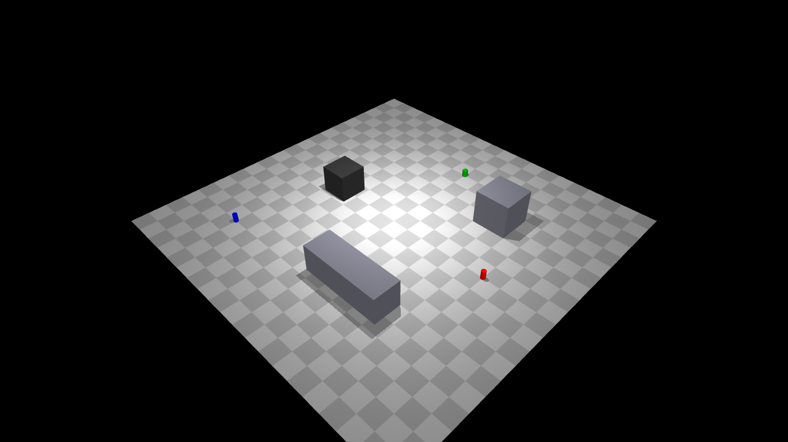
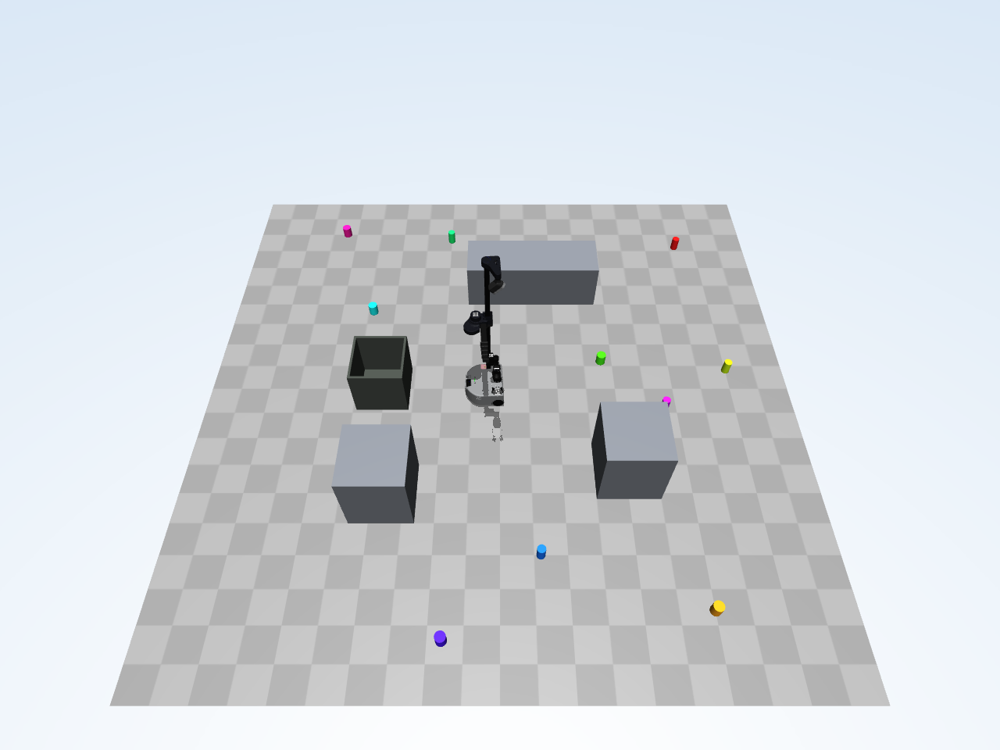

# 가게 앞 청소로봇 기획안

P00 · 기획안(Project Proposal) · 작성 최현준(PM) · 검토 최현준 + AI 심사위원 리뷰 1회 + grok 2차 의견 1회 · 상태 작성 · v1.0 · 2026-11-23 · 관련 [01-유저시나리오.md](01-유저시나리오.md), [charter.md](charter.md)

> 읽는 법: 숫자 옆에 **[출처 번호]**가 붙어 있으면 맨 아래 '출처'에 링크가 있다. **(가정)**은 근거 없이 정한 값, **(확인 필요)**는 찾았지만 원문으로 확인하지 못한 값이다. 이런 숫자는 1주 현장 검증(13장)으로 바꾼다. **(실측)**은 이 저장소 `logs/`에 기록이 있는 직접 측정값이다.

---

## 0. 한 문장

**영업 전 아침, 가게 앞 평평한 보도에 버려진 컵·캔은 집게로 집고 꽁초는 회전 솔로 쓸어 담는 청소로봇.** 이번 4주에는 그중 **'컵·캔 집기'를 MuJoCo 시뮬레이션(Hello Robot Stretch 3)으로 입증**하고, 메카넘 바퀴 차에 3D 프린트 집게를 단 축소판으로 실내에서 시연한다. 꽁초용 솔은 시뮬에서는 단순화해 보이고, 실물에서는 벤치 시험까지만 한다. 기간은 4주(2026-11-23 ~ 12-18), 인원은 1명이다.

| 한눈에 | 내용 |
| --- | --- |
| 대상 쓰레기 | **컵·캔(집게)** + **꽁초(솔)**. 비닐·전단지·액체·유리·낙엽은 하지 않음 |
| 이동 전략 | **직선 훑기(지그재그) + 팔이 닿는 것만 멈춰서 집기**, 줄 끝에서만 방향 전환(후진), 장애물은 우회 뒤 같은 줄로 복귀, 사람은 멈춰서 기다림 (6-6, 6-7) |
| 이번 4주 필수 | 시뮬: Stretch 3가 5 m × 3 m 가게 앞을 훑으며 컵·캔 10개를 집어 통에 넣기 · 실물: 메카넘 축소판이 2 m × 2 m를 훑으며 표적 3개를 집어 차에 실은 통에 넣기 |
| 이번 4주 확장 | 시뮬: 꽁초를 '솔 수거 영역'으로 쓸어 담기 · 실물: 솔 모듈 벤치 시험(직진하며 꽁초 크기 표적 쓸어 담기) |
| 운행 조건 | 건조한 평탄 보도, 경사 1/25(약 2.3°) 이하, 턱·줄눈 단차 1 cm 이하(가정), 영업 전 아침 1회. 실물은 실내 바닥만 |
| 성공 기준 | 시뮬: 10회 평균 커버리지 95% 이상, 10개 중 8개 이상, 운행 완료 720 s 이하(시뮬 시간), 충돌 0, 같은 시간 안 수거가 '찾아가기'의 0.8배 이상 · 실물: 5회 평균 3개 중 2개 이상, 5분 이하, 사람 개입 0 |
| 이동부 | 실물 4주 = 메카넘(실내, 측면 이동으로 집게 정렬) · 제품 개념(실외·눈) = 궤도 (6-2) |
| 눈 치우기 | 주인 아이디어를 검토한 결과 **로드맵**으로 둔다(16장, 부록 A) |
| 4주 | 1주 정하기(01~03 스테이지, D01~D08) → 2주 한 개 줍기(04) → 3주 열 개·색 인식·측정(04~05) → 4주 시연·인수인계(05~08) |

---

## 1. 문제와 근거

### 1-1. 길에 버려지는 쓰레기는 많고, 대부분 작다

| 숫자 | 내용 | 출처 |
| --- | --- | --- |
| **하루 약 1,246만 개** | 국내 길거리에 버려지는 담배꽁초 (연 45억 4,115만 개, 서울시가 2020년 환경부 조사를 인용) | [1] |
| **54%** | 시민 215명이 전국 13개 지역에서 2시간 동안 주운 쓰레기 12,055점 가운데 꽁초 6,488점 (꽁초의 89%가 도심) | [2] |
| **16%** | 같은 조사의 2위 '비닐봉지·포장지' 1,965점 | [2] |
| **각 5.4%** | 일회용 종이컵 655점(3위), 일회용 플라스틱 컵 654점(4위) | [2] |
| **557,533개** | 서울의 빗물받이 수. 서울시는 꽁초가 빗물받이를 막아 침수를 키운다고 설명한다 | [3] |
| 1위 품목 | 미국에서도 꽁초가 가장 많이 버려지는 단일 품목이다 (Keep America Beautiful 2020) | [4] |

### 1-2. 가게 앞은 누가 치우나

- **법:** 「폐기물관리법」 제7조는 국민이 생활환경을 깨끗이 유지하도록 노력할 책무를 정하고, 토지·건물의 소유자·점유자·관리자의 청결 유지 책임도 다룬다. 시장·군수·구청장은 조례에 따라 조치를 명할 수 있다(제8조) [5]. **현행 제7조 제2항의 문언은 확인 필요**하다(국가법령정보센터 원문을 보지 못함).
- **'의무'가 가장 분명한 것은 눈이다:** 「자연재해대책법」 제27조와 서울시 조례(2006)는 건축물 관리책임자가 건물 대지에 접한 **보도 전폭**의 눈을 치우도록 한다. 다만 강제성이 없고 과태료 도입도 무산됐다 [6][7]. → 16장 눈 치우기 검토의 출발점이다.
- **쓰레기는 관행이라고 본다(가정 → 13장 인터뷰로 확인):** 기사 속 상인들은 스스로 가게 앞을 치운다.
  - 종로 젊음의 거리 상인은 **매일 아침 3시간** 동안 꽁초를 쓸어 75 L 봉투 6개를 채운다 [8]. 유흥가 핫스폿의 극단값이므로 일반 가게의 평균으로 쓰지 않는다.
  - 서울 상가 골목의 한 자영업자는 2022년 강남역 침수 뒤로 **매일** 가게 앞 빗물받이 주변을 치우지만, 안내문을 붙여도 꽁초가 거의 줄지 않는다고 말했다 [9].
  - 무단투기 과태료는 자치구·경찰에 따라 3~6만 원(2023년 기준)이지만, 단속 인력이 부족하다 [10].

### 1-3. 하루 청소 시간과 로봇이 덜어 주는 것 (아직 가정)

국내 '가게 앞 하루 청소 시간' 통계는 찾지 못했다. 그래서 범위만 **가정**하고, 현장 검증에서 잰다.

| 항목 | 값 | 표시 |
| --- | --- | --- |
| 가게 앞 쓰레기 | 하루 10~30개, 그중 꽁초가 절반 이상 | 가정 (꽁초 비율은 [2]의 54%와 맞춤) |
| 한 개 줍는 데 | 집게로 5~10초 | 가정 |
| 하루 청소 시간 | 약 1~5분 (줍기) + 쓸기·봉투 정리 | 가정 → 현장 검증 |
| 극단값 | 유흥가 핫스폿, 하루 3시간 | 기사 [8] |

**로봇이 실제로 덜어 주는 양을 계산하면 이렇다(가정 숫자로):**

| 로봇이 하는 것 | 덜어 주는 것 | 판단 |
| --- | --- | --- |
| 컵·캔만 (이번 4주 시제품) | 하루 컵·캔 2~5개 × 5~10초 = **약 10~50초**, 그리고 젖은 컵을 손으로 만지는 일 | **시간 절약으로는 약하다.** '손대기 싫은 것 빼기'가 가치다 |
| 컵·캔 + 꽁초 (제품 개념: 집게 + 솔) | 줍기 대부분 = **약 1~5분**, 허리 숙이기 대부분 | 매일 반복되는 일을 거의 다 뺀다 |

결론: **집게만으로는 '왜 로봇인가'가 약하다. 그래서 제품 개념은 집게 + 회전 솔 조합으로 잡고(6-5), 4주 안에는 위험이 큰 집기부터 입증한다.** 이 가설은 현장 검증의 '하루 청소 분'과 '가장 싫은 점'으로 판정한다(12장 K-4·K-5).

---

## 2. 사용자와 현장

자세한 하루 흐름은 [01-유저시나리오.md](01-유저시나리오.md)에 있고, 여기서는 요약만 한다. 두 사람 모두 **가상 인물**이며, 13장 인터뷰로 검증한다.

| | 페르소나 A — 동네 카페 사장 | 페르소나 B — 상가 건물 관리인 |
| --- | --- | --- |
| 현장 | 역 근처 1층 카페, 가게 앞 보도 약 6 m × 3 m (가정) | 5층 상가 건물 1층 앞 보도와 모퉁이 흡연 구역, 약 15 m × 3 m (가정) |
| 언제 | 08:00 개점 전 10분쯤 (가정) | 07:00 출근 직후 (가정) |
| 지금 하는 일 | 빗자루·집게로 컵·꽁초 줍기, 젖은 컵은 손으로 | 건물 앞 전체를 쓸고, 빗물받이 주변 꽁초를 따로 치움 |
| 가장 싫은 것 | 개점 준비로 바쁜 시간에 허리 숙이기, 꽁초 냄새 | 넓은 구역, 매일 반복, 치워도 다시 쌓임 |
| 로봇에 바라는 것 | 개점 전에 가게 앞 쓰레기를 치워 두기 | 넓은 곳을 돌고, 어디에 많이 쌓이는지 기록 |

---

## 3. 왜 로봇인가

| 대안 | 왜 부족한가 |
| --- | --- |
| 재떨이·쓰레기통 더 놓기 | 근본 대책이지만, 놓아도 바닥에 버리는 것은 남는다. 얼마나 남는지는 현장 검증으로 본다 |
| 단속·캠페인 | 지자체 몫이고 단속 인력이 부족하다 [10] |
| 사람(직원·용역) | 매일 아침 몇 분짜리 일이라 따로 사람을 쓰기 애매하다 (가정) |
| 실내 로봇청소기 | 흡입식이라 컵·캔은 못 담는다. 팔이 달린 제품(Saros Z70)도 실내 전용이다 [17] |

남는 일은 **'찾아가서 → 집거나 쓸어 담아 → 옮기는' 물리 작업**이라 앱이나 알림으로 대신할 수 없다. 더럽고(Dirty) 매일 반복되는 일이라 로봇이 맡기 좋은 3D 작업이다. 다만 1-3의 계산대로 **컵·캔만 하면 덜어 주는 양이 작다**는 점을 숨기지 않는다.

---

## 4. 대상 쓰레기 정의

피드백 ②('대상 정의를 구체적으로')에 대한 답이다. **어떤 방식으로 무엇을 줍는지, 무엇은 안 하는지**를 크기·무게까지 정한다.

| 구분 | 품목 | 크기·무게 (시뮬 모델 값) | 개수 비율 [2] | 방식 | 이번 4주 |
| --- | --- | --- | --- | --- | --- |
| **대상 1** | 세워진 컵·캔 | 캔 ø66 × 122 mm, 20 g / 컵 ø80 × 100 mm, 10 g | 종이컵 5.4% + 플라스틱 컵 5.4% (캔은 따로 집계 없음, 확인 필요) | 집게 | **필수** (시뮬 + 실물) |
| 대상 1 확장 | 누운 컵·캔 | 높이 약 33~40 mm | 위와 같음 | 집게 | 시뮬, 남는 시간 |
| **대상 2** | 담배꽁초 | ø8 × 25 mm, 1 g 미만 (가정) | **54%** | 회전 솔 | **확장 1순위** (시뮬 단순화 + 실물 벤치 시험) |
| 안 함 | 비닐·포장지·전단지 | 모양이 변함 | 16% (비닐·포장지) | — | Out. 솔로 쓸린다는 보장이 없다(6-5 실험) |
| 안 함 | 액체, 깨진 유리, 음식물, 동물 배설물 | — | — | — | Out (위생·안전) |
| 안 함 | 낙엽·모래·먼지 | 많고 잘다 | — | — | Out (빗자루·흡입이 할 일) |
| 안 함 | 내놓은 쓰레기봉투, 물건 | — | — | — | Out (버린 것인지 판단할 수 없음) |

**왜 꽁초(54%)를 필수가 아닌 확장 1순위로 두나?**
1. 꽁초는 집게로는 안 된다. Stretch 3 그리퍼 고무 패드는 아래면이 바닥에서 약 1~2 cm 떠 있어, 높이 8 mm인 꽁초를 '집지' 못하고 '긁는다'(실측, `logs/2026-11-22_stretch3_measurements.md`).
2. 솔은 MuJoCo로 물리 그대로 흉내 내기 어렵다. 강체 롤러 실험에서 꽁초 10개 중 0~3개만 통에 들어갔다(6-5).
3. 그래서 **위험이 큰 집기를 먼저 끝내고**, 솔은 단순화된 시뮬과 실물 벤치 시험으로 따로 확인한다.

> 현장 검증에서 가게 앞 컵·캔이 하루 1개도 안 되면 '대상 1 필수'는 틀린 결정이다 → 중단 기준 K-4.

---

## 5. 운행 조건 (ODD: 로봇이 일하는 조건)

피드백 ①('보도가 울퉁불퉁해 바퀴가 문제')에 대한 답이다. **평탄한 곳에서만 하고, 숫자로 선을 긋는다.**

| 조건 | 한다 (In) | 안 한다 (Out) | 근거 |
| --- | --- | --- | --- |
| 바닥 재질 | 줄눈이 메워진 보도블록, 타일, 콘크리트 | 자갈, 잔디, 나무 데크 틈, 맨홀 뚜껑 위 | 바퀴·집기 높이 맞추기 |
| 경사 | **1/25(약 2.3°) 이하** | 그보다 가파른 곳, 경사로 | 국토부 보도 지침의 횡단경사: 원칙 1/50, 부득이할 때 1/25 [11] |
| 턱·단차 | **1 cm 이하** (가정) | 1 cm 넘는 턱, 연석, 계단 | 서울시는 횡단보도 턱을 1 cm로 낮추는 사업을 했다 [12]. 보도블록 단차 허용치는 확인 필요 |
| 운행 구역 | 가게 앞 사각형 (시뮬 5 m × 5 m) | 차도, 연석 너머, 다른 가게 앞 | 차도는 안전상 무조건 Out |
| 날씨 | 맑음·흐림, 건조한 바닥 | 비·눈, 젖은 바닥, 젖은 쓰레기 | 미끄럼·전기 안전 |
| 시간 | 영업 전 아침 1회 | 영업 중 수시 운행 | 보행자가 적다고 보는 시간 (가정 → 현장 검증 질문 7) |
| 사람 | 시뮬 필수 장면에는 없음. 나타나면 피하지 않고 멈춰서 기다림(R-07, 6-7, 시뮬 확장) | 사람 사이를 피해 다니기 | 1인·4주 범위 |
| 위치 추정 | 시뮬은 로봇 위치 참값. 실물은 바닥 테이프로 구역 경계를 표시하고, 통을 차에 실어 '통으로 돌아가기'를 없앤다 | SLAM, GPS | 메카넘은 미끄러짐이 커서 주행거리만으로는 위치가 틀어진다(가정). 지그재그는 줄 끝 경계만 알면 된다 |

**실물 축소판은 실외에 나가지 않는다.** 메카넘 바퀴는 작은 롤러가 바닥과 번갈아 닿아, 울퉁불퉁한 바닥과 문턱에서 진동하고 불안정하다고 알려져 있다 [13]. 축소판은 **실내 평평한 바닥**에서만 시연하고, 실제 보도용 제품 개념은 6-2의 '궤도'로 적는다.

---

## 6. 해결 방식 (설계 선택)

### 6-1. 수거 방식

| 기준 | A. 집게로 집기 | B. 흡입 | C. 솔로 쓸어 담기 | **D. 조합: 집게(큰 것) + 회전 솔(작은 것)** |
| --- | --- | --- | --- | --- |
| 컵·캔 | ◎ | ✕ (흡입구보다 큼) | △ (캔은 굴러감) | ◎ (집게) |
| 꽁초 | ✕ (패드가 높음) | ◎ | ○ | ○ (솔) |
| 위치 오차 허용 | 작다 (수 cm) | 작다 (Butty는 꽁초 4 cm 안까지 가야 함 [16]) | 크다 (솔 폭만큼) | 집게는 작고, 솔은 크다 |
| MuJoCo 구현 | Stretch 그대로 + 접촉 튜닝 (안 되면 weld) | 물리 흡입이 없어 흉내만 | 강체 롤러로는 잘 안 쓸린다 (6-5 실험) | 집게는 물리, 솔은 '수거 영역'으로 단순화 |
| 실물 4주 (1인) | 서보 2개, 출력물 5개 | 송풍 모터·필터·전원 → 부피·전력이 큼 | 기어모터 2개 + 시판 솔 + 출력물 | 일이 늘어난다 → 솔은 벤치 시험까지만 |
| 비슷한 제품 | BeachBot [15], Saros Z70의 팔 [17] | Butty [16], VERO [14] | 도로 청소차 [18], 로봇청소기 | Saros Z70 (실내, 흡입 + 팔) |

**추천: 제품 개념 = D(조합), 이번 4주 = A(집게) 필수 + C(솔) 확장.**
- 근거 1: 1-3 계산대로 컵·캔만으로는 덜어 주는 양이 작다. 꽁초를 함께 해야 '매일 하는 일을 뺀다'가 선다.
- 근거 2: 위험이 가장 큰 것은 집기(시뮬 접촉, 실물 서보 정렬)다. 이것부터 끝내야 4주 안에 '반드시 끝나는 길'이 남는다.
- 근거 3: 솔은 로봇청소기 교체용 부품을 그대로 쓸 수 있어 실물 벤치 시험이 싸고 빠르다(6-5).

### 6-2. 이동부 (메카넘 / 큰 바퀴 4WD / 궤도)

주인 의견(2026-11-23, "바퀴를 탱크처럼 하면 눈에도 안 미끄럽고 내구성 좋지 않을까")에 따라 궤도를 같은 무게로 비교했다.

| 기준 | 메카넘 | 큰 바퀴 4WD (스키드 또는 차동) | **궤도 (탱크)** |
| --- | --- | --- | --- |
| 보도 턱·줄눈 틈 | 나쁘다. 작은 롤러가 진동하고 불안정하다 [13] | 바퀴 지름이 클수록 좋다 | **가장 좋다.** 접지 길이가 길어 틈을 건너간다 (일반 원리, 가정) |
| 눈·젖은 바닥 접지 | 나쁘다 (롤러가 미끄러짐, 가정) | 보통 | **좋다.** Yarbo는 고무 궤도로 빙판 경사 36%(약 20°)를 오른다고 주장한다 (회사 주장, 독립 시험 없음). 눈이 깊으면 궤도가 미끄러진다는 사용자 보고도 있다 [35] |
| 내구성 | 롤러·베어링이 많다 | 단순하다 | 단순하지만 **궤도 이탈·늘어남**이 생긴다 |
| 쓰레기 옆 정렬 | **옆으로 바로 이동**(측면 이동) → 집게 정렬이 쉽다 | 회전한 뒤 전진 | 측면 이동이 없다. 회전해야 한다 |
| 제자리 회전 | 부드럽다 | 바퀴가 긁힌다 | **바닥을 긁고, 앞의 쓰레기를 흩뜨린다.** 회전할 때 전류가 커진다 (일반 원리, 가정) |
| 속도·배터리 | 보통 | 좋다 | 마찰이 커서 같은 배터리로 덜 간다 (가정) |
| 실외 제품 사례 | — | 배송 로봇 등 | Yarbo(제설·잔디), 많은 실외 순찰·농업 로봇 [35] |
| 우리 쪽에서 | **실물 축소판 (실내)** | — | **제품 개념(실외 보도)** |

**3D 프린트 궤도 vs 기성 섀시**

| 방법 | 근거 | 장단점 |
| --- | --- | --- |
| 3D 프린트 궤도: TPU 일체형 | Printables에 공개 도면이 있다(라이선스는 확인 필요) [36] | 싸다. 다만 Ender-3 기본 보우덴 압출기로 TPU를 뽑기는 까다롭다 (가정, 시험 출력 필요) |
| 3D 프린트 궤도: PLA·PETG 링크 + 핀 | HowToMechatronics 전체 출력 탱크, Fermilab RVR(접지면만 TPU + 몸체 PETG, 궤도 하나에 링크 31개, 한 쌍에 필라멘트 2 kg) [36] | 튼튼하다. 링크가 수십 개라 출력·조립 시간이 길다 (1~2일, 가정) |
| 기성 궤도 섀시 (국내) | 디바이스마트 로보블럭 Tracked Tank Robot Kit 1,290,000원(VAT 별도), HD 모델 5,850,000원 [37] | **우리 예산에 비해 너무 비싸다.** 해외 저가 키트(수만 원대로 알려짐)는 가격 확인 필요 |
| 메카넘 부품 재사용 | 메카넘 키트의 제어기(ESP32)·모터 드라이버·18650 배터리·모터 2개는 그대로 쓸 수 있다 (보유 구성 확인 필요) | 궤도는 모터 2개로 움직인다. 스프로킷(구동 톱니)·아이들러·궤도만 새로 출력하면 된다 |

**궤도 예산 (추정):** 출력 궤도로 가면 추가 비용은 필라멘트 0.5~2 kg에 TPU를 쓰면 TPU 1롤 정도다(약 2~5만 원, 가정). 대신 **출력·조립 시간이 2~3일**(가정)이다.

**추천:**
- **이번 4주 실물 = 메카넘 유지 (실내 평평한 바닥).** 이유는 세 가지다. ① 이미 정했고 부품이 있다. ② 6-6의 '멈춰서 옆으로 이동해 집기'에 측면 이동이 딱 맞는다. ③ 궤도를 출력·조립하는 2~3일이 1인 일정에 크다.
- **제품 개념(실외 보도·눈) = 궤도.** 보도 턱·틈·젖은 바닥·눈에서 접지가 가장 좋다. 제자리 회전 때 긁히는 문제는 6-6의 '줄 끝에서도 돌지 않고 후진' 전략으로 줄인다.
- **선택:** 4주차에 시간이 남으면 궤도 한쪽만 출력해 1 cm 턱 넘기 벤치 시험을 한다(성공 기준 밖).

**시뮬에서 궤도를 흉내 내려면:** MuJoCo에는 궤도 요소가 없다. 그래서 한쪽에 작은 바퀴 4~6개를 일렬로 두고, 같은 쪽 바퀴를 같은 속도로 돌리는 차동 구동으로 근사한다(가정, 흔히 쓰는 근사). 이 경우 **Stretch 3와 따로 '우리 로봇 모델'**을 만들어야 한다. 판단: **4주 안에는 만들지 않는다.** 집기·전략 검증은 Stretch 3 하나로 하고, '우리 로봇 모델'은 로드맵(실물 설계가 정해진 뒤)으로 둔다. 두 모델을 동시에 유지하면 1인 일정이 무너진다(K-6).

**궤도를 썼을 때 다시 제안하는 운행 조건 (제품 개념, 이번 4주 아님):** 턱 **2 cm 이하**, 경사 **1/12(약 4.8°) 이하**, 얕은 눈·젖은 바닥은 허용(가정. 현장 검증과 궤도 벤치 시험으로 정한다). 이번 4주의 운행 조건(5장: 턱 1 cm, 경사 1/25, 건조)은 그대로 둔다.

### 6-3. 인식

| 단계 | 방법 | 언제 |
| --- | --- | --- |
| 1 | **색 인식(HSV 임계값)**: 장면의 쓰레기만 채도 높은 색으로 둔다 | 시뮬·실물 (2~3주) |
| 2 | 머리 카메라 깊이, 또는 '바닥 평면과 광선의 교점'으로 바닥 위치 계산 | 시뮬 3주 |
| 3 | YOLO 같은 학습형 검출기 (공개 쓰레기 데이터셋 TACO 등 [19]) | 4주 이후, 이번 범위 밖 |

색 인식으로는 '진짜 쓰레기를 알아본다'고 주장할 수 없다. 발표에서 "위치를 찾고 집는 흐름을 먼저 입증하고, 인식기는 나중에 바꿔 끼운다"고 밝힌다.

### 6-4. 운영 시나리오

| 안 | 장점 | 단점 |
| --- | --- | --- |
| **A. 영업 전 아침 1회 (추천)** | 사람이 적다(가정), 개점 전에 깨끗해야 할 이유가 분명하다, 기사 속 상인들도 아침에 치운다 [8][9] | 낮 동안 쌓이는 것은 남는다 |
| B. 영업 중 수시 | 늘 깨끗하다 | 보행자 사이로 다녀야 해 안전 요구가 훨씬 커진다 |
| C. 마감 후 밤 | 사람이 가장 적다 | 아침까지 다시 쌓이고, 어두워서 카메라에 불리하다 |

### 6-5. 조합안 상세: 집게 + 회전 솔

주인 의견(2026-11-23, "바닥에 돌아가는 솔도 만들어야겠네?")을 구체화했다.

**구조 (로봇청소기와 같은 2단 구조)**

```
   진행 방향 →
  ┌──────────────────────────────┐
  │  [통]  ← 경사판 ← (메인 롤러 솔)│  ◎ 사이드 브러시(원판 솔)
  │                              │     작은 쓰레기를 가운데로 모음
  │      메카넘 차체 + 집게 팔       │  ◎ 사이드 브러시 (선택, 2개째)
  └──────────────────────────────┘
```

1. **사이드 브러시**(원판 솔 1~2개, 차체 앞 모서리): 바깥쪽 꽁초를 가운데로 쓸어 모은다.
2. **메인 롤러 솔**(차체 앞쪽 아래, 가로): 모인 꽁초를 경사판 위로 쓸어 올려 통(쓰레받기)에 넣는다.
3. **집게**: 롤러 입구보다 큰 컵·캔을 따로 집어 통에 넣는다.

**실물 부품 (메카넘 축소판에 다는 경우)**

| 부품 | 무엇을 쓰나 | 가격 근거 |
| --- | --- | --- |
| 사이드 브러시 | 로봇청소기 교체용 호환품을 그대로 사용 | 쿠팡 호환품 2종 세트 29,900원 (판매 페이지, 시점 확인 필요) [31] |
| 메인 롤러 솔 | 로봇청소기 교체용 호환 메인브러시 | 쿠팡 호환품 1만~1만 2천 원대 (로보락 S10 MaxV용 10,000원, S8용 12,400원, 시점 확인 필요) [32] |
| 모터 2개 | N20 기어모터 6 V (사이드 1, 롤러 1) | DFRobot 1:150 N20 $3.40 (6 V 133 rpm, 정지 토크 1.0 kg·cm) [33]. TT 모터 가격·전류는 확인 필요 |
| 허브·하우징·경사판·통 | 3D 프린트 (모터 축 → 솔 결합 허브, 롤러 양쪽 베어링 받침, 경사판, 통) | PLA 소량 (가정) |
| 모터 드라이버 | 작은 2채널 DC 드라이버 1개 | 보유 여부 확인 필요 |

**메카넘 차체에 달 수 있나 (확인할 것)**

| 항목 | 확인할 내용 | 지금 판단 |
| --- | --- | --- |
| 바닥 간격 | 차체 아래 높이(지상고)에 롤러가 들어가나. 솔 털 끝이 바닥에 1~2 mm 눌려 닿아야 한다 (가정) | **확인 필요** — 보유 키트 지상고를 잰다. 부족하면 차체 앞에 출력 브래킷으로 내단다 |
| 전류 | N20 무부하 약 32~60 mA, 정지 전류 0.64~1.5 A (제품마다 다름) [33] | 두 개를 동시에 돌려도 무부하 0.2 A 안쪽(가정). 털이 감겨 멈출 때(정지 전류)가 문제 → 드라이버 전류 한계와 배터리 여유 확인 필요 |
| 무게·균형 | 솔 모듈 + 집게 팔을 앞쪽에 같이 달면 앞이 무거워진다 | 통을 뒤쪽에 두어 균형 (가정) |
| 공간 | 집게가 내려갈 자리와 롤러 입구가 겹친다 | 집게는 옆, 솔은 앞으로 나눔 (설계 3주차) |

**시뮬에서 솔을 어떻게 단순화하나**

| 방법 | 어떻게 | 장점 | 단점 | 판단 |
| --- | --- | --- | --- | --- |
| ① 강체 회전 원기둥 + 마찰 | 롤러를 회전 관절이 있는 원기둥으로 두고, 경사판과 통을 모델링 | 물리 그대로 | **직접 실험 결과: 꽁초 10개 중 0~3개만 통에 들어감, 전단지 조각 0개. 대부분 앞으로 밀려남.** 처음엔 관절이 발산(NaN)해서 튜닝도 필요했다 (실측, `logs/2026-11-23_roller_brush.md`) | 4주 안에는 ✕ |
| ② 회전 원판 + 마찰 (사이드 브러시) | 바닥 가까이 도는 원판이 꽁초를 옆에서 민다 | 모으는 동작은 보인다 | 담는 동작은 결국 ①이 필요 | △ |
| **③ 수거 영역 (추천)** | 솔 입 앞에 상자 영역을 두고, **로봇이 일정 속도 이하로 지나갈 때 그 안에 들어온 작은 쓰레기는 '수거'로 본다** (판정 함수에서 지움) | 싸고 결정적이다. '어디를 지나가야 하나'(경로 덮기) 문제에 집중할 수 있다 | 솔이 정말 쓸어 담는지는 보여 주지 못한다 → 발표에 '단순화'라고 밝힘 | **◎** |

**위험 표시 — 솔로 정말 쓸리나**

| 대상 | 위험 | 대응 |
| --- | --- | --- |
| 꽁초 | 젖거나 바닥 틈에 끼면 안 쓸린다. 털에 감길 수 있다 | 운행 조건에서 비·젖은 바닥 Out. 실물 벤치 시험으로 비율을 잰다 |
| 전단지·종이 조각 | 납작해서 롤러가 위로 지나가거나, 바람에 날린다. 시뮬 실험에서 0/10 | **대상에서 뺀다(Out)** |
| 줄눈·보도블록 틈 | 틈에 낀 꽁초는 솔 끝이 닿지 않는다 | 실제 보도는 로드맵. 실물은 실내 평탄 바닥 |
| 롤러 정지(감김) | 정지 전류가 흘러 드라이버·모터가 과열된다 | 전류 한계가 있는 드라이버를 쓰고, 정지가 감지되면 끈다 (설계 3주차) |

**결론:** 솔은 **로봇청소기 부품 + N20 모터 + 출력 허브**로 싸게 만들 수 있다(추가 약 3~6만 원, 9장). 다만 쓸어 담기가 실제로 되는지는 불확실하다. 그래서 **4주 범위는 '시뮬 수거 영역 + 실물 벤치 시험'**으로 두고, 벤치 시험에서 10개 중 6개 미만이면 솔 실물은 접는다(12장 K-9).

### 6-6. 이동 전략: 직선 훑기 + 팔이 닿는 것만 줍기

주인 제안(2026-11-23)을 기본 전략으로 채택했다. 로봇청소기처럼 **직선으로 줄을 그어 구역을 훑고(지그재그, boustrophedon)**, 줄 위에서 **팔이 닿는 거리 안의 쓰레기만** 줍는다. 줄을 벗어나 쓰레기를 찾아가지 않는다.

```
 가게 벽 ─────────────────────────────────────────
  줄 1  ▶▶▶▶▶▶▶▶▶▶▶▶▶▶▶▶▶▶▶▶▶▶▶▶▶▶▶▶▶ (끝: 돌지 않고 옆으로 한 칸)
  줄 2  ◀◀◀◀◀◀◀◀◀◀◀◀◀◀◀◀◀◀◀◀◀◀◀◀◀◀◀◀◀ (후진)
  줄 3  ▶▶▶▶▶▶▶▶▶[화분]▶▶▶▶▶▶▶▶▶▶▶▶▶▶ → 6-7 우회
  ...                   ↕ 줄 간격 s
 연석(차도 쪽, 넘지 않음) ───────────────────────────
```

**(1) 줄 간격 계산식**

| 로봇 | 도구 배치 | 줄 간격 식 | 숫자 |
| --- | --- | --- | --- |
| 일반 (도구가 앞 가운데, 좌우 대칭) | 팔이 옆으로 r까지 닿고, 솔 폭이 W | **s = 2 × min(r, W/2) × (1 − 겹침)** | — |
| Stretch 3 (시뮬) | 팔이 **오른쪽(-y)으로만** 뻗는다. 집기 중심이 로봇 중심에서 0.42 m(팔 0)~0.94 m(팔 최대 0.52 m) | **s = (r_max − r_min) × (1 − 겹침)** = 0.52 × 0.9 | **약 0.47 m** (겹침 10%는 가정) |
| 실물 축소판 (메카넘) | 집게는 앞 가운데. 멈춘 뒤 측면 이동으로 좌우 r = 0.15 m까지 맞춤(가정). 솔 폭 W = 0.20 m(가정) | s = 2 × min(0.15, 0.10) × 1.0 | **0.20 m** (솔이 없으면 0.30 m) |

- 예상 시간: Stretch는 5 m × 3 m 가게 앞 띠에서 약 7줄 × 5 m = 35 m를 0.097 m/s로 달려 **약 360 s**가 걸린다. 차동 구동이라 옆 줄로 바로 못 가서, 줄을 바꿀 때마다 **90° 돌기 → 0.47 m 전진 → 90° 되돌기**를 한다(회전 180° ÷ 35°/s ≈ 5 s + 이동 약 5 s ≈ 10 s, 6번이면 약 60 s). 여기에 집기 10 × 15 s = 150 s와 우회 약 30 s를 더하면 **약 600 s**다. 그래서 시간 기준은 여유 20%를 둔 **720 s**로 잡는다(11장). 실측은 속도·회전뿐이고, 15 s·30 s는 가정이다. 실물은 2 m × 2 m에서 10줄 × 2 m = 20 m를 0.1 m/s로 달려 200 s, 집기 3 × 20 s를 더해 **약 260 s**다(가정).
- **Stretch는 팔 쪽으로 줄을 옮겨 간다.** 팔이 닿는 띠(로봇 오른쪽 0.42~0.94 m)가 다음 줄의 바퀴 자리를 미리 치운다. 그래서 로봇은 늘 치운 바닥 위를 지나고, 쓰레기를 바퀴로 밀어내지 않는다. 첫 줄의 벽 쪽 띠(약 0.4 m)만 남는데, 이것은 마지막에 한 줄을 더 돌아 덮는다(가정).

**(2) 발견하면: 멈춰서 집기 (추천)**

| 안 | 장점 | 단점 |
| --- | --- | --- |
| **멈춰서 집고 다시 직진 (추천)** | 단순하다. 정렬 오차가 작다. 상태 기계가 '직진 → 멈춤 → 집기 → 직진' 하나다 | 멈출 때마다 시간이 든다 |
| 움직이며 집기 | 빠르다 | 팔과 베이스를 동시에 제어해야 한다. 4주 범위 밖 |

**(3) 회전은 줄 끝에서만.** Stretch는 줄 끝에서 위의 '90° 두 번' 동작으로 옆 줄로 옮긴 뒤, **방향을 그대로 둔 채 후진**으로 다음 줄을 간다. 그래야 팔이 늘 같은 쪽(치우지 않은 쪽)을 본다. 줄 위에서는 돌지 않는다. 메카넘은 측면 이동으로 다음 줄로 간다. 궤도라면 줄 끝에서만 돌거나 후진한다. 어느 쪽이든 **제자리 회전이 줄어 바닥 긁힘과 쓰레기 흩뜨림이 줄어든다**.

**(4) 장애물을 만나면** 6-7의 규칙대로 우회한 뒤 같은 줄로 돌아온다.

**(5) 못 집은 것** (3번 실패, R-08)은 **사진과 위치**를 기록하고 줄을 계속 간다.

**비교 기준: '찾아가기' 전략.** 같은 장면·같은 시드에서, 카메라로 본 가장 가까운 쓰레기를 찾아가는 전략과 시간·충돌·수거율을 비교한다(11장). 참고로 예전 하천 정화로봇 시뮬 실측에서는 지그재그가 10분에 평균 8.3개, 위치를 아는 로봇이 18.0개를 모았다(배치 7개). 다만 그건 **물 위에 떠내려가는 쓰레기를 카메라 없이 훑은** 경우였다. 지그재그가 줄 사이로 쓰레기를 밀어내고 벽으로 몰아붙였다 [38]. 땅 위의 멈춰 있는 쓰레기를 카메라로 보고 '팔 닿는 것만' 줍는 우리 경우는 다를 수 있지만, **지그재그가 더 느릴 수 있다는 경고**로 받아들인다(K-10).

**왜 그래도 지그재그인가:** ① 구역을 빠짐없이 덮었다는 것을 '커버리지 %'로 증명할 수 있다(카메라가 놓친 것도 지나간다). ② 경로를 미리 알 수 있어 사람 눈에 예측 가능하고, 안전 개념(D08)을 쓰기 쉽다. ③ 실제 로봇청소기·노면 청소차가 쓰는 방식이라 솔 모듈과 잘 맞는다.

### 6-7. 장애물 처리 규칙

주인 의견(2026-11-23, "앞에 장애물이 있으면 피해 가고")을 규칙으로 만들었다.

| 단계 | 실물 축소판 | 시뮬 (Stretch 3) |
| --- | --- | --- |
| 감지 | 앞쪽 초음파 또는 ToF 거리 센서 2개(좌·우) + 앞 범퍼 스위치 | 베이스 앞쪽에 MuJoCo `rangefinder` 센서 2~3개(레이캐스트) + 접촉 판정 |
| 멈춤 거리 | **0.30 m** (가정) | 같음 |
| 고정 / 움직임 구분 | 0.5 s 동안 거리가 5 cm 넘게 바뀌면 '움직이는 것' (가정) | 같은 규칙. 정답 확인용으로 장애물 이름(`obstacle_*`, `person_*`)도 로그에 남긴다 |

| 상황 | 규칙 | 기록 |
| --- | --- | --- |
| **고정 장애물** (화분·입간판·세워 둔 자전거) | 0.30 m 앞에서 멈춘다 → 팔 반대쪽으로 비켜 장애물 옆을 지난다 → 장애물 끝을 지나면 **같은 줄로 돌아온다** (아래 그림) | 우회 횟수, 복귀 성공 여부 |
| **사람·움직이는 것** | **피하지 않고 멈춰서 기다린다.** 1.0 m 안에 있으면 정지, 3초 동안 1.0 m 안이 비면 다시 간다. 30초가 넘으면 그 칸을 건너뛴다 (R-07, 가정 숫자) | 기다린 시간, 건너뛴 칸 |
| **우회 못 함** (틈이 '로봇 폭 + 0.1 m'보다 좁음, 가정) | 그 칸을 건너뛰고 다음 줄로 간다 | **'청소 못 한 구역'**으로 좌표를 기록하고 결과 보고에 넣는다 (R-12) |
| 범퍼가 눌림 (실물) | 즉시 멈추고 0.1 m 후진한 뒤 고정 장애물 규칙으로 간다 | 충돌 1회로 센다 (성공 기준은 0회) |

```
 우회 경로 (위에서 본 그림, 진행 방향 →)

  줄  ──────●───┐            ┌───●──────  ← 같은 줄로 복귀
              멈춤 │ 0.30 m      │ 장애물 끝 + 여유
                  └──[ 화분 ]──┘   (팔 반대쪽으로 비켜 지나감)
```

시뮬 성공 기준에 **장애물 충돌 0회**와 **우회 뒤 줄 복귀율**을 넣었다(11장).

---

## 7. 유저 시나리오 (요약)

전문은 [01-유저시나리오.md](01-유저시나리오.md)에 있다. 시나리오의 로봇은 **제품 개념(집게 + 솔)** 기준이다.

| 시간 | 지금 (로봇 없이) | 로봇과 함께 |
| --- | --- | --- |
| 전날 마감 | 가게 앞을 한 번 쓸고 들어간다 | 로봇 통을 비우고 충전기에 꽂는다. 앱에서 '내일 07:30 출동' 확인 |
| 아침 영업 전 | 10분 일찍 나와 허리를 숙여 컵·꽁초를 줍는다 (가정) | 로봇이 07:30에 출발해 가게 앞을 직선 줄로 훑는다. 꽁초는 솔로 쓸어 담고, 팔이 닿는 컵·캔은 멈춰서 집는다. 사장은 개점 준비를 하다 '완료: 컵 3, 캔 1, 꽁초 약 9 · 못 집은 것 1개(사진) · 청소 못 한 구역 1곳 · 구역 96%' 알림을 받는다 |
| 영업 중 | 손님이 버린 컵이 보이면 줍는다 | 지금처럼 사람이 한다 (로봇은 영업 중에 운행하지 않음) |
| 실패 상황 | — | 못 집음 → 3번 시도 후 사진·위치 기록하고 계속 / 화분·입간판 → 돌아서 같은 줄로 복귀 / 사람·자전거 → 멈춰서 기다림 / 좁은 틈 → '청소 못 한 구역' 기록 / 비 → 출동 취소 / 배터리 부족 → 출발 안 함 / 통 가득 → 돌아와 알림 |

시나리오에서 나온 요구사항 **R-01~R-16**와, 시뮬에서 재현할 것 / 실물로 시연할 것은 01-유저시나리오.md 끝의 표에 있다. 3일차 요구사항 명세(D03)의 씨앗이다.

---

## 8. 시뮬레이션 계획


*그림 1. 지금 저장소의 장면 뼈대 `scenes/sidewalk_v0.xml` (5 m × 5 m, 쓰레기 3개, 화분·벤치·쓰레기통, 로봇 없음). MuJoCo 오프스크린으로 직접 렌더.*


*그림 2. 예전 검토 때 만든 Stretch 3 + 쓰레기 10개 장면 (참고용, 직접 렌더). 4일차에 만들 **장면 v1**은 이 구성을 목표로 한다.*

| 항목 | 계획 |
| --- | --- |
| 로봇 | MuJoCo Menagerie `hello_robot_stretch_3`를 그대로 쓴다 (모델을 고치지 않음) |
| 장면 v1 | **5 m × 3 m 가게 앞 띠**(페르소나 A의 보도 폭 3 m에 맞춤, 가정). 한쪽 긴 변은 가게 벽, 반대쪽은 연석(넘지 않음). 화분·입간판·세워 둔 자전거 역할의 고정 장애물 2~3개, 컵·캔 10개 무작위 배치. 지금 뼈대(`sidewalk_v0`, 5 m × 5 m)를 줄여서 만든다 |
| 통 | **로봇에 실은 통**: 베이스 위에 바구니 body를 weld로 고정한다(로봇 모델 파일은 고치지 않음). 팔을 접어 바구니 위에서 놓을 수 있는지는 4일차에 확인(확인 필요). 안 되면 출발점 뒤 고정 통을 왕복하고 시간 기준을 900 s로 한다(K-11) |
| 전략 | 직선 훑기(줄 간격 약 0.47 m, 7줄, 줄 끝은 후진) + 팔이 닿는 띠 안의 쓰레기만 멈춰서 집기 (6-6). 비교용으로 '찾아가기' 전략도 같은 코드 틀에 넣는다 |
| 센서 | 머리 카메라(색 인식), 베이스 앞 `rangefinder` 2~3개(장애물 감지, 6-7) |
| 장면 v1-b (확장) | 같은 장면에 꽁초 10개를 더 놓고, Stretch 베이스 앞에 '솔 수거 영역'(폭 0.3 m × 길이 0.1 m, 가정)을 둔다 (6-5 ③) |
| 집기 | 1차는 실제 그리퍼. 12/04까지 '들어 3초 버티기'가 안 되면 '닿으면 붙기'(weld)로 내린다. 결과에 `grasp_mode`를 기록한다 |
| 위치 | 로봇 위치는 시뮬 참값. 쓰레기 위치는 2주차엔 참값, 3주차부터 머리 카메라 색 인식 |
| 측정 | 판정 함수(`metrics`): 커버리지 %, 수거 수, 시뮬 시간, 장애물 충돌 횟수, 우회 뒤 줄 복귀, 떨어뜨림, 구역 밖 나감, 재시도 횟수, 청소 못 한 구역, **쓰레기 참값 조회 횟수**, 참고값(밀림·벽시계 시간) |
| 반복 | 무작위 시드 10개로 10회 실행해 평균과 최저값을 기록 |

**시간 720 s의 근거:** Stretch 3 모델의 베이스 최고 속도는 0.097 m/s, 제자리 회전은 약 35°/s다(실측). 지그재그로 5 m × 3 m를 훑으면 주행 약 360 s, 줄 바꾸기 약 60 s, 집기 10 × 15 s = 150 s, 우회 약 30 s를 더해 **약 600 s**로 예상하고, 기준은 여유 20%를 둔 **720 s**다(6-6). 팔 동작 15 s와 우회 시간은 가정이다. 예전 '찾아가기 + 고정 통 왕복' 계산(가까운 8개 약 443 s)은 배치 1개 기준이고 탐색 시간이 빠져 있었다. 무작위 배치 10회에서 720 s를 넘는 회가 나오면, 11장에 묶어 둔 폭 안에서 12/01에 다시 정한다. 실제 Stretch 3 하드웨어의 최고 속도는 공식 문서에서 찾지 못했다(확인 필요).

---

## 9. 실물 축소판 계획

| 항목 | 내용 |
| --- | --- |
| 차체 | 메카넘 바퀴 4륜 자동차 (**보유 키트를 쓸지, 제어기가 무엇인지 확인 필요**) |
| 팔 | 3D 프린트 집게 1개 + 들어 올리는 관절 1개 = 서보 2개 (손목 1개는 선택) |
| 솔 모듈 (확장) | 사이드 브러시 1개 + 메인 롤러 1개 + N20 모터 2개 + 출력 허브·경사판·통 (6-5) |
| 출력물 | 집게 손가락 2, 집게 몸통 1, 팔 링크 1, 카메라 거치대 1, 차체 연결판 1 (+ 솔 허브 2, 롤러 받침 2, 경사판·통 1). 모두 Ender-3 출력 범위 220 × 220 mm 안 |
| 인식 | USB 카메라 1개 → 노트북(또는 차에 단 작은 컴퓨터)에서 OpenCV 색 인식 → 차에 명령 전송 |
| 표적 | 지름 30~60 mm, 50 g 이하 원기둥 (빈 소형 종이컵·미니캔·출력 표적 중에서 고름, 가정). 솔 시험용 꽁초 크기 표적은 ø8 × 25 mm 출력물이나 필터 모형 |
| 시연장 | 실내 평평한 바닥 2 m × 2 m (가정), 상자 장애물 1개, 바닥 테이프로 구역 경계 표시. **통은 차에 싣는다** (지그재그 중 통으로 돌아가지 않음) |
| 장애물 센서 | 앞쪽 초음파 또는 ToF 2개 + 범퍼 스위치 1개 (6-7) |

**예산 추정 (모두 추정 — 사기 전에 판매처 가격 확인 필요)**

| 품목 | 수량 | 추정 | 비고 |
| --- | --- | --- | --- |
| 메카넘 차 키트 | 1 | 0원 ~ 10만 원대 | 보유하고 있으면 0원 (확인 필요) |
| 서보 (토크형 1, 소형 1) | 2 | 1~3만 원 | 집게·들기 (가정) |
| PLA 필라멘트 | 약 0.2~0.3 kg 사용 | 1만 원 이하 | 1 kg 롤 일부 (가정) |
| USB 카메라 | 1 | 2~5만 원 | 보유 웹캠을 쓰면 0원 (가정) |
| 전원·배선·볼트 | — | 1~2만 원 | (가정) |
| 초음파/ToF 센서 2 + 범퍼 스위치 1 | 3 | 1~2만 원 | 보유 여부 확인 필요 (가정) |
| **소계: 집게 축소판** | | **약 6만 ~ 22만 원** | 차·카메라·센서 보유 여부에 따라 |
| 사이드 브러시 (호환품) | 1~2 | 약 3만 원 (2종 세트) | [31] |
| 메인 롤러 (호환품) | 1 | 1만~1만 2천 원대 | [32] |
| N20 기어모터 6 V | 2 | 약 1만 원 (개당 $3.40 + 배송, 가정) | [33] |
| 2채널 DC 모터 드라이버 | 1 | 0~1만 원 | 보유 여부 확인 필요 (가정) |
| **소계: 솔 모듈** | | **약 3만 ~ 6만 원** | |
| **합계 (메카넘)** | | **약 9만 ~ 28만 원** | |
| (참고) 궤도로 바꿀 때 추가 | | 약 2만 ~ 5만 원 + 출력·조립 2~3일 | 6-2, 이번 4주 추천 아님 |

---

## 10. 비슷한 제품·연구와 차별점

| 이름 | 무엇 | 대상·방식 | 가격 | 출처 |
| --- | --- | --- | --- | --- |
| Capra **Butty** (덴마크, 독일 Telekom과 시연) | 도심 보도 자율 청소 로봇, 2024 쾰른 시연 | 꽁초. 3D 카메라 + AI, **흡입**, 꽁초 4 cm 안까지 접근 | 공개 안 됨 | [16] |
| **VERO** (이탈리아 IIT) | 4족 로봇(Unitree AlienGo) + 진공청소기, 다리 끝 흡입구 | 꽁초. 현장 시험에서 구역 꽁초의 약 90% 수거 | 연구용 | [14] |
| **BeachBot** (네덜란드 TechTics) | 해변 꽁초 로봇 | 꽁초. 카메라 AI, 판 두 개로 **집기**. 첫 시연에서 30분에 10개, 배터리 1시간 | 공개 안 됨 | [15] |
| **Angsa Clive** (독일 뮌헨) | 잔디·자갈 공원 쓰레기 로봇 | 꽁초·병뚜껑·플라스틱 조각. 2025-04 만하임 공원 시범 | 공개 안 됨 (2026년 25대 상용화 계획은 회사 발표) | [20] |
| **Roborock Saros Z70** | 5축 접이식 팔이 달린 로봇청소기 | 실내. 양말·수건 같은 작은 물건 집기 + 흡입 | 국내 200만 원대 (2025-05 출시), 미국 정가 $2,599 | [17] |
| 로보티즈 **개미** | 서울 양천구 공원 3곳에 12대 | 재활용품 수거·운반 (사람이 넣음) + 순찰 | 공개 안 됨 | [21] |
| **Trombia Free** 등 도로 청소차 | 자율 전기 노면 청소차, 약 2,600 kg | 솔·흡입, 도로 전체 | 공개 안 됨 | [18] |
| **Hello Robot Stretch 3** (시뮬 플랫폼) | 이동형 로봇팔 | 집기 연구용 | $24,950 (출시가) | [22] |

**비교 축으로 보면** (◎ 한다 / △ 일부 / ✕ 안 한다 / ? 공개 자료 없음)

| 축 | Butty | VERO | BeachBot | Angsa | Saros Z70 | **우리 (제품 개념)** |
| --- | --- | --- | --- | --- | --- | --- |
| 장소: 가게 앞 평탄 보도 | ◎ (도심 보도) | △ | ✕ (해변) | ✕ (잔디·자갈) | ✕ (실내) | ◎ |
| 꽁초 | ◎ 흡입 | ◎ 흡입 | ◎ 집기 | ◎ | △ 흡입 | ○ 솔 |
| 컵·캔처럼 큰 것 | ? | ✕ | ? | ? | △ (실내 작은 물건) | ◎ 집게 |
| 운영 단위 | 도시·지자체 | 연구 | 해변 | 공원 | 가정 | **가게 1곳, 영업 전 1회** |
| 수거 위치 기록 | ? | ? | ? | ? | ✕ | ○ (R-14) |

**차별점 한 줄:** 지금 나온 실외 로봇은 **지자체·공원 단위로 꽁초를 빨아들이거나 집는** 쪽이다. 우리는 **가게 한 곳 앞이라는 작은 단위에서, 큰 것(컵·캔)은 집고 작은 것(꽁초)은 쓸어 담아 영업 전에 한 번 치우고, 어디서 많이 나왔는지 기록하는 것**을 노린다. 다만 "가게 주인이 이것에 돈을 낼까"는 아직 근거가 없다(가정 → 13장 인터뷰 질문 9). 목표 가격은 이번 범위 밖이다.

---

## 11. 성공 기준

전략은 6-6의 **직선 훑기(지그재그)**다. 시간은 **'1회 운행 완료'(모든 줄을 끝내고 정지)까지**로 정의한다(유저 시나리오 R-05와 같다). **커버리지만으로는 통과할 수 없다.** 커버리지·수거·충돌을 모두 넘어야 한다.

| 구분 | 항목 (관련 R) | 기준 | 측정 방법 (자동/수동) |
| --- | --- | --- | --- |
| **시뮬** | 커버리지 (R-02) | 운행 구역을 5 cm 격자로 나눴을 때, 팔이 닿는 띠가 한 번 이상 지나간 칸이 **95% 이상** (10회 평균). 분모 = 전체 칸 − 장애물이 차지한 칸. **건너뛴 칸과 벽 쪽 첫 띠는 분모에 남긴다**(빼지 않음) | 자동: 베이스 궤적 + 팔 띠로 격자 칠하기 |
| 시뮬 | 수거 (R-04) | 세운 컵·캔 10개 중 **8개 이상** 통 안 (10회 평균), 최저 회도 6개 이상 | 자동: 에피소드 끝에 쓰레기 중심이 통 영역 안 |
| 시뮬 | 시간 (R-05) | 1회 운행 완료까지 **시뮬 시간 720 s 이하** (10회 평균, 근거 6-6) | 자동: `data.time` |
| 시뮬 | 충돌 (R-06) | 장애물 충돌 **0회** (10회 모두) | 자동: 로봇과 `obstacle_*` 접촉 횟수 |
| 시뮬 | 우회 복귀 (R-06) | 우회한 뒤 장애물 끝에서 1 m 안에 **원래 줄 ±5 cm로 돌아온 비율 90% 이상** (가정 숫자) | 자동: 줄 좌표와 베이스 궤적 비교 |
| 시뮬 | 떨어뜨림 (R-04) | 한 회에 **1개 이하** | 자동: 5 cm 넘게 들렸다가 통 밖에 떨어짐 |
| 시뮬 | 구역 (R-02) | 로봇 베이스가 운행 구역 밖으로 나간 횟수 **0** | 자동: 베이스 위치 |
| 시뮬 | 인식 (R-03) | 3주차부터 쓰레기 위치는 카메라 색 인식으로만 얻는다: **쓰레기 참값 조회 0회** | 자동: 참값 조회 함수 호출 수를 `metrics` 로그에 기록, 0이 아니면 실패 |
| 시뮬 | 건너뛰기 (R-08) | 못 드는 물체(질량 2 kg 캔)가 있으면 **3번 시도한 뒤 건너뛰고** 위치를 기록한 다음 줄을 계속 간다 | 자동: 재시도 횟수·건너뜀 로그 |
| 시뮬 | 못 지나간 칸 (R-16) | 벽과 화분 사이 좁은 틈 장면에서 그 칸을 건너뛰고 '청소 못 한 구역' 좌표를 기록, 충돌 0 | 자동: 결과 표 + 접촉 로그 |
| 시뮬 | 결과 보고 (R-12) | 실행이 끝나면 수거 수·못 집은 위치·청소 못 한 구역·시간을 표로 출력 | 자동: 출력 파일이 있는지 테스트 |
| 시뮬 | 정지 (R-13) | 정지 명령 후 **1초 안에** 베이스 속도 0.01 m/s 이하 | 자동: 속도 로그 |
| 시뮬 | **전략 비교** | 같은 장면·같은 시드 10개에서 '찾아가기' 전략과 **같은 시간 예산(720 s) 안의 수거 수**를 비교한다. 지그재그 수거가 **찾아가기의 0.8배 이상**이고 충돌은 같거나 적어야 한다 (0.8은 가정 기준. 예전 하천 실측에서는 약 0.5배였다 [38]) | 자동: `compare_to_baseline()`으로 두 전략 표 |
| 시뮬 확장 | 꽁초 (R-15) | 꽁초 10개 중 **8개 이상**을 '솔 수거 영역'으로 수거 (단순화임을 발표에 명시) | 자동: 같은 `metrics` |
| 시뮬 확장 | 사람 대역 (R-07) | 움직이는 기둥이 1 m 안에 들어오면 정지하고, 비면 3초 뒤 재개 (5번 모두) | 자동: 거리·속도 로그 |
| **실물** | 수거 (R-04) | 2 m × 2 m 구역을 훑으며 표적 **3개 중 2개 이상**을 차에 실은 통에 넣기 (5회 평균, 최저 회도 1개 이상). 표적 위치는 매 회 0.5 m 격자 16칸 중 3칸을 주사위로 고른다 | 수동: 사람이 세고 영상 기록 |
| 실물 | 시간 (R-05) | 1회 운행 완료까지 **5분 이하** (벽시계) | 수동: 영상 타임스탬프 |
| 실물 | 자율 (R-03) | 시작 키를 누른 뒤 사람 개입 **0회**. 개입한 회는 수거 0개로 평균에 넣는다 | 수동: 영상 |
| 실물 | 멈춤 (R-06) | 줄 위 상자 앞에서 거리 센서로 **0.30 ± 0.10 m**에 멈춤, 범퍼 눌림 0회 (5번 모두). 우회는 확장 | 수동: 영상 + 센서 로그 |
| 실물 | 정지 (R-13) | 비상정지 키 → 1초 안에 멈춤 (5번 모두) | 수동: 영상 |
| 실물 확장 | 표적 5개 | 5개 중 4개 이상, 5분 | 수동 |
| 실물 확장 | 우회 (R-06) | 상자를 돌아 같은 줄로 복귀 (5번 중 4번) | 수동: 영상 |
| 실물 확장 | 솔 벤치 (R-15) | 솔 모듈을 단 차가 꽁초 크기 표적 10개 위를 직진 1회 → **6개 이상 통 안** (5회 평균) | 수동: 개수 세기 |

**기준을 다시 정할 수 있는 폭을 미리 묶어 둔다.** 12/01(화) 현장 검증 결과로 조정하더라도 **수거율 70~90%, 커버리지 90~98%, 시뮬 시간 300~900 s, 전략 비교 배율 0.5~1.0** 안에서만 움직인다. 이 폭을 벗어나야 한다면 기준을 바꾸지 않고 '실패'로 기록한다.

---

## 12. 위험과 대응, 중단 기준

| ID | 위험 | 가능성 | 대응 | 중단·전환 기준 (kill criteria) |
| --- | --- | --- | --- | --- |
| K-1 | 시뮬 그리퍼로 컵·캔을 못 든다 | 중 | 접촉 파라미터, 컵 질량 조정 | **12/04(금)까지 '들어 3초 버티기' 실패 → weld로 전환** (집었다는 판단은 진짜로 유지) |
| K-2 | 시뮬 이동·정렬이 안 된다 (팔이 옆으로 뻗는 구조) | 중 | 경유점 방식, 목표 자세 = 쓰레기 옆으로 팔 길이만큼 | **12/09(수)까지 weld로도 1개 넣기 실패 → 쓰레기 10→5개, 장애물 제거로 범위 축소** |
| K-3 | 실물 집게·메카넘 제어가 늦는다 | 상 | 2주차에 원격 조종으로 집기부터 확인 | **12/09까지 정지 표적 5번 중 3번을 못 집으면 → 실물은 '원격 조종 + 집게' 시연으로 축소, 자율은 시뮬로만 주장** |
| K-4 | 가게 앞 컵·캔이 거의 없다 (대상 정의가 틀림) | 중 | 현장 검증 7일 집계 | **7일 평균 컵·캔이 하루 1개 미만 → 12/01(화)에 '꽁초(솔) 우선'으로 바꿀지 주인이 결정** |
| K-5 | 사용자가 필요 없다고 한다 | 중 | 인터뷰 2명 | **2명 모두 '쓸 생각 없음' + '하루 5분 미만' → 사용자를 상가 관리인·핫스폿으로 바꿔 D01을 다시 쓴다.** 표본이 2명뿐이라 '중단'이 아니라 '방향 재검토' 신호로만 쓴다 |
| K-6 | 1인 일정 초과 (3주차에 시뮬 지그재그·인식·우회·비교와 실물 자율이 겹침) | 상 | 시뮬 우선, 실물은 남는 시간. 실물 우회·솔은 확장으로 뺌. 매일 기록 | **12/09(수)에 시뮬 L1(한 줄 훑으며 1개 집기)이 안 됐으면 실물·솔 작업을 멈추고 시뮬에 집중** |
| K-7 | 부품 배송 지연 | 중 | 1주차 월~화에 주문 | 12/02(수)까지 안 오면 보유 부품으로 집게(서보 1개)만 |
| K-8 | 색 인식이 로봇 몸(초록 라이트바 등)을 쓰레기로 본다 | 상 | 로봇 geom 숨기기, 바닥 영역만 보기 | — |
| K-10 | 지그재그가 '찾아가기'보다 훨씬 느리다 (예전 하천 정화로봇 실측에서 지그재그가 절반 이하 수거 [38]) | 중 | 줄 간격을 팔 띠에 맞추고, 바퀴로 밀어내지 않게 팔 쪽으로 줄을 옮김 (6-6) | **3주차 10회 측정에서 지그재그가 720 s 기준이나 0.8배 비교를 못 넘고 '찾아가기'는 수거 기준을 넘으면 → 기본 전략을 찾아가기로 바꾸고, 지그재그는 '커버리지 보장 모드'로 남긴다** |
| K-11 | Stretch 팔로 로봇에 실은 통에 넣지 못한다 | 중 | 4일차 장면 v1에서 팔 자세로 먼저 확인 | **12/04까지 안 되면 고정 통 왕복으로 바꾸고 시간 기준 900 s (11장 재조정 폭 안)** |
| K-9 | 솔이 꽁초를 실제로 쓸어 담지 못한다 | 상 (시뮬 강체 실험 0~3/10) | 털 높이·롤러 속도·경사판 각도 조정 | **솔 벤치 시험에서 10개 중 6개 미만(5회 평균) → 솔 실물은 접고, 꽁초는 시뮬 단순화로만 보인다** |

---

## 13. 현장 검증 계획 (1주, 11/24(화) ~ 11/30(월))

**목표:** 1장과 4장의 '가정'을 실측값으로 바꾼다. 결과는 **12/01(화)**에 성공 기준(11장의 폭 안에서)과 대상 정의에 반영한다.

| 할 일 | 방법 |
| --- | --- |
| 매일 개수 세기 (7일) | 같은 가게 앞, 같은 시각(개점 전)에 꽁초·컵·캔·비닐·기타로 나눠 세고 사진 1장 (얼굴·간판이 안 나오게) |
| 줍는 시간 재기 | 직접 집게로 주우며 스톱워치로 잰다. 허리 숙인 횟수도 센다 |
| 바닥 재기 | 운행 구역 가로·세로, 경사(휴대폰 수평계 앱), 줄눈·턱 높이(자), 바닥 재질 사진 |
| 인터뷰 | 가게 주인 1명 + 건물 관리인 또는 다른 가게 1명. 이름·연락처는 적지 않는다 |

**인터뷰 질문지 (10분)**

1. 가게 앞은 누가, 하루 몇 번 치우세요? 주로 몇 시에 하세요?
2. 한 번 치우는 데 몇 분쯤 걸리세요?
3. 가장 많이 나오는 쓰레기는 무엇인가요? (꽁초 / 컵 / 캔 / 비닐·전단지 / 낙엽 / 기타)
4. 치우면서 가장 싫거나 힘든 점은 무엇인가요?
5. 비 오는 날이나 주말·월요일 아침에는 달라지나요?
6. 가게 앞 바닥에 턱이나 경사, 깨진 블록이 있나요? 화분·입간판·자전거는 어디에 두나요?
7. 개점 전에 가게 앞을 지나는 사람은 많은 편인가요?
8. 지금 쓰는 도구(빗자루·집게·호스 등)와 비용이 있나요?
9. 로봇이 개점 전에 컵·캔과 꽁초를 치워 준다면 쓰시겠어요? 왜 그렇게 생각하세요?
10. 로봇이 해서는 안 되는 일이나 걱정되는 점이 있나요? (손님 불편, 도난, 소음 등)

**결과로 다시 정할 것:** 하루 컵·캔 개수 → 시뮬 쓰레기 수 / 사람이 줍는 시간 → 1-3의 '덜어 주는 양' / 경사·턱 실측 → 5장 숫자 / 대상 비율 → K-4 / 인터뷰 9번 → K-5.

---

## 14. 4주 일정 (수업 스테이지·산출물과 맞춤)

| 주 | 날짜 | 스테이지 | 시뮬 | 실물 | 산출물·관문 |
| --- | --- | --- | --- | --- | --- |
| 1 | 11/23(월) ~ 11/27(금) | 01 Discovery → 02 Requirements → 03 Design | 장면 v1 (5 m × 3 m, Stretch + 컵·캔 10개 + 로봇 위 통) | 부품 확인·주문(월~화), 집게 설계 | 1일 D02 차터·목록 + 기획안·유저 시나리오 / 2일 D01 문제 정의 / 3일 D03 요구사항 + 판정 함수 / 4일 D06·D07·D08 + 장면 v1 / 5일 D04·D05 · 관문 G1~G2 |
| (현장) | 11/24(화) ~ 11/30(월) | 01·06 준비 | — | — | 현장 검증 기록 → **12/01(화) 기준 재조정, K-4·K-5 판단** |
| 2 | 11/30 ~ 12/04 | 04 Development | L1: 컵·캔 1개를 참값 위치로 집어 넣기, 직선 한 줄 훑기. **12/04 그리퍼 마감(K-1)·통 확인(K-11)** | 집게 출력·조립, 원격 조종으로 집기 | 단위 테스트, 개발 기록 · 관문 G3~G4(설계 검토) |
| 3 | 12/07 ~ 12/11 | 04 → 05 Verification | L2: 지그재그 전체 + 색 인식 + 장애물 우회, 10회 측정, '찾아가기' 비교. **12/09 K-2·K-6, 12/11 K-10 확인** | 한 줄 훑기 + 색 인식 + 측면 이동 집기 1개 → 2 m × 2 m 지그재그 3개, 거리 센서 멈춤. **12/09 K-3·K-6 확인**. 솔 모듈 출력·벤치 시험(K-3 통과 시) | 검증 보고(성공 기준 표), 결함 목록 · 관문 G5~G7 · **12/11 K-6** |
| 4 | 12/14 ~ 12/18 | 06 Pilot → 07 Deployment → 08 Operation | 데모 영상, 꽁초 '솔 수거 영역'(장면 v1-b) | 실물 5회 측정·시연 영상, 솔 벤치 5회 | 인터뷰 대상에게 영상을 보여 주고 수용성 묻기(06), 다른 PC에서 README대로 재현(07), 운영 리포트·백로그(08), 발표 |

- 2주차 이후 수업 일정과 D09 이후 산출물 번호는 아직 받지 않았다(확인 필요). 받으면 이 표를 맞춘다.
- 실제 가게 앞에 로봇을 두는 파일럿은 하지 않는다. 06 Pilot은 '영상 + 인터뷰'로 대신한다.

---

## 15. 주인이 정할 것

| # | 질문 | 선택지 | 추천 |
| --- | --- | --- | --- |
| 1 | 솔(꽁초)을 4주 안에 어디까지 하나? | A. 집게 필수 + 솔은 시뮬 수거 영역·실물 벤치 시험(조건부) / B. 집게만, 솔은 로드맵 / C. 솔 우선(꽁초 중심), 집게는 축소 | **A** — 위험이 큰 집기를 먼저 끝내고, 솔은 싼 부품으로 확인만. 12/01 현장 검증 결과로 다시 본다(K-4) |
| 2 | 실물 이동부를 궤도로 바꾸나? | A. 4주는 메카넘 유지, 궤도는 제품 개념·로드맵 / B. 지금 궤도로 전환(출력 궤도 + 메카넘 부품 재사용) / C. 4주차에 궤도 한쪽만 출력해 턱 넘기 벤치 시험 | **A (+ 여유 있으면 C)** — 측면 이동이 '멈춰서 집기' 정렬에 맞고, 궤도 출력·조립 2~3일이 1인 일정에 크다 (6-2) |
| 3 | 현장 검증 장소 | A. 집 근처 가게 1곳 / B. 학원 근처 상가 | **A** — 7일 동안 같은 시각에 갈 수 있는 곳이 우선 |

이미 기본값으로 정한 것(바꾸려면 말해 주면 된다): 실물 인식은 노트북에서 카메라 영상을 처리하고 무선으로 명령한다. 이동 전략은 주인 제안대로 지그재그(6-6), 장애물 규칙은 6-7을 따른다.

---

## 16. 확장 검토: 겨울 눈 치우기 (요약)

주인 아이디어(2026-11-23, "눈도 치우는 거 어때?")를 검토했다. 전문은 **부록 A**에 있다.

- **근거는 강하다:** 「자연재해대책법」 제27조와 서울시 조례가 건물 관리자에게 보도 전폭의 제설을 맡긴다. 다만 벌칙은 사실상 없다 [6][7][24][25].
- **4주 안에는 무리다:** 눈을 미는 힘은 차체 크기가 정한다(30 kg가량을 밀어야 함, 가정). 시뮬로 눈 입자를 흉내 내면 2,000개쯤부터 실시간보다 느려진다(실측). 12월 안에 눈이 쌓인다는 보장도 없다.
- **추천: 로드맵.** 같은 차체에 모듈을 바꿔 다는 방식(Yarbo가 실제로 판매 [27])으로 '겨울엔 제설'을 사업성 설득 포인트로만 쓴다. 유저 시나리오에 '눈 온 날 아침'을 로드맵 한 줄로 넣었다.

---

## 부록 A. 겨울 눈 치우기 검토 (전문)

### A-1. 근거 — 쓰레기보다 '의무'가 분명하다

| 항목 | 내용 | 출처 |
| --- | --- | --- |
| 법 | 「자연재해대책법」 제27조: 건축물 관리책임자는 건물 주변 보도·이면도로·보행자 전용도로의 제설·제빙을 해야 한다 | [6][24] |
| 서울 조례 | 「서울특별시 건축물관리자의 제설 및 제빙 책임에 관한 조례」(2006-07 제정, 2016 지붕 제설 반영 개정). 보도는 건물 대지에 접한 구간의 **보도 전폭**, 이면도로는 대지경계선에서 1 m | [6][24][25] |
| 시한 (예: 관악구) | 눈이 그친 뒤 낮에는 4시간 안, 밤에 그쳤으면 다음 날 11시까지 | [7] |
| 벌칙 | **사실상 없다.** 강제성 없는 권고이고, 과태료 도입 시도는 번번이 무산됐다(2021·2024 보도). 서울 조례의 현행 벌칙 조문은 확인 필요 | [7] |
| 언제 | 서울 첫눈 평년은 **11월 20일**(1991년부터의 평균). 첫눈은 '눈이 날리는 것'이라 눈이 쌓이는 날과 다르다(적설 평년일은 확인 필요) | [26] |

### A-2. 판매 중인 제설 로봇 (확인된 것만)

| 제품 | 방식 | 가격 | 출처 |
| --- | --- | --- | --- |
| **Yarbo** (모듈형) | 본체(Core)에 제설·잔디깎기·송풍 모듈을 바꿔 단다 | 제설 모듈 단품 $1,299(미국)~C$1,649, 본체 + 제설 모듈 $4,899 (2026 블랙프라이데이, 정가 $6,199) | [27] |
| **Snowbot S1** | 소형 자율 제설기 (CES 2022 공개) | $1,999 (당시, 품절) | [28] |
| 피직스에이아이 (국내) | 모듈형 실외 로봇, 맞춤 모듈로 청소·제설. 처음엔 원격 조종, 2026-12 서울 구청 제설 PoC 예정 | 공개 안 됨 | [29] |

**모듈 교체 방식**은 Yarbo가 실제로 팔고 있어 개념은 검증됐다. 우리 로봇이라면 '집게 팔·솔 → 밀대(블레이드)'로 바꾼다. 문제는 **미는 힘**이다. 보도 폭 1 m × 길이 6 m에 눈이 5 cm 쌓이고 밀도가 약 100 kg/m³이라면(가정) 약 30 kg을 밀어야 한다. 그런데 Stretch 3는 가반하중 2 kg급의 실내 로봇이고, 우리 축소판은 더 작다. 제설에는 **무게·출력이 큰 다른 차체**가 필요하다(Yarbo 같은 잔디깎기급).

### A-3. MuJoCo로 눈을 입자로 흉내 내면 — 간단 실험 (실측)

평면 위에 구 입자를 한 층 깔고, 상자 블레이드가 0.3 m/s로 미는 장면을 2초(시뮬 시간) 돌렸다. 조건은 MuJoCo 4.0.1, Apple M4, 렌더 없음이다. 기록과 코드: [logs/2026-11-23_snow_particles.md](../logs/2026-11-23_snow_particles.md)

| 입자 수 | 반지름 2 cm로 덮는 면적 | 실시간 대비 속도 |
| --- | --- | --- |
| 100 | 0.16 m² | 약 19배 빠름 |
| 400 | 0.64 m² | 약 4.3배 |
| 1,024 | 1.64 m² | 약 1.6배 |
| 2,025 | 3.24 m² | **약 0.73배 (실시간보다 느림)** |

- 입자 수에 거의 비례해 느려진다(반지름 1 cm에서도 같은 경향). 5 m × 5 m를 2 cm 입자 **한 층**으로만 덮어도 약 15,600개다. 단순 비례로 추정하면 실시간의 약 0.1배라서, 10분 운행 1회에 벽시계로 약 100분이 걸린다. 눈을 두껍게 쌓으면 몇 배 더 든다.
- 입자는 뭉치거나 다져지지 않아 '눈'이라기보다 '구슬'이다. 시뮬로 보일 수 있는 것은 **밀대 경로와 밀어낸 비율** 정도다.
- 한다면 1 m × 3 m 띠에 입자 2,000개 이하로 줄여야 한다.

### A-4. 실물 시연 시기 위험

- 4주 일정(11/23~12/18) 안에 **쌓일 만큼 눈이 온다는 보장이 없다**. 첫눈 평년이 11월 20일이어도 적설은 다른 문제다(확인 필요).
- 축소판은 실내 전용(5장)이다. 메카넘 롤러는 눈·물기에서 더 미끄러진다고 보는 것이 안전하다(가정). 전기부 방수도 없다.
- 실내에서 흉내(스티로폼 알갱이 등)를 낼 수는 있지만, 그것으로 '눈을 치웠다'고 주장할 수는 없다.

### A-5. 추천

| 안 | 내용 | 판단 |
| --- | --- | --- |
| A. 본선에 넣기 | 쓰레기와 눈 둘 다 4주 안에 | ✕ — 차체 힘·날씨가 모두 불확실하고, 1인 일정을 넘는다 |
| **B. 로드맵으로 두기 (추천)** | 기획안·발표에 '같은 차체에 모듈 교체' 로드맵 1장, 유저 시나리오에 '눈 온 날 아침' 한 줄 | ◎ — 법적 근거가 분명해 **사업성 설득 포인트**로 강하고, 비용이 들지 않는다 |
| C. 시뮬 맛보기만 | 4주차에 시간이 남으면 1 m × 3 m 입자 밀기 데모 1개 | △ — 본선 기준을 다 넘긴 뒤에만 |

---

## 출처

1. 서울시 미디어허브, 담배꽁초 '꽁정당당' 캠페인 (2020년 환경부 조사 인용: 하루 약 1,246만 개, 연 45억 4,115만 개) — https://mediahub.seoul.go.kr/archives/2009097
2. 오마이뉴스, 환경운동연합 2020 쓰레기 성상조사 (전국 13개 지역, 시민 215명, 12,055점, 꽁초 6,488점 54%, 비닐·포장지 1,965점, 종이컵 655점, 플라스틱 컵 654점) — https://www.ohmynews.com/NWS_Web/View/at_pg.aspx?CNTN_CD=A0002647292 · 같은 내용: 더밸류뉴스 https://thevaluenews.co.kr/news/159665
3. 서울시 환경 누리집, 빗물받이 꽁초와 침수 (빗물받이 557,533개소) — https://news.seoul.go.kr/env/archives/525110
4. Keep America Beautiful, 2020 National Litter Study 요약 보고서 — https://kab.org/litter-study-summary-report-may-2021_final_05172021
5. 폐기물관리법 (국가법령정보센터) — https://www.law.go.kr/법령/폐기물관리법 · 조문 사본: https://ko.wikisource.org/wiki/대한민국_폐기물관리법 (제7조 제2항 현행 문언 확인 필요)
6. 서울시 미디어허브, 내 집 앞 눈은 내 손으로 (조례 2006, 보도 전폭) — https://mediahub.seoul.go.kr/archives/190677
7. 세계일보, 제설 조례는 강제성 없는 권고사항 (2021) — https://www.segye.com/newsView/20211130516758 · 과태료 추진 무산 (2024) — https://www.segye.com/newsView/20241128519464
8. 머니투데이, "무한 빗자루질" 젊음의 거리 꽁초와의 전쟁 (2023-11-25) — https://www.mt.co.kr/society/2023/11/25/2023112416260853117
9. 헤럴드경제, 꽁초 하루 1200만 개, 장마철 침수 (2026-07-09) — https://www.heraldk.com/article/2026070906151446417
10. 서울신문, 꽁초 무단투기 과태료·범칙금 3~6만 원 (2023-07-06) — https://m.seoul.co.kr/news/2023/07/06/20230706001006
11. 국토교통부 공고 제2018-757호, 보도 설치 및 관리 지침 개정 (횡단경사 원칙 1/50, 부득이할 때 1/25, 유효폭 1.5 m) — https://molit.go.kr/USR/I0204/m_45/dtl.jsp?idx=15594
12. 서울시 미디어허브, 횡단보도 턱 20 cm → 1 cm (2015) — https://mediahub.seoul.go.kr/archives/861493
13. Applied Sciences 15(9):4773 (2025), 메카넘·옴니 바퀴 체계적 검토 — 울퉁불퉁한 바닥·문턱에서 진동·불안정 — https://www.mdpi.com/2076-3417/15/9/4773
14. IEEE Spectrum, VERO 로봇 개 진공청소기 — https://spectrum.ieee.org/robot-dog-vacuum
15. Microsoft, BeachBot (TechTics) — https://news.microsoft.com/source/emea/features/cigarette-butts-are-poisoning-shoreline-animals-this-beach-rover-may-help-clean-all-that-up/
16. Deutsche Telekom, Smart city cleaner Robo "Butty" (2024-09) — https://www.telekom.com/en/newsroom/latest-updates/media-information/2024/9/smart-city-cleaner-robo-butty-cleans-up-litter-in-cologne
17. 한국경제, 로보락 사로스 Z70 국내 출시, 200만 원대 (2025-05-26) — https://www.hankyung.com/article/202505266122g · TechRadar 리뷰(정가 $2,599) — https://www.techradar.com/home/robot-vacuums/roborock-saros-z70-review
18. IET E&T, Trombia Free 자율 전기 노면 청소차 — https://engx.theiet.org/b/articles/posts/the-measure-of-trombia-free-autonomous-electric-street-sweeper · 제원(약 2,600 kg) — https://en.leobotics.com/comparateur-robot/robot-balayeur-geant-trombia-free
19. TACO: Trash Annotations in Context (공개 쓰레기 이미지 데이터셋) — http://tacodataset.org/
20. Angsa Robotics 회사 소개 자료 (EU Joinup, 2024) — https://joinup.ec.europa.eu/sites/default/files/document/2024-06/Angsa_Startup%20Presentation.pdf · 만하임 시범 — https://www.trendingtopics.eu/angsa-robotics-munchener-roboter-clive-reinigt-parks-lupenrein/
21. ZDNet Korea, 로보티즈 '개미' 12대 양천구 공원 투입 (2024-10) — https://zdnet.co.kr/view/?no=20241004165041
22. Hello Robot FAQ (Stretch 3 $24,950) — https://hello-robot.com/faq
23. Stretch 3 모델 실측값 (베이스 0.097 m/s, 회전 약 35°/s, 패드 높이, 예상 443 s) — [logs/2026-11-22_stretch3_measurements.md](../logs/2026-11-22_stretch3_measurements.md)
24. 서울시 안전 누리집, 서울시의 제설작업 (자연재해대책법 제27조, 조례 2006 제정·2016 개정) — https://news.seoul.go.kr/safe/archives/12294
25. 서울특별시 건축물관리자의 제설 및 제빙 책임에 관한 조례 (자치법규정보) — https://www.law.go.kr/ordinInfoP.do?ordinSeq=1796603 (현행 벌칙 조문 확인 필요)
26. 서울신문, 서울 첫눈 관측 기준(송월동 관측소 직접 목격) — https://seoul.co.kr/news/society/2021/11/09/20211109500047 · 정책브리핑 첫눈 평년값 — https://www.korea.kr/multi/visualNewsView.do?newsId=148975357
27. Yarbo 제설 모듈 — https://www.yarbo.com/products/yarbo-snow-blower · Best Buy(모듈 $1,299) — https://www.bestbuy.com/product/yarbo-2-stage-snow-blower-module-works-with-core-24-cleaning-width-and-12-intake-height-yarbo-core-sold-separately-black/JJG6F9XVFP · Bob Vila 2026 블랙프라이데이 가격 — https://www.bobvila.com/reviews/yarbos-black-friday-deals-2026/
28. Fox Weather, Snowbot 로봇 제설기 — https://www.foxweather.com/lifestyle/shovels-are-so-last-year-this-robotic-snowblower-clears-your-driveway-for-you
29. 산업일보(kidd.co.kr), 피직스에이아이 모듈형 실외 로봇 — https://kidd.co.kr/news/247652
30. MuJoCo 입자 실험 기록 (직접 측정) — [logs/2026-11-23_snow_particles.md](../logs/2026-11-23_snow_particles.md)
31. 쿠팡, 로봇청소기 호환 사이드 브러시 2종 세트 29,900원 (판매 페이지, 조회 시점·호환 모델 확인 필요) — https://www.coupang.com/np/categories/524714
32. 쿠팡, 로보락 호환 메인브러시 (S10 MaxV용 10,000원, S8용 12,400원, 조회 시점 확인 필요) — https://www.coupang.com/vp/products/9649298781 · https://www.coupang.com/vp/products/7721250310
33. DFRobot N20 1:150 기어모터 ($3.40, 6 V 133 rpm, 정지 토크 1.0 kg·cm, 작동 전류 32 mA) — https://www.dfrobot.com/product-3176.html · Gravity N20(무부하 50 mA, 정지 640 mA) — https://vctec.co.kr/product/n20-마이크로-기어-모터-3v-6v-1150133rpm-드라이버-내장-gravity-n20-micro-metal-gear-m/23279/ · Pololu 6 V(무부하 0.10 A, 정지 1.5 A) — https://www.robotscience.kr/goods/view?no=17661
34. 롤러 솔 단순화 실험 기록 (직접 측정) — [logs/2026-11-23_roller_brush.md](../logs/2026-11-23_roller_brush.md)
35. Yarbo, 궤도로 경사 눈 치우기 (빙판 경사 36% 주장) — https://www.yarbo.com/blog/snow-blower-with-tracks · https://de.yarbo.com/en/blogs/all/conquering-slope-snow-how-yarbo-masters-36-driveway-slopes · 사용자 포럼, 눈에서 궤도 미끄러짐 — https://forum.yarbo.com/t/snow-blower-track-slippage/5468 · Core77, 궤도형 Yarbo Core — https://www.core77.com/posts/140646/The-Yarbo-Autonomous-Snow-Blower
36. 3D 프린트 궤도 공개 도면: Printables TPU/TPE 궤도 — https://printables.com/model/613519-tputpe-printed-tank-tracks · HowToMechatronics 전체 출력 탱크 — https://howtomechatronics.com/projects/fully-3d-printed-tank-tracked-robot-platform/ · Fermilab RVR 하이브리드 링크(TPU + PETG, 링크 31개, 한 쌍 2 kg) — https://indico.fnal.gov/event/60714/contributions/272516/attachments/170032/228657/Elijah%20Wilkinson%20CCI%20Final%20Paper.pdf
37. 디바이스마트, 로보블럭 Tracked Tank Robot Kit (1,290,000원 VAT 별도) — https://www.devicemart.co.kr/goods/view?no=1378387 · HD Tracked Tank (5,850,000원) — https://www.devicemart.co.kr/goods/view?no=1378374
38. 예전 하천 정화로봇 시뮬 실측 (지그재그 10분 평균 8.3개 vs 위치를 아는 로봇 18.0개, 배치 7개, 2026-11-22) — 예전 작업 폴더 `새싹/litter-robot/90_프로젝트/river-cleaner/docs/02-검토.md` (저장소 밖, 조건이 다름: 물 위·표류·카메라 없음)

## 변경 기록

| 날짜 | 버전 | 바꾼 것 |
| --- | --- | --- |
| 2026-11-23 | v1.0 | 첫 작성. 예전 기획서(쓰레기 줍는 로봇)를 '가게 앞 청소로봇'으로 다시 짰다. 대상·운행 조건·설계 선택·kill criteria·현장 검증을 넣고, 주인 요청으로 유저 시나리오(01), 회전 솔 조합안(6-5), 눈 치우기 검토(16장·부록 A)를 더했다. 이어서 주인 요청으로 궤도 이동부 비교(6-2), 직선 훑기 전략(6-6), 장애물 처리 규칙(6-7)을 넣고 성공 기준을 커버리지·전략 비교 중심으로 바꿨다. AI 심사위원 리뷰 15개 지적과 grok 2차 의견 5개(줄 바꾸기 회전 시간, 커버리지 분모, 전략 비교 방식, 실물 판정 세부, 3주차 과부하)를 반영했다: 덜어 주는 양 정량화, 시간 기준 통일, 필수 R과 성공 기준 1:1 대응, 실물 기본 목표를 3개로 낮춤, 기준 재조정 폭 고정, 요일·ID 오류 수정 |
