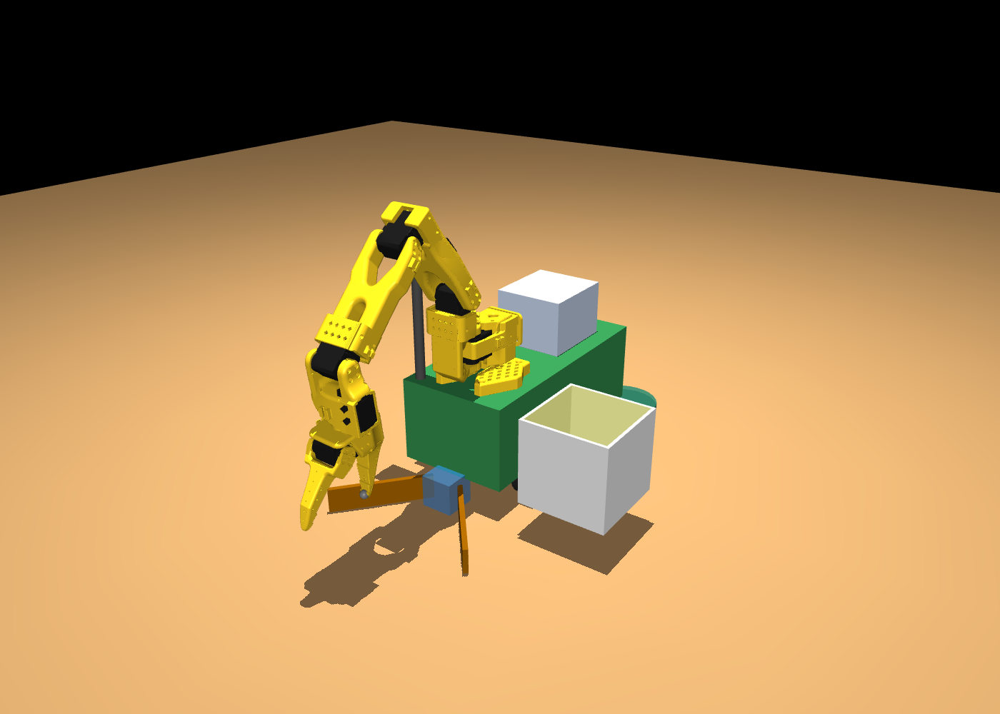

# 2026-11-24 시뮬 로봇 교체: 메카넘 차체 + SO-101 — 모델과 실측

주인 결정(2026-11-24): 시뮬도 실물과 같은 로봇으로 — 메카넘 4륜 축소판 + 청소 모듈 A + SO-ARM101 팔(차체 위). 차체 치수는 '실제 제품 기준'(같은 날 추가 결정) → 후보 조사는 [2026-11-24_chassis_candidates.md](2026-11-24_chassis_candidates.md), 시뮬 기준 차체는 **Yahboom ROSMASTER X3**.
예전 Stretch 3 값(`2026-11-22_stretch3_measurements.md`, `2026-11-23_stretch3_lift_reach.md`)은 지우지 않고 아래 표에서 나란히 비교한다. 요구사항 숫자 재계산과 기획안 반영은 다음 단계다(맨 아래 '재계산 필요 목록').

- 환경: MuJoCo 4.0.1, macOS. SO-101 MJCF: TheRobotStudio/SO-ARM100 커밋 `141aea7` (Apache-2.0, `scenes/assets/so101/README.md`)
- 파일: `scenes/robot_v1.xml`(로봇만, `scripts/build_robot_v1.py`가 생성), `scenes/gym_v1.xml`(gym_v0 include + 로봇 attach, gym_v0.xml은 그대로)
- 재현: `uv run python scripts/build_robot_v1.py` → `uv run python src/checks/mecanum_so101_measure.py` (전체 약 30 s). 그림: `uv run --with pillow python src/checks/render_robot.py robot docs/img/robot_v1.png` / `... gym docs/img/gym_v1.png`

## 1. 모델을 어떻게 만들었나

| 부분 | 시뮬 모델 | 값의 근거 |
| --- | --- | --- |
| 차체 크기 | 상자 0.300 × 0.139 m(몸통) + 바퀴 포함 폭 0.1994 m, 바퀴 반지름 0.0325 m, 앞뒤 바퀴 축 ±0.08 m, 좌우 ±0.0745 m | ROSMASTER X3 커뮤니티 URDF(BSD-3) 값. 공식 치수표는 못 찾음 (확인 필요) |
| 윗판 높이 | 0.14 m | **추정**: URDF 메시의 판 2장 간격에서 어림. 확인 필요 |
| 차체 질량 | 4.2 kg (+ 핸디 청소기 자리 0.7 kg, 바구니 0.05 kg, 가이드 0.04 kg) | 판매처 표기 4.23 kg(포장 포함인지 확인 필요). 청소기 0.7 kg은 기획안 '0.5~1 kg'의 가운데 (가정) |
| 이동 | 평면 관절 3개(`base_x`·`base_y` 미끄럼 + `base_yaw` 회전) + 속도 액추에이터(`drive_x/y/yaw`). 명령은 월드 기준이라 `robot_v1_util.drive()`가 차체 기준 속도를 돌려 넣는다 | 아래 '롤러를 만들지 않은 이유' |
| 최고 속도 | 1.0 m/s (직진·옆걸음 같게) | 판매처 Q&A 1.0 m/s (**확인 필요**) |
| 제자리 회전 | 6.47 rad/s (371 °/s) | 공개값 없음 → 메카넘 운동학 상한 ω = v / (lx + ly) = 1.0 / (0.08 + 0.0745) (가정: 바퀴가 최고 속도일 때) |
| 팔 | SO-101 new calib, 받침 원점 = 차체 가운데에서 앞으로 0.07 m, 윗판 위. 어깨 회전축은 차체 앞으로 0.109 m, 높이 0.20 m, 어깨 들기 축 높이 0.257 m | 위치는 **가정**(주인 장착 디자인 전): 앞쪽 가운데라 앞 바닥에 가장 멀리 닿고, 무게중심이 바퀴 사각형 안에 남는다. 뒤쪽은 청소기 자리 |
| 앞: 모듈 A | V자 가이드 2장(충돌 있음, 진행 방향과 θ 40°, 입 0.20 m, 목 0.04 m, 높이 0.03 m, 바닥에서 2 mm), 목 뒤 흡입구 판정 영역 4 × 4 cm(`site suction_zone`, 충돌 없음) | 기획안 6-10·9장(모두 가정) |
| 뒤: 회전 패드 | 원판 2개(반지름 0.05 m, 충돌 없음 `pad_left/right`) — 판정 영역만 | 반지름은 가정(차체 폭 0.2 m에 원판 2장) |
| 바구니 | **차체 왼쪽 옆**에 거는 통, 안쪽 0.10 × 0.10 m, 바닥 높이 0.045 m, 테두리 0.145 m (`basket`, `site basket_zone`) | 가정. 윗판 뒤에 두면 병을 넣을 수 없어서 옮김(아래 3-3) |
| 깊이 카메라 자리 | 차체 앞 오른쪽 기둥 끝, 높이 0.30 m, 아래로 40°, fovy 58° (`camera depth_cam`) | 가정 |
| 집게 충돌 형상 | 고정 집게 메시(볼록 껍질)를 상자 2개로 바꿈 | 껍질이 두 손가락 사이를 메워서 (`scenes/assets/so101/README.md`) |

**롤러를 만들지 않은 이유:** 메카넘 바퀴는 바퀴마다 45° 기운 롤러가 8~12개 있다. 롤러를 하나하나 관절로 만들면 접촉점이 수십 개가 되고, MuJoCo에서는 롤러 접촉이 튀거나 미끄러져 '바퀴 모델이 맞나'를 따로 검증해야 한다. 이번에 알고 싶은 것은 바퀴 물리가 아니라 **차체가 어디까지, 얼마나 빨리 가고 팔이 어디에 닿나**라서, 이동은 평면 관절 + 속도 명령으로 흉내 냈다. 대가: 미끄러짐·바닥 상태(먼지 낀 마루, 기획안 6-5)·가속 한계는 반영되지 않는다. 차체가 기울지 않으므로 **넘어짐은 물리로 안 보이고, 무게중심 계산으로 따로 본다**(4절).

## 2. 실측 표 — Stretch 3와 나란히

| 항목 | Stretch 3 (예전 실측) | 메카넘 + SO-101 (이번) | 메모 |
| --- | --- | --- | --- |
| 직진 최고 속도 | 약 0.097 m/s | **1.000 m/s** | 명령 최대로 3 s, 마지막 1 s 평균. 시뮬은 명령값(판매처 1.0 m/s, 확인 필요)을 그대로 따라간다 — 95% 도달 0.04 s라 실제 가속은 반영 안 됨 |
| 옆걸음 최고 속도 | 불가 (차동 구동) | **1.000 m/s** | 실물 메카넘은 옆걸음이 롤러 미끄러짐으로 직진보다 느린 편 (확인 필요) |
| 제자리 회전 | 약 35 °/s | **371 °/s** (6.47 rad/s) | 운동학 상한(가정). 실제 운행값은 다음 단계에서 정함 |
| 바닥 높이(손끝 z 1 cm)에서 손끝이 닿는 범위 — 앞 | — (Stretch는 옆으로 뻗음) | 차체 가운데에서 앞으로 **0.17 ~ 0.43 m** (차체 앞면 0.15 m → 앞면에서 0.02 ~ 0.28 m) | 팔-차체·가이드 충돌 없는 자세만. 0.17~0.26 m는 V자 가이드 사이(흡입구 앞)다 |
| 〃 — 오른쪽 (팔 축 x = 0.11 m) | 오른쪽 0.42 ~ 0.94 m (로봇 중심 기준, 팔이 옆으로) | 차체 중심선에서 **0.12 ~ 0.34 m** (차체 옆면 0.10 m → 옆면에서 0.02 ~ 0.24 m) | |
| 〃 — 왼쪽 (팔 축 x = 0.11 m) | — | **닿지 않음** (바구니가 그 자리에 있음) | |
| 〃 — 왼쪽 (x = 0.25 m, 바구니 앞) | — | 0.11 ~ 0.31 m | |
| 〃 — 오른쪽 (x = 0, 차체 가운데 옆) | — | 0.27 ~ 0.33 m | 팔이 비스듬히 뒤로 뻗어 겨우 닿음 |
| 바닥까지 닿나 | 손목 아래로 하면 패드 아래면이 바닥에서 1~2 cm | **닿는다** (손끝 z 1 cm 자세가 위 범위에 있음) | |
| 손끝 최고 높이 | 약 1.22 m (리프트 1.1 m) | **약 0.67 m** | 창문틀(1.0 m, 가정)에는 **닿지 않는다**. 벤치 윗면(0.45 m)은 닿는 높이 |
| 생수병 집어 바구니에 넣기 | 15 s (**가정**, 실제로 해 보지 않음) | 기획안 크기 원기둥(ø65): **실패 0/9**. 뚜껑 모양 병(가정): **성공 8/9**, 팔 동작 평균 **10.3 s** (+ 다가가기 0.73 m 3.8 s, 상한 0.3 m/s 가정) | 3절 |
| 가반하중 | 2 kg (공식) | 팔을 수평으로 쭉 폈을 때 손끝에 더 들 수 있는 무게: 7.4V 서보 19.5 kg·cm면 **263 g**, 12V 서보 30 kg·cm면 **519 g** (12V 사양 확인 필요) | 4절. 빈 병 20 g, 물 남은 병 기준 100 g 모두 가능 |
| 넘어짐 여유 | (해당 없음) | 팔 수평으로 쭉 펴고 0.1 kg 들어도 무게중심이 바퀴 사각형 안 **46~50 mm** | 4절 |

## 3. 생수병 한 번 집어 바구니에 넣기 (gym_v1, `litter_bottle1`)

**순서:** 시작 자리(-0.6, 0.2)에서 팔을 접은 채(`STOW`) 병 쪽으로 이동(차체 기준 병이 앞 0.40 m, 로봇은 벤치 쪽 +y를 봄, 바구니가 벤치에 닿지 않게) → 병 위에서 수직으로 내려와 끼움 → 닫기 → 수직으로 20 cm 들기 → 팔 축 둘레 같은 높이로 호를 따라 바구니 위로 → 0.5 s 멈춰 흔들림 줄이기 → 내리기 → 벌리기 → 접기.
팔 관절 이동 속도 상한 2 rad/s (가정: STS3215 무부하 약 0.19 s/60° ≈ 5.5 rad/s의 약 1/3), 경로는 손끝이 직선·호를 따르게 IK로 경유점을 만들었다(관절 직선 보간으로 하면 병을 쳐서 쓰러뜨렸다). 판정: 병이 바구니 안쪽 넓이 안에 서 있음(또는 누워도 테두리 아래).

| 병 모양 | 집는 자세 | 결과 (위치 ±2 cm 격자 9곳) | 팔 동작 시간 | 집게 마찰 0.5 |
| --- | --- | --- | --- | --- |
| **기획안 크기 원기둥** ø65 × 210 mm, 20 g (gym_v0 그대로) | 손가락 30° 숙임, 손끝 쪽으로 몸통(높이 12 cm)을 집음 | **실패 0/9** — 닫는 순간 병이 앞으로 밀려 쓰러짐 | (끝까지 돌린 시간 평균 14.3 s) | 실패 |
| 뚜껑 모양 병 (**가정**: 몸통 ø65 0~150 mm, 어깨 ø48·ø36, 목+뚜껑 ø30 180~210 mm, 합 20 g) | 손가락 15° 숙임, 목·뚜껑(높이 19.5 cm)을 집음 | **성공 8/9** | **평균 10.3 s** (집기 시작 → 놓고 손 뺄 때까지) | 성공 |

**왜 원기둥 몸통은 안 되나 (실측):**
1. **집게가 ø65에 겨우 벌어진다** (`mecanum_so101_measure.py gap`). 병을 손가락 사이에 둔 자세에서 집게 각도별 '집게·손바닥과 병 사이 최소 틈'(음수 = 겹침):

   | 손가락 숙임 | 집는 점 (손끝에서) | 벌림 0.3 | 0.5 | 0.7 | 0.9 | 1.2 rad |
   | --- | --- | --- | --- | --- | --- | --- |
   | 0° | 1 cm 안쪽 | −30.9 | −18.4 | −6.8 | +1.5 | +1.5 mm |
   | 0° | 2 cm 안쪽 | −33.6 | −22.9 | −12.9 | −4.2 | +1.5 mm |
   | 0° | 3 cm 안쪽 | −36.2 | −27.3 | −19.1 | −11.8 | −3.2 mm |
   | 30° | 손끝 | −29.1 | −16.2 | −5.8 | +1.5 | +1.5 mm |
   | 30° | 2 cm 안쪽 | −35.2 | −26.3 | −18.9 | −13.3 | −7.9 mm |
   | 60° | 손끝 | −32.2 | −26.4 | −23.6 | −22.1 | −21.9 mm |

   (0° 손끝은 IK가 1.8 cm 못 미침.) 손끝 가까이에 둘 때만 1.5 mm 틈이 생긴다. SO-101 움직이는 집게는 뒤쪽 축을 중심으로 돌아서, 많이 벌리면 집게가 위·뒤로 물러나 병 자리를 막는다.
2. **손끝으로 집으면 튕겨 나간다.** 회전하는 집게가 손끝에서 둥근 병을 누르면 접촉 방향이 바깥을 향해 병이 앞으로 밀려 나간다(pick 9회 모두 '닫는 순간 쓰러짐'. 일회성 받침대 시험 — 스크립트로 남기지 않음 — 에서도 ø65는 0.22 m 밀려 떨어졌고, ø30은 집게 안쪽으로 2.7 cm 끌려 들어가 잡혔다).
3. **5관절 팔이라 낮은 곳에서 손가락을 수평으로 못 둔다.** 바닥 10 cm 높이에서 손가락 수평 + 집게 수평 닫힘 자세는 어깨(1.75 rad)·손목(1.66 rad) 관절 한계에 걸려 IK가 1~12 cm 못 미친다. 그래서 손가락을 15~30° 숙여야 하고, 숙이면 수직 병의 단면이 길어져(타원) 틈이 더 줄어든다.

→ 실물 집기는 **목·뚜껑을 잡는 것**이 현실적이다(시판 500 mL 병의 목·뚜껑은 지름 약 3 cm라고 보고 모델을 만들었으나, 실제 병 치수는 실측 필요). 기획안 4장의 생수병 '대상 크기 ø65 × 210'에는 목·뚜껑 치수를 더해야 한다(재계산 목록).

**바구니를 윗판 뒤에서 옆으로 옮긴 이유 (실측):** 뚜껑을 잡아 병을 매단 채 손끝을 아래로 향하면, 어깨 들기 축(높이 0.257 m) + 위팔·아래팔(0.116 + 0.135 m) − 손목~손끝(약 0.16 m)이라 손끝이 아무리 높아도 약 0.35 m다. 병 길이 0.21 m를 빼면 병 바닥이 윗판(0.14 m)을 겨우 넘는다. 실제로 윗판 뒤쪽(x −0.12 ~ 0 m) 위 0.30~0.45 m 지점에 손끝을 아래로(또는 30~60° 뒤로 기울여) 보내는 IK는 대부분 2~40 cm 못 미쳤다(일회성 탐색, 스크립트로 남기지 않음). 그래서 바구니를 **팔 옆(왼쪽), 테두리가 윗판 높이(0.145 m)**인 통으로 바꿨다. 대가: 차체 폭이 바구니 포함 약 0.32 m로 넓어지고, 팔 축 왼쪽 바닥은 바구니 때문에 못 집는다.

**어깨 토크 (pick 중):** 관절이 움직이는 구간에서는 어깨 액추에이터가 모델 상한 3.35 N·m에 닿았다(위치 이득 kp 998이라 작은 추종 오차에도 힘이 상한까지 감). 멈춘 뒤(구간 끝) 버티는 힘은 최대 0.61 N·m(병을 들고 바구니 위)였다. 실물에서는 팔 이동 속도를 더 낮춰야 할 수 있다(확인 필요).

**차체 밀림:** 팔이 움직이는 동안 차체(속도 명령 0)가 4.7 mm 밀렸다. 집을 때 차를 세우는 것만으로는 위치가 고정되지 않는다(실물은 바퀴 모터 브레이크·위치 유지 필요 — 확인 필요).

## 4. 어깨 토크로 빈 병을 드나 (28차시 `so101_토크.py` 방식) + 넘어짐 여유

자세: new calib에서 IK로 찾은 '팔을 수평으로 쭉 편' 자세(어깨 들기 축에서 손끝까지 0.409 m, 관절 `[0, 1.23, −1.09, −0.21, 0]`). 토크 τ = Σ mᵢ · g · rᵢ (rᵢ = 어깨 들기 축에서 각 몸체 무게중심까지 수평 거리).

| 몸체 | 질량 | r | m·g·r |
| --- | --- | --- | --- |
| upper_arm | 0.103 kg | 0.088 m | 0.089 N·m |
| lower_arm | 0.104 kg | 0.213 m | 0.217 N·m |
| wrist | 0.079 kg | 0.288 m | 0.224 N·m |
| gripper | 0.087 kg | 0.336 m | 0.287 N·m |
| moving_jaw | 0.012 kg | 0.363 m | 0.043 N·m |
| **제 무게 합** | | | **0.859 N·m = 8.8 kg·cm** |

| 서보 토크 (정지 토크) | 손끝에 더 들 수 있는 무게 | 빈 병 20 g | 물 남은 병 100 g |
| --- | --- | --- | --- |
| STS3215 7.4V 19.5 kg·cm (28차시 코드 값) | 263 g | 든다 | 든다 |
| **STS3215 12V 30 kg·cm (판매처 표기, 확인 필요 — 주인이 12V로 사기로 함)** | **519 g** | 든다 | 든다 |
| 모델 forcerange 3.35 N·m (SO-101 MJCF) | 621 g | 든다 | 든다 |

- 정지 토크는 '멈춰 버틸 수 있는 최대'라 계속 쓰는 값이 아니다. 정격 토크(28차시 코드의 6.5 kg·cm@6V)로 보면 제 무게 8.8 kg·cm조차 넘어서, **팔을 수평으로 쭉 편 자세로 오래 버티면 안 된다**(12V 정격 토크는 확인 필요).
- 시뮬 pick 중 멈춘 상태 어깨 힘 최대 0.61 N·m(약 6.2 kg·cm) — 팔을 덜 뻗은 자세라 쭉 편 자세(0.86 N·m)보다 작다.

**넘어짐 여유** (차체가 평면 관절이라 물리로는 안 넘어진다 → 로봇 전체 무게중심이 바퀴 접지 사각형 ±0.08 × ±0.0745 m 안에 있나로 계산):

| 자세 (+ 손끝 0.1 kg) | 무게중심 (x, y) | 사각형 가장자리까지 |
| --- | --- | --- |
| 팔 수평으로 앞 최대 | (0.034, 0.001) m | 46 mm |
| 팔 수평 오른쪽 최대 | (0.008, −0.024) m | 50 mm |
| 팔 수평 왼쪽 최대 | (0.008, 0.027) m | 48 mm |

- 팔(0.632 kg)을 옆으로 쭉 펴고 0.1 kg을 들 때 넘어지지 않으려면, 팔·병을 뺀 나머지 질량이 차체 가운데에 있다고 보고 **1.23 kg 이상**이어야 한다. X3(4.2 kg)는 넉넉하고, 1.2 kg급 소형 키트(MentorPi M1)는 청소기까지 실어야 겨우 넘는다. 실제로는 가속·급정지 때 여유가 더 줄어든다(확인 필요).

## 5. 가정값 목록 (이번에 정한 것)

| 값 | 어디 | 근거 / 상태 |
| --- | --- | --- |
| 차체 치수 300 × 199.4 mm, 바퀴 r 32.5 mm, 바퀴 축 ±0.08/±0.0745 m | `build_robot_v1.py` CHASSIS | X3 커뮤니티 URDF (공식 확인 필요) |
| 윗판 높이 0.14 m, 차체 바닥판 0.035 m | CHASSIS | 추정 (확인 필요) |
| 차체 질량 4.2 kg | CHASSIS | 판매처 표기 4.23 kg (확인 필요) |
| 최고 속도 1.0 m/s | CHASSIS | 판매처 Q&A (확인 필요) |
| 제자리 회전 6.47 rad/s | CHASSIS | 운동학 상한 계산 (가정) |
| 팔 받침 위치: 차체 가운데에서 앞 0.07 m, 가운데 | ARM_X | 가정 (주인 장착 디자인 전) |
| V자 가이드 θ 40°, 입 0.20 m, 목 0.04 m, 높이 0.03 m, 틈 2 mm | GUIDE | 기획안 6-10·9장 (가정) |
| 흡입구 판정 4 × 4 cm | `suction_zone` | 기획안 8장 (가정) |
| 회전 패드 반지름 0.05 m × 2 | PAD_R | 가정 |
| 바구니: 왼쪽 옆, 안쪽 0.10 × 0.10 m, 바닥 0.045 m, 테두리 0.145 m | BASKET | 가정 (윗판 뒤는 팔이 못 넣음 — 3절) |
| 핸디 청소기 자리 0.7 kg, 0.10 × 0.09 × 0.07 m | VACUUM | 기획안 '0.5~1 kg' 가운데 (가정) |
| 깊이 카메라 높이 0.30 m, 아래 40°, fovy 58° | CAM | 가정 |
| 집게 마찰 1.0 | FINGER_FRICTION | MuJoCo 기본값. 0.5에서도 성공 1/1 (실물 PLA 확인 필요) |
| 팔 이동 속도 상한 2 rad/s, 다가가기 속도 상한 0.3 m/s | `mecanum_so101_measure.py` OMEGA, V_APPROACH | 가정 |
| 뚜껑 모양 병 치수 (목+뚜껑 ø30 × 30 mm 등) | `load_gym("cap")` | 시판 500 mL 병 흉내 (실측 필요) |
| STS3215 12V 정지 토크 30 kg·cm | `torque()` | 판매처 표기 (확인 필요) |

## 6. 재계산 필요 목록 (Stretch 기반 숫자를 쓰는 곳 — 이번에 고치지 않음)

| 파일 · 위치 | 지금 적힌 것 | 왜 다시 봐야 하나 |
| --- | --- | --- |
| `docs/00-기획안.md` 35·49줄 ('지금 상태', 한 문장 설명) | 시뮬 = Stretch 3 | 시뮬 로봇 교체 |
| `docs/00-기획안.md` 6-3 표 (347·352·360·362줄) | 0.097 m/s, 1개 15 s(가정), 주행 360 s·100 s, 약 600 s, 패드 폭 0.30 m → 줄 간격 0.27 m | 속도 1.0 m/s(판매처, 운행값은 따로), 집기 10.3 s(뚜껑 병), 패드 폭은 원판 2장 약 0.20 m |
| `docs/00-기획안.md` 6-4 표 (378~388줄) | 리프트 0~1.1 m, 그리퍼 0.11~1.22 m, 팔 0.42~0.94 m, '창문틀 확장 강점' | SO-101 손끝 최고 약 0.67 m → **창문틀(1.0 m)은 시뮬에서도 못 닿는다.** 확장 6-4·K-7 판단 다시 |
| `docs/00-기획안.md` 6-5 표 (392줄 열 이름) | 시뮬 (Stretch 3) | 메카넘 단순화 모델(미끄러짐 없음) |
| `docs/00-기획안.md` 6-8 (454줄) | Stretch 모델 속도 0.097 m/s | 같은 이유 |
| `docs/00-기획안.md` 7장 '규모 계산' (546줄) | Stretch 0.097 m/s·패드 0.30 m로 13~18분, 제품 개념 패드 1.0 m × 0.5 m/s | 새 속도·패드 폭. 제품 개념 숫자는 실제 청소 로봇(폭 0.27~0.78 m, 0.3~1.2 m/s, 후보 조사 B)과 비교 |
| `docs/00-기획안.md` 3장 '로봇이 나쁜 점' (248줄) | 시뮬 13~18분 | 같은 이유 |
| `docs/00-기획안.md` 8장 표 (561~565줄) | 로봇 = Menagerie Stretch 3, 바구니 weld, 가이드 입 폭 0.30 m, 창문틀은 리프트로 | robot_v1 / gym_v1, 입 0.20 m, 바구니는 옆 통 |
| `docs/00-기획안.md` 4장 대상 표 (258줄) | 생수병 ø65 × 210 mm | 목·뚜껑 치수 추가 (원기둥 몸통은 SO-101로 못 집음 — 3절) |
| `docs/00-기획안.md` 10장 표 (630줄), 출처 17·20·28 | Stretch 3 = 시뮬 플랫폼 | 비교 대상으로만 남길지 |
| `docs/00-기획안.md` 6-9 (476줄) | 'Stretch 3(가반하중 2 kg급)와 메카넘 축소판' | 팔 가반하중 263~519 g(정지 토크 기준) |
| `docs/00-기획안.md` K-7 (716줄), 14장 일정 1주차 (810줄) | 그리퍼 최고 약 1.22 m, 장면 v1 = gym_v0 + Stretch | 같은 이유 |
| `docs/00-기획안-요약.md` 5·28줄 | MuJoCo(Stretch 3), 'Stretch 강점 1.22 m' | 같은 이유 |
| `docs/01-유저시나리오.md` 92줄 (R-05), 111줄 | 창문틀 '리프트로', 시뮬 (Stretch 3) | 창문틀 못 닿음 |
| `docs/charter.md` 16~17줄 | 시뮬 = Stretch 3 그대로, 리프트 1.22 m 근거 | 같은 이유 |
| `docs/requirements.md` (D03, 다른 브랜치에서 작업 중) | Stretch 기반 숫자가 있으면 | 이번에 건드리지 않음 — D03 병합 뒤 확인 |
| `README.md` 첫 문단 (3줄) | MuJoCo(Hello Robot Stretch 3)로 입증 | 이번에는 트리·명령만 고침 |
| `docs/00-기획안.html` | md에서 생성 | md를 고친 뒤 `docs/build_html.py`로 다시 생성 |
