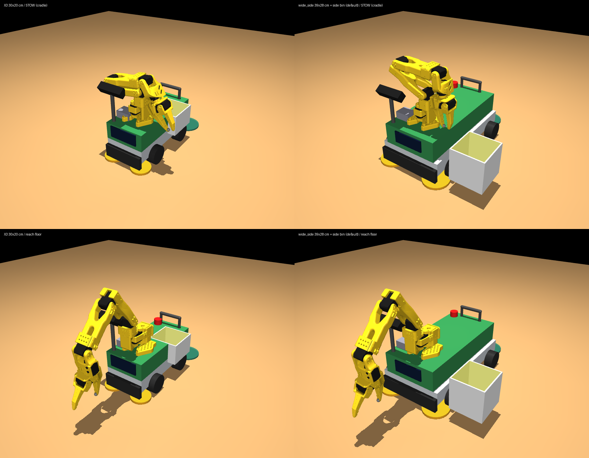

# 2026-11-24 robot_v2 (주인 설계 배치) — 모델과 실측, 요구사항 재계산

주인 결정(2026-11-24, 새싹봇 항목 83 — 설계 페이지 '체육관 정리 로봇 설계 구상' ①~④, [decisions.md](../docs/decisions.md)) 배치대로 시뮬 로봇을 고쳤다. robot_v1([2026-11-24_mecanum_so101_measurements.md](2026-11-24_mecanum_so101_measurements.md))은 지우지 않고 비교용으로 둔다.

- 환경: MuJoCo 4.0.1, macOS. 모델 생성 `scripts/build_robot_v2.py`, 실측 `src/checks/robot_v2_measure.py`(전체 약 13분), 그림 `src/checks/render_robot.py robot2`
- 실측 출력 원문: [2026-11-24_robot_v2_measure_output.txt](2026-11-24_robot_v2_measure_output.txt)

*그림. 왼쪽 열 X3 차체(30 × 20 cm), 오른쪽 열 설계 어림 차체(39 × 28 cm). 위 = 크래들 접기 자세(STOW_V2), 아래 = 앞 바닥 집기 자세. 노란 원판 = 옆솔 판정 영역, 초록 원판 = 뒤 패드, 흰 상자 = 묻힌 쓰레기통(노란 반투명 = 판정 영역), 검은 판 = 범퍼, 앞 기둥 = 깊이 카메라, 빨간 점 = 비상정지.*
*(2026-11-24 다시 렌더: 그림 오른쪽 열은 이제 지금 기본 `robot_v2.xml` — 넓은 차체(Fusion 폭) + 바퀴 밖 옆 통, 크래들 STOW_WIDE. 이 절의 묻힌 통 그림과 다르다 — [넣기 안정화](2026-11-24_pick_robust.md))*

**한 줄 결과:** 배치·크래들·넘어짐은 괜찮지만, **목·뚜껑을 잡은 병을 '몸통에 묻은 통'(회전축 뒤 15~20 cm, 테두리 = 윗면)에 넣기는 4가지 차체·통 모두 0/9**였다. 병을 매단 채 수직으로는 통 위로 못 오고(병 바닥이 테두리에 못 미침), 기울이면 목 잡기가 버티지 못해 병이 빠진다. → **주인 결정 ④ 재검토 필요** (6절).

## 1. 모델 (robot_v1에서 바뀐 것)

| 부분 | robot_v2 | 값의 근거 |
| --- | --- | --- |
| 차체 3안 | `x3` ROSMASTER X3 300 × 199.4 mm, 윗면 0.14 m (v1과 같음) · `x3b` 같은 차체, 통만 거의 바로 뒤 · `wide` 설계 페이지 어림 390 × 280 mm, 윗면 0.15 m · (`wide_long` = wide + 병이 누울 수 있는 긴 통, 대안 시험) | X3는 v1과 같은 근거(확인 필요). wide는 설계 페이지 '38~40 × 26~30 × 15 cm'의 가운데, **바퀴·질량은 X3와 같다고 둠(가정)** |
| 2단 | 아래 청소 베이스(0.035~0.08 m, 회색) + 위 몸통(0.08 m~윗면, 초록). X3는 폭이 좁아 같은 폭(색으로만 나눔), wide는 위 몸통이 한쪽 15 mm 좁음 | 가정 |
| 팔 | SO-101, **어깨 회전축 = 윗면 앞 모서리에서 6 cm 뒤**, 가운데 (X3: 차체 가운데에서 앞 0.09 m) | 설계 페이지 '로봇팔' 줄 |
| 크래들 접기 | `STOW_V2` = 허리 −90°(오른쪽), 어깨 −1.74, 팔꿈치 1.69, 손목 1.24 rad. 받침대(`cradle`)는 보기용(충돌 없음) | 2절에서 찾은 값 중 하나 |
| 앞 옆솔 2개 | `brush_left/right` 원판 판정 영역(충돌 없음, 안쪽 회전이라고 봄), 반지름 X3 0.035 / wide 0.045 m, 앞 모서리에서 조금 나옴 | 가정 (실물은 V자로 시작 — 주인 결정) |
| 흡입구 | `suction_zone` 차체 **밑 가운데, 앞바퀴 뒤 끝에서 1.2 cm 뒤**, 4 × 10 cm 판정 영역 | 위치는 주인 결정, 크기는 가정 (v1 4 × 4 cm) |
| 뒤 패드 2개 | `pad_left/right` 판정 영역, 반지름 X3 0.05 m(폭 0.20 m) / wide 0.07 m(폭 0.28 m) | 가정 (마른 극세사, 반대 방향 회전) |
| 앞 범퍼 | `bumper` 충돌 있음, **바닥에서 1.5 cm** ~ 6 cm | 설계 1~2 cm의 가운데 |
| V자 가이드 | 없앰 (시뮬은 옆솔 판정 영역으로) | 주인 결정 |
| 쓰레기통 | **몸통에 묻은 상자 통, 테두리 = 윗면.** x3: 안쪽 10 × 10 cm, 회전축에서 왼쪽 뒤 대각선 15.5 cm(옆 4.5 cm), 바닥 0.07 m(뒷바퀴 윗면 0.065 m 위라서 깊이 7 cm) · x3b: 옆 0.5 cm(거의 바로 뒤), 바닥 0.045 m(깊이 9.5 cm) · wide: 안쪽 13 × 13 cm, 17 cm(옆 3 cm), 깊이 10.5 cm · wide_long: 안쪽 앞뒤 23 × 옆 12 cm, 바로 뒤 19 cm | 거리는 설계 15~20 cm, 크기는 가정 (설계 페이지 '시판 통 15 × 15 × 15 cm'는 X3 몸통 폭 13.9 cm에 안 들어감). **x3 통은 몸통 옆면 밖으로 3 cm 나옴**(바퀴 바깥선 안) |
| 카메라·화면·손잡이·비상정지 | 앞 오른쪽 짧은 기둥 끝 깊이 카메라 **높이 0.25 m, 아래로 35°**, fovy 58°(가정) · 앞면 화면 · 위 뒤 손잡이 · 비상정지 — 모두 보기용 | 설계 페이지 (카메라 높이·각도는 가정) |
| 질량 | 차체 4.2 kg은 가운데, 핸디 청소기 0.7 kg은 베이스 안 오른쪽(보이지 않는 질량), 팔 0.632 kg | 가정 (v1과 같은 값) |
| 이동 | v1과 같음 (평면 관절 + 속도 명령, 롤러 없음). 최고 1.0 m/s, 제자리 회전 상한 X3 6.47 rad/s(371 °/s), wide 3.92 rad/s(225 °/s) | 판매처 Q&A(확인 필요) / 운동학 상한(가정) |

## 2. 실측 표

| 항목 | x3 (X3, 통 대각선) | x3b (X3, 통 바로 뒤) | wide (39 × 28) | wide_long (대안 통) | 참고: robot_v1 |
| --- | --- | --- | --- | --- | --- |
| **목·뚜껑 잡아 통에 넣기 (9회)** | **0/9** | **0/9** | **0/9** | **0/9** | 옆에 거는 바구니 **8/9** |
| 실패 모양 | 9회 모두 통 위에 오기 전에 병이 집게에서 빠짐 | 같음 | 8회 빠짐(통 위에 걸쳐 누움), 1회 통 밖 | 8회 빠짐(통 위에 걸침), 1회 걸침 | 1회 집기 실패 |
| 팔 동작 시간 (집기 시작 → 놓을 때까지, 실패 포함) | 7.3 s | 7.8 s | 7.7 s (7.2~7.8) | 7.7 s | 10.3 s (성공 기준) |
| 크래들로 접기 | 2.5 s | 2.8 s | 2.6 s | 2.7 s | — |
| 집게 마찰 0.5 | 실패 | 실패 | 실패 | 실패 | 성공 |
| 놓는 자세 (IK 표에서 고름) | 병 바닥 테두리 −5 cm, 병 41° 기울임 | 같음 | −5 cm, 32° | −5 cm, 32° | 수직, −5 cm |
| 크래들 자세 팔 최고 높이 | 0.293 m (윗면 위 0.15 m), 옆으로 56 mm 나옴, 충돌 없음 | 같음 | STOW_V2는 **wide 몸통과 겹침**. 옆 0 mm 한도면 0.352 m(윗면 위 0.20 m) | 같음 | 접은 자세 0.4 m대(v1 STOW) |
| 옆으로 안 나오게(0 mm) 접기 | 0.627 m — 사실상 '세워 둠'. X3 몸통 폭 13.9 cm에는 눕힐 수 없다 | 같음 | 0.352 m | 같음 | — |
| 바닥(손끝 z 1 cm) 앞으로 닿는 범위 | 차체 가운데에서 0.19~0.41 m = **앞면에서 0.04~0.26 m** | 같음 | 0.23~0.45 m = 앞면에서 0.04~0.26 m | 같음 | 앞면에서 0.02~0.28 m |
| 넘어짐 여유 (무게중심 → 바퀴 사각형, 손끝 0.1 kg) | 앞 46 · 왼 45 · 오른 53 · 크래들 71 mm | 같음 | 앞 89 · 왼 93 · 오른 106 · 크래들 115 mm | 같음 | 46~50 mm |
| 넘어짐 여유 — pick 중 최소 (병 포함) | 60 mm | 60 mm | 104 mm | 104 mm | — |
| 옆으로 쭉 펴고 0.1 kg일 때 필요한 나머지 질량 | ≥ 1.23 kg (지금 4.98 kg) | 같음 | ≥ 0.44 kg | 같음 | 1.23 kg |
| 손끝 최고 높이 | 약 0.67 m (v1 실측, 팔이 같음) → **창문틀(1.0 m)은 빠짐** | | | | |

- 판정: v1 기준(무게중심이 통 안쪽 넓이 안 + 서 있으면 테두리 + 6 cm 아래 / 누우면 테두리 아래)과, 묻힌 통용으로 느슨하게 한 기준(무게중심이 통 넓이 안 + 테두리 아래)을 같이 셌다. 두 기준 모두 0/9.
- 병 모양은 v1의 '뚜껑 모양 병'(가정: 몸통 ø65 0~150 mm, 어깨 ø48·ø36, 목+뚜껑 ø30 180~210 mm, 20 g), 집는 설정도 v1에서 8/9였던 것 그대로(손가락 15° 숙임, 목·뚜껑 높이 19.5 cm).

## 3. 왜 묻힌 통에 못 넣나 (실측)

1. **병을 수직으로 매단 채로는 통 위에 못 온다.** 회전축 뒤 15.5 cm의 통 위에서 '병 바닥 높이(테두리 기준) × 병 기울기' 격자로 IK를 풀었다(`robot_v2_measure.py` CACHE 표, x3b — 표의 칸은 IK 오차 mm, 3 mm 이하 = 가능):

   | 병 기울기 \ 병 바닥 (테두리 기준) | +10 cm | +6 cm | +3 cm | 0 | −3 cm | −5 cm |
   | --- | --- | --- | --- | --- | --- | --- |
   | 0° (수직) | 14 | 41 | 96 | 77 | 79 | 71 |
   | 14° | 1 | 35 | 50 | 62 | 76 | 79 |
   | 20° | 1 | 1 | 48 | 72 | 72 | 75 |
   | 26° | 1 | 1 | 12 | 63 | 65 | 55 |
   | 32° | 1 | 1 | 1 | 51 | 54 | 7 |
   | 37° | 36 | 1 | 1 | 38 | 42 | 3 |

   (씨앗을 바꾼 본 측정에서는 수직 +10 cm도 풀렸다 — 표는 한 번의 탐색 결과.) 병을 **수직으로 테두리 아래까지 내리는 자세는 없다.** 허리는 ±110°라 통 쪽(뒤 대각선)으로 돌 수 없고, 팔을 위로 넘겨 접은 자세에서는 손끝이 충분히 높지 않다 — 설계 페이지의 '회전축 뒤 최대 34 cm, 높이 +5~15 cm' 계산에 **병 길이(21 cm)가 빠진 것과 같은 문제**(v1 3절과 같음).
2. **기울이면 목 잡기가 버티지 못한다.** 테두리 아래로 넣으려면 병을 32~41° 기울여야 하는데, 집게가 목을 두 점으로 잡으므로 병이 집는 축 둘레로 돈다(무게가 한쪽으로 쏠림). 시뮬에서 36회 모두 '통 위 자세'에 닿기 전·닿을 때 병이 빠졌다(집게 마찰 1.0, 0.5 모두).
3. **통이 병보다 짧다.** 빠진 병이 통 안에 떨어져도, 안쪽 10~13 cm 통에 21 cm 병은 눕지 못하고 테두리에 걸치거나(wide 8회) 밖으로 넘어간다. X3는 뒷바퀴 위라 통 깊이가 7 cm(x3)뿐이고, 바퀴를 피해 바로 뒤로 옮겨도(x3b) 9.5 cm다.
4. **긴 통(wide_long, 23 × 12 cm)도 0/9**: 병이 빠질 때 옆(12 cm 쪽)으로 누워 테두리에 걸쳤다. 놓는 방향을 통의 긴 쪽에 맞추는 계획은 이번에 하지 않았다(다음에 해 볼 것).

**v1(옆에 거는 바구니, 테두리 = 윗면 0.145 m, 팔 축 바로 옆)은 8/9였다** — 팔 축 옆이라 팔을 넘길 필요가 없고, 병을 수직으로 테두리 아래 5 cm까지 내릴 수 있었다.

## 4. 크래들 접기와 차체 두 안 비교

- **X3(몸통 폭 13.9 cm):** 허리 90°로 눕히면 팔이 몸통 옆으로 나온다. 옆으로 0 mm면 팔을 거의 세워야 하고(최고 0.63 m), 56 mm 나오게 두면 최고 0.29 m(윗면 위 15 cm). 설계 페이지 '팔 접은 크기 약 15 × 20 cm'는 X3 폭에 안 들어간다.
- **wide(위 몸통 폭 18.9 cm):** 옆으로 안 나오게 0.35 m(윗면 위 20 cm)로 접힌다. 모델의 STOW_V2(X3 기준 자세)는 wide 몸통과 겹치므로 **wide로 가면 크래들 자세를 따로 정해야 한다**(옆 0 mm 자세: 허리 −90°, 어깨 −1.14, 팔꿈치 1.34, 손목 1.65 rad).
- **넘어짐 여유:** wide가 약 2배(89~115 mm vs 45~71 mm). 둘 다 무게중심은 바퀴 사각형 안(질량·가속 반영 안 함, 확인 필요).
- **바닥 닿는 범위:** 둘 다 앞면에서 0.04~0.26 m (회전축이 앞 모서리에서 6 cm로 같아서). v1(회전축 앞면에서 4.1 cm)보다 2 cm 줄었다.
- **청소 폭:** 패드 2장 폭 X3 0.20 m, wide 0.28 m(가정) → 줄 간격 0.18 / 0.252 m → 같은 면적에 줄 수 약 0.7배(5절).

## 5. 요구사항 재계산 (D03 ①-1 계산 줄 — 결과는 [requirements.md](../docs/requirements.md) ①-2)

입력 바꿈: 속도 0.097 → **1.0 m/s(시뮬 최고, 판매처 확인 필요)** 와 **0.3 m/s(운행 속도 가정 — pick 실측의 다가가기 상한과 같음)** 두 가지로 · 회전 35 → 371 °/s(X3 운동학 상한, 가속 미반영) · 패드 폭 0.30 → 0.20 m(X3) / 0.28 m(wide) · 집기 1개 15 s(가정) → **10.3 s**(v1 옆 바구니 실측 팔 동작 — 묻힌 통은 성공이 없어 그 시간 7.3~7.8 s는 쓰지 않음. 정렬·다가가기 시간은 빠짐, 확인 필요). 둘러보기 20 s, 핫스폿 거리 등 나머지 가정은 그대로.

| 계산 줄 | 전 (Stretch) | 후 X3 @1.0 m/s | 후 X3 @0.3 m/s | 후 wide @0.3 m/s | 목표 | 판단 |
| --- | --- | --- | --- | --- | --- | --- |
| C-02 줄 간격 | 0.27 m | 0.18 m | 0.18 m | 0.252 m | — | |
| C-03 줄 바꾸기 1번 | 7.9 s → 10 s로 올림 | 0.49 + 0.18 = 0.7 s | 0.49 + 0.60 = 1.1 s | 0.80 + 0.84 = 1.6 s | — | 가속 미반영 |
| C-07 벤치 앞 띠 줄 수 | 3줄 | 5줄 | 5줄 | 4줄 | — | |
| C-08 띠 밀기 | 140 s | 22.5 s | 75 s | 60 s | — | |
| C-06 출발 → 벤치 | 15 s | 1.5 s | 5 s | 5 s | — | |
| C-04 집기 1개 | 15 s (가정) | 10.3 s | 10.3 s | 10.3 s | — | 묻힌 통은 0/9 |
| **C-09 짧은 모드 예상** | **270 s** | **98 s** | **156 s** | **141 s** | **360 s** | **크게 남음 (예상 27~43%) → 재검토 필요** |
| C-12 모드 2 (코트 안 4.5 × 2.1 m) | 441 s | 12줄 54 m → 61 s | 180 + 12 = 192 s | 9줄 40.5 m → 135 + 13 = 148 s | 600 s | 크게 남음 → 재검토 필요 |
| C-14 장면 전체 5 × 3 m | 729 s (> 600, 그래서 코트 안만) | 17줄 85 m → 96 s | 283 + 17 = 301 s | 12줄 60 m → 200 + 18 = 218 s | 600 s | **이제 장면 전체도 600 s 안** → 'C-14 결론' 재검토 필요 |
| C-15 모드 1 | 290 s | 9.7 + 40 + 103 = 153 s | 32 + 40 + 103 = 175 s | 175 s | 480 s | 크게 남음 → 재검토 필요 |
| C-17 전체 모드 예상 (모드 1 + 모드 2) | 약 730 s | 214 s | 367 s | 323 s | 1,080 s | 크게 남음 → 재검토 필요 |
| **실제 코트 전체 28 × 15 m (420 m², 확인 필요) — 밀기만** | 약 4시간 (7장) | 84줄 2,352 m → 2,352 + 56 = **약 40분** | 7,840 + 90 = **약 2시간 12분** | 60줄 1,680 m → 5,600 + 97 = **약 1시간 35분** | 제품 전체 모드 15분 (C-27) | **넘음 → 재검토 필요** (wide @1.0 m/s도 약 29분) |
| C-22 사람 정지 뒤 남는 거리 | 0.90 m | **0.0 m** | 0.70 m | 0.70 m | 0.90 m (R-09 근거) | **넘음 → 재검토 필요** (운행 속도 ≤ 0.1 m/s여야 0.90 m) |
| C-23 장애물 앞 남는 거리 | 0.20 m | **−0.70 m (충돌)** | **0.0 m** | 0.0 m | 0.20 m 이상 | **넘음 → 재검토 필요** |
| C-29 비상정지 | 0.097 → 0.01 m/s | 1.0 → 0.01 m/s (99%) | 0.3 → 0.01 (97%) | 같음 | 1 s 안 | 줄여야 할 속도가 10배 — 실물 제동 확인 필요 |

- 실제 코트 전체 시간에는 집기·이동·충전 복귀가 빠져 있다(밀기만). 코트 크기는 7장의 어림(확인 필요).
- **바꾸지 않은 것:** Must 숫자(360 s, 커버리지 95%, 수거율 80%)와 480 / 600 / 1,080 s, `tests/`·`src/judge.py`. judge.py에는 속도·정지 거리 기준값이 없어서(정지 '시간' 1.0 s만 있음) 판정 기준값을 고칠 곳은 없다 — 다만 C-22·C-23이 깨지면 **R-09·R-13·장애물 정지의 근거 숫자를 운행 속도와 함께 다시 정해야** 한다(주인 결정).

## 6. 주인이 정해야 할 것

1. **쓰레기통 자리(결정 ④) 재검토** — 묻힌 통 0/9. 후보: (a) v1처럼 팔 축 옆에 거는 통(8/9, 차체가 넓어지고 그쪽 바닥을 못 집음), (b) 묻힌 통이지만 팔 축 바로 옆(회전축에서 옆으로 15 cm 안, 허리를 돌려 닿는 자리)이고 깊이 15 cm 이상, (c) 집게 손가락을 넓게 바꿔 몸통을 잡기(만들기봇 확인 중), (d) 병을 누여 넣는 긴 통 + 놓는 방향 계획(이번 wide_long은 0/9, 방향 계획 없이). 시뮬로 바로 시험할 수 있는 것은 (a)(이미 8/9)와 (b).
2. **운행 속도** — 최고 1.0 m/s면 사람·장애물 정지 근거(C-22·C-23)가 깨진다. 운행 속도(예: 0.1~0.3 m/s)를 정하거나, 정지 거리·시간 기준을 다시 정한다.
3. **짧은 모드·전체 모드 숫자** — 새 로봇으로는 시뮬 장면 기준이 크게 남는다(짧은 모드 예상 98~156 s / 360 s). 진행 중인 '대관 사이 청소 빼기' 검토와 함께, 기준을 실제 코트 전체 시간(0.3 m/s 약 1.5~2.2시간, 1.0 m/s 약 29~40분 — 밀기만)으로 볼지 정한다.
4. **차체 안** — wide(39 × 28)는 크래들을 몸통 안에 눕힐 수 있고 넘어짐 여유가 2배, 패드 폭도 넓다. X3는 팔이 옆으로 56 mm 나오거나 0.63 m로 세워야 한다.

## 7. 가정값 목록 (이번에 새로 정한 것)

| 값 | 어디 | 상태 |
| --- | --- | --- |
| 회전축 = 앞 모서리에서 6 cm 뒤 | PIVOT_BACK | 설계 페이지 |
| wide 차체 390 × 280 × 150 mm, 바퀴 X3와 같음, 질량 4.2 kg | VARIANTS["wide"] | 가정 |
| 통 크기·바닥 높이·자리 (1절 표) | VARIANTS[...]["bin"] | 가정 (거리는 설계 15~20 cm) |
| 옆솔 반지름 0.035 / 0.045 m, 패드 반지름 0.05 / 0.07 m | brush_r, pad_r | 가정 |
| 흡입구 4 × 10 cm, 앞바퀴 뒤 1.2 cm | SUCTION | 위치는 주인 결정, 크기 가정 |
| 범퍼 바닥 1.5 cm, 높이 6 cm | BUMPER | 설계 1~2 cm 가운데 |
| 카메라 높이 0.25 m, 아래 35° | CAM | 설계 페이지 어림 (가정) |
| 운행 속도 0.3 m/s | 5절 | 가정 (pick 다가가기 상한과 같음) |
| 놓는 자세 = IK 표에서 가장 낮고 똑바른 칸, 관절 직선 보간 경로 | robot_v2_measure.py pick | 계획 방식 가정 — 다른 경로·놓는 방향은 시험 안 함 |
